**Language / Ngôn ngữ:** [English](lab-guide_en.md) | [Tiếng Việt](lab-guide.md)

# Lab 09: OSPF Multi-Area Architecture

**Arc 2 — Deep-Dive Routing Protocols**

## Objectives
- Design a multi-area OSPF network: Area 1 — Area 0 (Backbone) — Area 2.
- Understand the role of Area Border Routers (ABRs) and the golden rule of OSPF: all non-backbone areas must connect directly or virtually to Area 0.
- Verify convergence via `show ip ospf neighbor` and `show ip route ospf`.

## Prerequisites
Completion of [03-static-route-multi-hop](../03-static-route-multi-hop/lab-guide_en.md) — multi-hop routing principles prior to dynamic routing.

## Topology Diagram

```mermaid
graph LR
    subgraph area1 ["OSPF Area 1"]
        srv1["srv1<br>10.1.1.10/24<br>GW: 10.1.1.1"]
        r1["r1 (Internal Router)<br>eth1: 10.1.1.1/24<br>eth2: 10.12.0.1/30"]
    end

    subgraph abr1 ["ABR (Area 1 / Area 0)"]
        r2["r2 (Area Border Router)<br>eth1: 10.12.0.2/30 (Area 1)<br>eth2: 10.23.0.1/30 (Area 0)"]
    end

    subgraph abr2 ["ABR (Area 0 / Area 2)"]
        r3["r3 (Area Border Router)<br>eth1: 10.23.0.2/30 (Area 0)<br>eth2: 10.34.0.1/30 (Area 2)"]
    end

    subgraph area2 ["OSPF Area 2"]
        r4["r4 (Internal Router)<br>eth1: 10.34.0.2/30<br>eth2: 10.4.4.1/24"]
        srv2["srv2<br>10.4.4.10/24<br>GW: 10.4.4.1"]
    end

    srv1 -- "eth1 <-> eth1<br>(10.1.1.0/24)" --- r1
    r1 -- "eth2 <-> eth1<br>(10.12.0.0/30)" --- r2
    r2 -- "eth2 <-> eth1<br>(10.23.0.0/30)" --- r3
    r3 -- "eth2 <-> eth1<br>(10.34.0.0/30)" --- r4
    r4 -- "eth2 <-> eth1<br>(10.4.4.0/24)" --- srv2
```

Detailed link and OSPF Area breakdown:
- **OSPF Area 1**:
  - **`srv1` ↔ `r1`**: LAN Link Area 1 (`10.1.1.0/24`). `srv1` (`10.1.1.10/24`), `r1` eth1 (`10.1.1.1/24`).
  - **`r1` ↔ `r2`**: P2P Link Area 1 (`10.12.0.0/30`). `r1` eth2 (`10.12.0.1/30`), `r2` eth1 (`10.12.0.2/30`).
- **OSPF Area 0 (Backbone Area)**:
  - **`r2` ↔ `r3`**: P2P Link Backbone (`10.23.0.0/30`). `r2` eth2 (`10.23.0.1/30`), `r3` eth1 (`10.23.0.2/30`).
- **OSPF Area 2**:
  - **`r3` ↔ `r4`**: P2P Link Area 2 (`10.34.0.0/30`). `r3` eth2 (`10.34.0.1/30`), `r4` eth1 (`10.34.0.2/30`).
  - **`r4` ↔ `srv2`**: LAN Link Area 2 (`10.4.4.0/24`). `r4` eth2 (`10.4.4.1/24`), `srv2` (`10.4.4.10/24`).

**Router Roles**:
- **`r1`**: Internal Router within Area 1.
- **`r2`**: Area Border Router (ABR) connecting Area 1 and Area 0.
- **`r3`**: Area Border Router (ABR) connecting Area 0 and Area 2.
- **`r4`**: Internal Router within Area 2.

Node details and IP addressing are in [`topology/ospf-lab.clab.yml`](./topology/ospf-lab.clab.yml). Interface IPs are pre-assigned in `configs/<router>/frr.conf`, with OSPF sections left as `TODO`.

## Tasks & Instructions

1. On each router (`r1`–`r4`), complete the `router ospf` configuration inside `configs/<router>/frr.conf`:
   - Assign a unique `router-id` (Loopback IP or interface IP).
   - Declare network interfaces into their designated areas per topology design.
2. Redeploy lab after updating configs (`sudo clab destroy` and `deploy`, or modify live via `docker exec ... vtysh` and save using `write memory`).
3. Verify on **R2 and R3** (ABR routers): `show ip ospf neighbor` must display neighbors on both interfaces in state `Full`; `show ip route ospf` must show routes learned from remote areas.
4. Inspect the Link-State Database (LSDB): execute `show ip ospf database` on R2 — verify Type 1 (Router-LSAs) from both Area 1 and Area 0. Understand that LSDB inspection is vital for deep OSPF troubleshooting beyond routing tables.
5. From `srv1`, execute `ping` and `traceroute` to `srv2` — verify transit hops R1 → R2 → R3 → R4.
6. Record outputs: `show ip ospf neighbor` on R2 + R3, `show ip ospf database` on R2, `show ip route ospf` on R1 + R4, and `traceroute` output.

## Technical Hints
- If neighbors fail to form between adjacent routers in the same area, verify matching Area IDs on both ends (`show ip ospf interface`).
- R2 and R3 are ABRs — their interfaces belong to **two separate areas**.
- **Production Extension:** In large enterprise networks, edge areas are often configured as **stub areas** or **totally stubby areas** to reduce LSDB sizing on internal routers.

## Discussion & Community Support
This lab is self-guided. If you have questions or feedback, discuss them in the [Network Thực Chiến](https://www.facebook.com/profile.php?id=61591373979991) community.

## Next Lab
→ [10-bgp-ebgp-co-ban](../10-bgp-ebgp-co-ban/lab-guide_en.md): eBGP Fundamentals.
