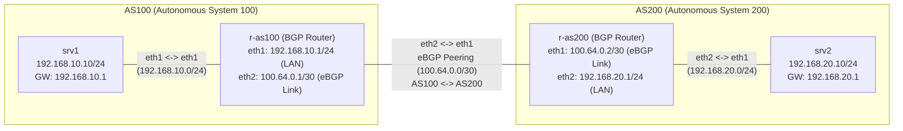

**Language / Ngôn ngữ:** [English](lab-guide_en.md) | [Tiếng Việt](lab-guide.md)

# Lab 10: eBGP Fundamentals

**Arc 2 — Deep-Dive Routing Protocols**

## Objectives
- Establish an eBGP session between two Autonomous Systems (ASes).
- Originate internal LAN prefixes into BGP.
- Verify peering state and BGP routing table entries using `show ip bgp summary` and `show ip bgp`.

## Prerequisites
Completion of [09-ospf-multi-area](../09-ospf-multi-area/lab-guide_en.md) — editing `frr.conf` and `vtysh` CLI.

## Topology Diagram

Detailed link and subnet breakdown:
- **AS100**:
  - **`srv1`**: Internal LAN host (`192.168.10.10/24`), Gateway `192.168.10.1`.
  - **`r-as100`**: Border router for AS100. `eth1` (`192.168.10.1/24`) connected to LAN, `eth2` (`100.64.0.1/30`) connected to inter-AS link.
- **AS200**:
  - **`r-as200`**: Border router for AS200. `eth1` (`100.64.0.2/30`) connected to inter-AS link, `eth2` (`192.168.20.1/24`) connected to LAN.
  - **`srv2`**: Internal LAN host (`192.168.20.10/24`), Gateway `192.168.20.1`.
- **eBGP Inter-AS Link (`100.64.0.0/30`)**: Interconnection between `r-as100` eth2 (`100.64.0.1`) and `r-as200` eth1 (`100.64.0.2`).

Node details and IP addressing are in [`topology/bgp-lab.clab.yml`](./topology/bgp-lab.clab.yml). Interface IPs are pre-assigned in `configs/<router>/frr.conf`, with `router bgp` left as `TODO`.

## Tasks & Instructions

1. On `r-as100`, complete `router bgp 100` configuration:
   - Configure neighbor targeting `r-as200`'s transit link IP with `remote-as 200`.
   - Originate local LAN subnet `192.168.10.0/24` into BGP.
2. On `r-as200`, complete `router bgp 200` similarly: neighbor pointing to `r-as100` (`remote-as 100`), originating `192.168.20.0/24`.
3. Verify eBGP neighbor state reaches **Established**: `show ip bgp summary` on both routers.
4. Verify learned routes: `show ip bgp` on `r-as100` must show prefix `192.168.20.0/24` learned from AS200 (and vice versa).
5. From `srv1`, execute `ping` to `srv2` — confirm connectivity via the BGP-advertised path.
6. Record outputs: `show ip bgp summary` + `show ip bgp` on both routers, and ping results.

## Technical Hints
- **Prefix Origination:** Use `network 192.168.x.0/24` inside `address-family ipv4 unicast` (requires an exact matching connected route in the RIB). **Do not use `redistribute connected`** — it would advertise Containerlab management subnets (`172.20.20.0/24`), injecting unnecessary routes.
- If neighbor state fails to reach Established, verify `remote-as` alignment and test IP reachability between neighbor interface IPs.
- **Important Note on RFC 8212:** FRR 10.x enables `bgp ebgp-requires-policy` by default. The eBGP session will reach **Established** state, but **will not exchange any routes** without explicit policies/route-maps. Include `no bgp ebgp-requires-policy` under `router bgp` to disable this requirement for basic labs.

## Discussion & Community Support
This lab is self-guided. If you have questions or feedback, discuss them in the [Network Thực Chiến](https://www.facebook.com/profile.php?id=61591373979991) community.

## Next Lab
→ [11-bgp-route-map-policy](../11-bgp-route-map-policy/lab-guide_en.md): BGP Route-Maps & Policy.
