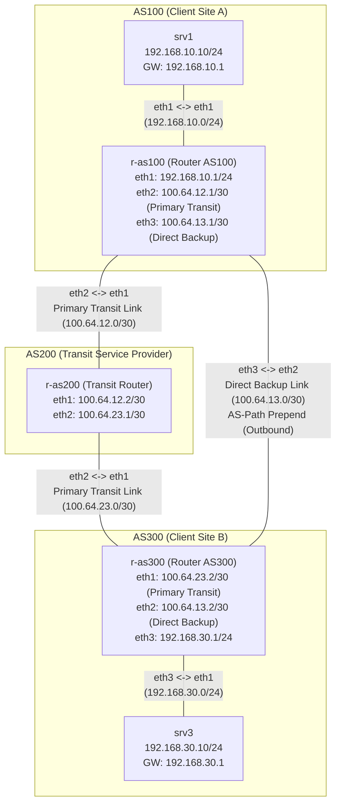

**Language / Ngôn ngữ:** [English](lab-guide_en.md) | [Tiếng Việt](lab-guide.md)

# Lab 11: BGP Route-Maps & Policy

**Arc 2 — Deep-Dive Routing Protocols**

## Objectives
- Use route-maps combined with AS-path prepending to influence BGP path selection, superseding default shortest AS-path selection.
- Understand BGP best-path decision criteria (specifically AS-path length) and how outbound advertisement policies alter neighboring AS routing decisions.

## Prerequisites
Completion of [10-bgp-ebgp-co-ban](../10-bgp-ebgp-co-ban/lab-guide_en.md) — baseline eBGP peering concepts.

## Topology Diagram

Detailed link and routing path breakdown:
- **Primary Transit Path (via AS200)**:
  - `r-as100` eth2 (`100.64.12.1/30`) ↔ `r-as200` eth1 (`100.64.12.2/30`).
  - `r-as200` eth2 (`100.64.23.1/30`) ↔ `r-as300` eth1 (`100.64.23.2/30`).
- **Direct Backup Link**:
  - `r-as100` eth3 (`100.64.13.1/30`) ↔ `r-as300` eth2 (`100.64.13.2/30`).
- **Internal Subnets (LAN)**:
  - Site A (AS100): `srv1` (`192.168.10.10/24`) connected to `r-as100` eth1 (`192.168.10.1/24`).
  - Site B (AS300): `srv3` (`192.168.30.10/24`) connected to `r-as300` eth3 (`192.168.30.1/24`).

See IP details in [`topology/bgp-policy-lab.clab.yml`](./topology/bgp-policy-lab.clab.yml).

**Baseline configuration is complete** (eBGP sessions are Established over both links).

## Problem Statement
By default, BGP selects paths with the shortest AS-path length → traffic between AS100 and AS300 traverses the **direct backup link** (low bandwidth) instead of the primary transit AS200 link (high bandwidth). This is undesirable in production setups.

## Tasks & Instructions

1. On `r-as100`: Add a route-map applied **outbound** to the direct link neighbor (not the transit neighbor over AS200), utilizing `set as-path prepend` to lengthen the AS-path for `192.168.10.0/24` when advertised across the direct backup link.
2. On `r-as300`: Implement identical prepending for `192.168.30.0/24` — prepending outbound towards the direct link neighbor.
3. Verify on `r-as300`: `show ip bgp 192.168.10.0/24` — confirm path via AS200 is selected as best path.
4. Verify on `r-as100`: `show ip bgp 192.168.30.0/24` — confirm best path points to AS200.
5. From `srv1`, run `traceroute` to `srv3` — confirm traffic routes through `r-as200` (transit) rather than over the direct link.
6. Record outputs: Route-map definitions on `r-as100` and `r-as300` + `show ip bgp <prefix>` outputs in both directions + `traceroute` output.

## Technical Hints
- `set as-path prepend <asn> <asn>` — prepending multiple ASN entries lengthens the AS-path, reducing route preference.
- Apply route-map to neighbor using `neighbor <ip> route-map <name> out` targeting the direct link neighbor.

## Bonus Challenge — Local Preference (Inbound Traffic Engineering)
AS-path prepending controls **outbound** traffic steering (how neighboring ASes reach local subnets). To control **inbound** exit paths (how local routers select outbound exits), leverage **Local Preference**:
- Configure an **inbound** route-map on `r-as100`: `set local-preference 200` for routes received from AS200 (transit), maintaining default `100` for direct link routes.
- Verify using `show ip bgp` — routes with higher Local Preference win regardless of AS-path length.

## Discussion & Community Support
This lab is self-guided. If you have questions or feedback, discuss them in the [Network Thực Chiến](https://www.facebook.com/profile.php?id=61591373979991) community.

## Next Lab
→ [12-bgp-local-pref-prefix-list](../12-bgp-local-pref-prefix-list/lab-guide_en.md): BGP Local Preference & Prefix-Lists.
