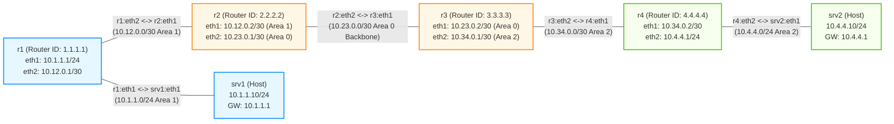

**Language / Ngôn ngữ:** [English](lab-guide_en.md) | [Tiếng Việt](lab-guide.md)

# Bài 18: Troubleshooting Chaos Lab

**Arc 5 — Troubleshooting chaos lab**

## Mục tiêu
- Rèn kỹ năng troubleshooting có phương pháp: thu hẹp phạm vi lỗi từng bước, không đoán mò.
- Không có gợi ý cụ thể lỗi nằm ở đâu — tự tìm hoàn toàn, giống tình huống thực tế khi được báo "mạng bị đứt".

## Yêu cầu tiên quyết
Hoàn thành [09-ospf-multi-area](../09-ospf-multi-area/lab-guide.md) — bài này dùng lại đúng topology đó.

## Tình huống

Lab dưới đây **đã được cấu hình đầy đủ** (không phải skeleton, không có `TODO`) và trông như đã hoàn chỉnh. Nhưng khi đồng nghiệp báo cáo:

> "srv1 không ping được srv2, mạng chắc bị đứt ở đâu đó."

Topology tương tự Bài 09 (`srv1 -- R1 -- R2 -- R3 -- R4 -- srv2`, OSPF Area 1 — Area 0 — Area 2).

## Sơ đồ topology

Chi tiết các kết nối và dải mạng:
- **`srv1` ↔ `r1`**: Link LAN Area 1 (`10.1.1.0/24`). `srv1` (`10.1.1.10/24`), `r1` eth1 (`10.1.1.1/24`).
- **`r1` ↔ `r2`**: Link P2P Area 1 (`10.12.0.0/30`). `r1` eth2 (`10.12.0.1/30`), `r2` eth1 (`10.12.0.2/30`).
- **`r2` ↔ `r3`**: Link P2P Area 0 Backbone (`10.23.0.0/30`). `r2` eth2 (`10.23.0.1/30`), `r3` eth1 (`10.23.0.2/30`).
- **`r3` ↔ `r4`**: Link P2P Area 2 (`10.34.0.0/30`). `r3` eth2 (`10.34.0.1/30`), `r4` eth1 (`10.34.0.2/30`).
- **`r4` ↔ `srv2`**: Link LAN Area 2 (`10.4.4.0/24`). `r4` eth2 (`10.4.4.1/24`), `srv2` (`10.4.4.10/24`).

Chi tiết xem [`topology/chaos-lab.clab.yml`](./topology/chaos-lab.clab.yml).

## Đề bài / Yêu cầu

1. Deploy topology (`sudo clab deploy -t chaos-lab.clab.yml`).
2. Xác nhận đúng là `srv1` không ping được `srv2`.
3. Tìm nguyên nhân gốc. **Không có gợi ý vị trí lỗi** — tự điều tra bằng phương pháp của riêng bạn. Một vài hướng điều tra tổng quát (không chỉ đích danh lỗi):
   - Kiểm tra trạng thái OSPF neighbor trên từng router (`show ip ospf neighbor`) — router nào chưa lên `Full`?
   - So sánh cấu hình 2 đầu của link đang nghi ngờ — có điểm nào lệch nhau không (area, subnet, ...)?
   - Kiểm tra routing table (`show ip route ospf`) — router nào thiếu route đáng lẽ phải có?
4. Sửa lỗi bằng `vtysh` (live config) trên router liên quan.
5. Verify: `srv1` ping thông `srv2`, tất cả router liên quan lên `Full` neighbor.
6. Ghi lại: quá trình điều tra (đã kiểm tra những gì, loại trừ những gì), nguyên nhân gốc tìm được, và cách đã sửa.

## Thảo luận và hỏi đáp
Bài tập này tự làm và tự xác minh kết quả. Nếu có thắc mắc hoặc cần trao đổi thêm, các bạn hãy đăng bài thảo luận trên group Facebook [Network Thực Chiến](https://www.facebook.com/profile.php?id=61591373979991).
## Bài tiếp theo
→ [19-troubleshooting-chaos-bgp](../19-troubleshooting-chaos-bgp/lab-guide.md): Troubleshooting chaos lab — BGP.
