**Language / Ngôn ngữ:** [English](lab-guide_en.md) | [Tiếng Việt](lab-guide.md)

# Lab 18: Troubleshooting Chaos Lab — OSPF

**Arc 5 — Troubleshooting Chaos Lab** | 🎥 **Video Tutorial:** [YouTube - Troubleshooting Chaos Lab OSPF](https://youtu.be/M4Mzix0tP70)

## Objectives
- Develop structured network troubleshooting skills: isolate failure domains systematically without random guessing.
- Practice root-cause diagnosis without pre-disclosed fault hints — simulating real-world production outage tickets ("network is down").

## Prerequisites
Completion of [09-ospf-multi-area](../09-ospf-multi-area/lab-guide_en.md) — this lab reuses the multi-area OSPF topology structure.

## Outage Scenario

The lab environment below is **pre-configured completely** (no skeleton templates or `TODO` items). However, a ticket reports:

> "srv1 cannot ping srv2, connectivity appears broken somewhere in the path."

Topology mirrors Lab 09 (`srv1 -- R1 -- R2 -- R3 -- R4 -- srv2`, OSPF Area 1 — Area 0 — Area 2).

## Network Topology

```mermaid
graph LR
    subgraph area1 ["OSPF Area 1"]
        srv1["srv1<br>10.1.1.10/24<br>GW: 10.1.1.1"]
        r1["r1 (Router ID: 1.1.1.1)<br>eth1: 10.1.1.1/24<br>eth2: 10.12.0.1/30"]
    end

    subgraph abr1 ["ABR (Area 1 / Area 0)"]
        r2["r2 (Router ID: 2.2.2.2)<br>eth1: 10.12.0.2/30 (Area 1)<br>eth2: 10.23.0.1/30 (Area 0)"]
    end

    subgraph abr2 ["ABR (Area 0 / Area 2)"]
        r3["r3 (Router ID: 3.3.3.3)<br>eth1: 10.23.0.2/30<br>eth2: 10.34.0.1/30 (Area 2)"]
    end

    subgraph area2 ["OSPF Area 2"]
        r4["r4 (Router ID: 4.4.4.4)<br>eth1: 10.34.0.2/30<br>eth2: 10.4.4.1/24"]
        srv2["srv2<br>10.4.4.10/24<br>GW: 10.4.4.1"]
    end

    srv1 -- "eth1 <-> eth1<br>(10.1.1.0/24)" --- r1
    r1 -- "eth2 <-> eth1<br>(10.12.0.0/30)" --- r2
    r2 -- "eth2 <-> eth1<br>(10.23.0.0/30)" --- r3
    r3 -- "eth2 <-> eth1<br>(10.34.0.0/30)" --- r4
    r4 -- "eth2 <-> eth1<br>(10.4.4.0/24)" --- srv2
```

Detailed link and subnet breakdown:
- **`srv1` ↔ `r1`**: LAN Link Area 1 (`10.1.1.0/24`). `srv1` (`10.1.1.10/24`), `r1` eth1 (`10.1.1.1/24`).
- **`r1` ↔ `r2`**: P2P Link Area 1 (`10.12.0.0/30`). `r1` eth2 (`10.12.0.1/30`), `r2` eth1 (`10.12.0.2/30`).
- **`r2` ↔ `r3`**: P2P Link Area 0 Backbone (`10.23.0.0/30`). `r2` eth2 (`10.23.0.1/30`), `r3` eth1 (`10.23.0.2/30`).
- **`r3` ↔ `r4`**: P2P Link Area 2 (`10.34.0.0/30`). `r3` eth2 (`10.34.0.1/30`), `r4` eth1 (`10.34.0.2/30`).
- **`r4` ↔ `srv2`**: LAN Link Area 2 (`10.4.4.0/24`). `r4` eth2 (`10.4.4.1/24`), `srv2` (`10.4.4.10/24`).

See [`topology/chaos-lab.clab.yml`](./topology/chaos-lab.clab.yml).

## Tasks & Instructions

1. Deploy topology (`sudo clab deploy -t chaos-lab.clab.yml`).
2. Confirm the failure: `srv1` fails to ping `srv2`.
3. Investigate and diagnose the root cause. **No fault locations are provided** — use systematic troubleshooting techniques:
   - Check OSPF neighbor adjacency states across all routers (`show ip ospf neighbor`) — which router fails to reach state `Full`?
   - Compare interface configurations on suspect links — identify mismatched parameters (Area ID, subnets, interface status...).
   - Inspect routing tables (`show ip route ospf`) — which router is missing expected routes?
4. Resolve the issue live via `vtysh` on the affected router.
5. Verification: `srv1` successfully pings `srv2`, and all relevant router neighbors establish `Full` adjacencies.
6. Record your investigation process: Diagnostic steps taken, hypotheses eliminated, root cause identified, and resolution steps applied.

## Discussion & Community Support
This lab is self-guided. If you have questions or feedback, discuss them in the [Network Thực Chiến](https://www.facebook.com/profile.php?id=61591373979991) community.

## Next Lab
→ [19-troubleshooting-chaos-bgp](../19-troubleshooting-chaos-bgp/lab-guide_en.md): Troubleshooting Chaos Lab — BGP.
