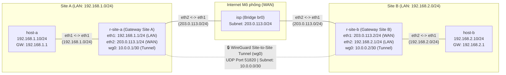

**Language / Ngôn ngữ:** [English](lab-guide_en.md) | [Tiếng Việt](lab-guide.md)

# Bài 20: WireGuard VPN Site-to-Site

**Arc 6 — Advanced Security & VPN**

## Mục tiêu
- Thiết lập VPN tunnel site-to-site bằng WireGuard giữa 2 site qua "internet" mô phỏng.
- Hiểu quy trình: tạo keypair → cấu hình interface → thêm peer → route traffic qua tunnel.
- Verify: host ở site A ping được host ở site B qua tunnel, traffic đi qua "internet" đã được mã hóa.

## Yêu cầu tiên quyết
Hoàn thành [17-nftables-firewall](../17-nftables-firewall/lab-guide.md) — quen thao tác trên Linux network stack.

## Sơ đồ topology



Chi tiết các kết nối và dải mạng:
- **Lớp Underlay (Mạng vật lý / Mô phỏng Internet)**:
  - **Site A LAN (`192.168.1.0/24`)**: `host-a` (`192.168.1.10/24`) kết nối trực tiếp với `r-site-a` eth1 (`192.168.1.1/24`).
  - **Mạng WAN Internet (`203.0.113.0/24`)**: `r-site-a` eth2 (`203.0.113.1/24`) và `r-site-b` eth1 (`203.0.113.2/24`) nối với nhau qua bridge `isp`.
  - **Site B LAN (`192.168.2.0/24`)**: `r-site-b` eth2 (`192.168.2.1/24`) kết nối trực tiếp với `host-b` (`192.168.2.10/24`).
- **Lớp Overlay (WireGuard VPN Tunnel)**:
  - **Tunnel Interface (`wg0`)**: Dải mạng `10.0.0.0/30`. `r-site-a` (`10.0.0.1/30`) ↔ `r-site-b` (`10.0.0.2/30`).
  - **Mã hóa**: Toàn bộ lưu lượng giữa LAN Site A và LAN Site B được mã hóa qua UDP port `51820` trên WAN.

Chi tiết xem [`topology/wg-lab.clab.yml`](./topology/wg-lab.clab.yml).

## Đề bài / Yêu cầu

1. Deploy topology. IP WAN và LAN đã gán sẵn, WireGuard **chưa cấu hình**.
2. Cài WireGuard tools trên cả 2 site router:
   ```bash
   docker exec r-site-a apk add --no-cache wireguard-tools
   docker exec r-site-b apk add --no-cache wireguard-tools
   ```
3. **Tạo keypair** trên mỗi router:
   ```bash
   wg genkey | tee /etc/wireguard/privatekey | wg pubkey > /etc/wireguard/publickey
   ```
4. **Cấu hình WireGuard interface** trên `r-site-a`:
   - Tạo interface `wg0`, gán IP tunnel `10.0.0.1/30`.
   - Thêm peer = public key của `r-site-b`, endpoint `203.0.113.2:51820`, allowed-ips `192.168.2.0/24,10.0.0.2/32`.
5. **Cấu hình tương tự** trên `r-site-b`:
   - `wg0` IP: `10.0.0.2/30`.
   - Peer = public key của `r-site-a`, endpoint `203.0.113.1:51820`, allowed-ips `192.168.1.0/24,10.0.0.1/32`.
6. **Thêm route** để traffic đến remote LAN đi qua tunnel:
   ```bash
   # Trên r-site-a:
   ip route add 192.168.2.0/24 via 10.0.0.2 dev wg0
   # Trên r-site-b:
   ip route add 192.168.1.0/24 via 10.0.0.1 dev wg0
   ```
7. Verify:
   - `host-a` ping `host-b` (`192.168.2.10`) → **phải thông** qua WireGuard tunnel.
   - `wg show` trên cả 2 router — phải thấy peer, latest handshake, transfer bytes > 0.
   - Trên `isp`, chạy `tcpdump -i br0 -n udp port 51820` — phải thấy traffic UDP encrypted (không đọc được nội dung ICMP).
8. Ghi lại: cấu hình WireGuard (không ghi private key!), output `wg show` 2 phía, kết quả ping.

## Gợi ý
- **Private key bảo mật:** không bao giờ share private key. Chỉ trao đổi public key giữa 2 site.
- Nếu handshake không thành công, kiểm tra: (1) endpoint IP + port đúng chưa, (2) public key khớp đúng peer, (3) `wg0` đã up chưa (`ip link set wg0 up`).
- WireGuard dùng UDP port 51820 mặc định — `isp` bridge chỉ cần forward ở Layer 2, không cần cấu hình gì thêm.
- **Lưu ý kernel module:** WireGuard cần kernel module `wireguard` trên host (server) — Ubuntu 24.04 (kernel 6.x) đã có sẵn. Container dùng chung kernel với host.

## Bonus — Persistent Config
Trong production, cấu hình WireGuard lưu trong `/etc/wireguard/wg0.conf` và quản lý bằng `wg-quick`:
```ini
[Interface]
PrivateKey = <private-key>
Address = 10.0.0.1/30
ListenPort = 51820

[Peer]
PublicKey = <peer-public-key>
Endpoint = 203.0.113.2:51820
AllowedIPs = 192.168.2.0/24, 10.0.0.2/32
```
Thử tạo file này và dùng `wg-quick up wg0` thay vì gõ từng lệnh `ip` và `wg`.

## Thảo luận và hỏi đáp
Bài tập này tự làm và tự xác minh kết quả. Nếu có thắc mắc hoặc cần trao đổi thêm, các bạn hãy đăng bài thảo luận trên group Facebook [Network Thực Chiến](https://www.facebook.com/profile.php?id=61591373979991).
## Bài tiếp theo
→ [21-enterprise-campus-lan](../21-enterprise-campus-lan/lab-guide.md): Dựng campus LAN cho trụ sở NTC (VLAN access–distribution).
