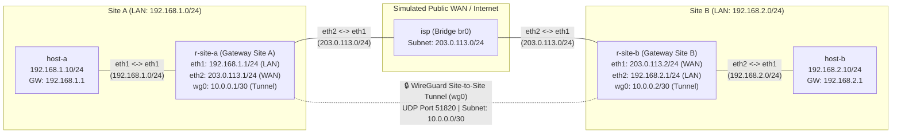

**Language / Ngôn ngữ:** [English](lab-guide_en.md) | [Tiếng Việt](lab-guide.md)

# Lab 20: WireGuard Site-to-Site VPN

**Arc 6 — Advanced Security & VPN**

## Objectives
- Build a Site-to-Site VPN tunnel using WireGuard between two remote sites across a simulated public WAN infrastructure.
- Master key creation, interface setup, peer associations, and route steering through encrypted tunnels.
- Verify end-to-end connectivity between site LAN hosts across the encrypted VPN path.

## Prerequisites
Completion of [17-nftables-firewall](../17-nftables-firewall/lab-guide_en.md) — Linux networking stack fundamentals.

## Topology Diagram



Detailed link and subnet breakdown:
- **Underlay Layer (Physical Network / Simulated Internet)**:
  - **Site A LAN (`192.168.1.0/24`)**: `host-a` (`192.168.1.10/24`) connected to `r-site-a` eth1 (`192.168.1.1/24`).
  - **Public WAN Network (`203.0.113.0/24`)**: `r-site-a` eth2 (`203.0.113.1/24`) and `r-site-b` eth1 (`203.0.113.2/24`) linked via `isp` bridge.
  - **Site B LAN (`192.168.2.0/24`)**: `r-site-b` eth2 (`192.168.2.1/24`) connected to `host-b` (`192.168.2.10/24`).
- **Overlay Layer (WireGuard VPN Tunnel)**:
  - **Tunnel Interface (`wg0`)**: Tunnel subnet `10.0.0.0/30`. `r-site-a` (`10.0.0.1/30`) ↔ `r-site-b` (`10.0.0.2/30`).
  - **Encryption**: Site A LAN to Site B LAN traffic is encapsulated and encrypted via UDP port `51820` across the WAN.

See [`topology/wg-lab.clab.yml`](./topology/wg-lab.clab.yml).

## Tasks & Instructions

1. Deploy topology. WAN and LAN interface IPs are pre-assigned; WireGuard is **unconfigured**.
2. Install WireGuard utilities on both site routers:
   ```bash
   docker exec r-site-a apk add --no-cache wireguard-tools
   docker exec r-site-b apk add --no-cache wireguard-tools
   ```
3. **Generate keypairs** on each site router:
   ```bash
   wg genkey | tee /etc/wireguard/privatekey | wg pubkey > /etc/wireguard/publickey
   ```
4. **Configure WireGuard interface** on `r-site-a`:
   - Create interface `wg0`, assign tunnel IP `10.0.0.1/30`.
   - Add peer using `r-site-b`'s public key, endpoint `203.0.113.2:51820`, allowed-ips `192.168.2.0/24,10.0.0.2/32`.
5. **Configure WireGuard interface** on `r-site-b`:
   - `wg0` IP: `10.0.0.2/30`.
   - Add peer using `r-site-a`'s public key, endpoint `203.0.113.1:51820`, allowed-ips `192.168.1.0/24,10.0.0.1/32`.
6. **Configure routes** steering remote LAN traffic through the tunnel:
   ```bash
   # On r-site-a:
   ip route add 192.168.2.0/24 via 10.0.0.2 dev wg0
   # On r-site-b:
   ip route add 192.168.1.0/24 via 10.0.0.1 dev wg0
   ```
7. Verification:
   - `host-a` pings `host-b` (`192.168.2.10`) → **must succeed** through the WireGuard tunnel.
   - `wg show` on both routers — verify active peers, recent handshakes, and transferred byte counters > 0.
   - On `isp`, run `tcpdump -i br0 -n udp port 51820` — observe encrypted UDP traffic payloads.
8. Record outputs for submission (do not disclose private keys).

## Technical Hints
- **Private Key Confidentiality:** Never disclose or transmit private keys. Exchange public keys exclusively between peer sites.
- If handshakes fail to complete: (1) verify endpoint IP address and UDP port, (2) verify public key matches peer's public key, (3) verify interface state (`ip link set wg0 up`).

## Discussion & Community Support
This lab is self-guided. If you have questions or feedback, discuss them in the [Network Thực Chiến](https://www.facebook.com/profile.php?id=61591373979991) community.

## Next Lab
→ [21-enterprise-campus-lan](../21-enterprise-campus-lan/lab-guide_en.md): Enterprise Campus LAN Architecture.
