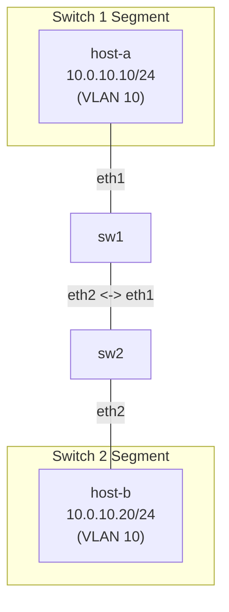

# Bài 25: Troubleshooting Chaos Lab — VLAN

**Arc 5 — Troubleshooting chaos lab**

## Mục tiêu
- Rèn luyện tư duy chẩn đoán Layer 2: cấu hình VLAN trên Linux Bridge, trunking, tag/untag.
- Học cách sử dụng các công cụ kiểm tra bridge trên Linux như `ip link`, `bridge link`, `bridge vlan`.
- Không có bất kỳ gợi ý nào về lỗi — tự mình tìm kiếm và khắc phục.

## Yêu cầu tiên quyết
Hoàn thành [04-linux-bridge-vlan](../04-linux-bridge-vlan/lab-guide.md) — nắm vững cách hoạt động của Linux Bridge và VLAN filtering.

## Tình huống

Hệ thống mạng của công ty vừa được triển khai mở rộng thêm một switch mới (`sw2`) kết nối với switch cũ (`sw1`) qua một đường trung kế (trunk link). Đồng nghiệp báo cáo:

> "Tôi đã cấu hình host-a nối vào sw1 thuộc VLAN 10 và host-b nối vào sw2 cũng thuộc VLAN 10. Cả hai switch đều đã được bật VLAN Filtering, nhưng host-a không tài nào ping thông được host-b. Tôi kiểm tra IP/Subnet của hai host đều đúng cùng dải `10.0.10.0/24`."

## Sơ đồ topology


Xem [`topology/chaos-vlan.clab.yml`](./topology/chaos-vlan.clab.yml).

## Đề bài / Yêu cầu

1. Deploy topology (`sudo clab deploy -t chaos-vlan.clab.yml`).
2. Xác nhận lỗi: `host-a` không thể ping tới `host-b`.
3. Tìm nguyên nhân gốc. **Không có bất kỳ gợi ý nào.** Một số câu hỏi gợi mở cho quá trình điều tra:
   - Interface nối giữa `sw1` và `sw2` đã được gán vào bridge chưa?
   - VLAN filtering đã được cấu hình đúng trên cả hai đầu trunk link chưa?
   - Cổng access của các host đã được cấu hình đúng chế độ untagged cho VLAN 10 chưa?
4. Tiến hành sửa lỗi trực tiếp trên các container switch bằng các lệnh Linux bridge (`ip link`, `bridge`).
5. Xác nhận sửa lỗi thành công: `host-a` ping thông hoàn toàn sang `host-b`.
6. Ghi lại: quá trình điều tra chi tiết, các lệnh chẩn đoán đã dùng, nguyên nhân lỗi và các lệnh dùng để sửa lỗi.

## Lời giải tham khảo

<details>
<summary>⚠️ Bấm để xem lời giải — chỉ mở sau khi đã tự troubleshoot!</summary>

### Lỗi 1: cổng trunk eth2 trên sw1 chưa được gán vào bridge
- **Triệu chứng**: `bridge link` trên sw1 chỉ thấy `eth1` — cổng `eth2` (nối sw2) không thuộc `br0`, frame không bao giờ được chuyển qua trunk.
- **Chẩn đoán**: `ip link show eth2` trên sw1 không có `master br0`.
- **Cách sửa**:
  ```bash
  docker exec clab-chaos-vlan-lab-sw1 ip link set eth2 master br0
  docker exec clab-chaos-vlan-lab-sw1 bridge vlan add dev eth2 vid 10 tagged
  ```

### Lỗi 2: cổng trunk eth1 trên sw2 thiếu tagged VLAN 10
- **Triệu chứng**: `bridge vlan` trên sw2 cho thấy `eth1` chỉ có VLAN 1 — frame tag VLAN 10 từ sw1 sang bị drop ngay tại cổng vào.
- **Chẩn đoán**: so sánh bảng `bridge vlan` hai đầu trunk: đầu sw1 (sau khi sửa lỗi 1) có VLAN 10 tagged, đầu sw2 không có.
- **Cách sửa**:
  ```bash
  docker exec clab-chaos-vlan-lab-sw2 bridge vlan add dev eth1 vid 10 tagged
  ```

**Xác nhận cuối:**
```bash
docker exec clab-chaos-vlan-lab-host-a ping -c 3 10.0.10.20   # thông
```

</details>

## Thảo luận và hỏi đáp
Bài tập này tự làm và tự xác minh kết quả. Nếu có thắc mắc hoặc cần trao đổi thêm, các bạn hãy đăng bài thảo luận trên group Facebook [Network Thực Chiến](https://www.facebook.com/profile.php?id=61591373979991).
## Bài tiếp theo
→ [26-troubleshooting-chaos-vrrp](../26-troubleshooting-chaos-vrrp/lab-guide.md): Troubleshooting chaos lab — VRRP.
