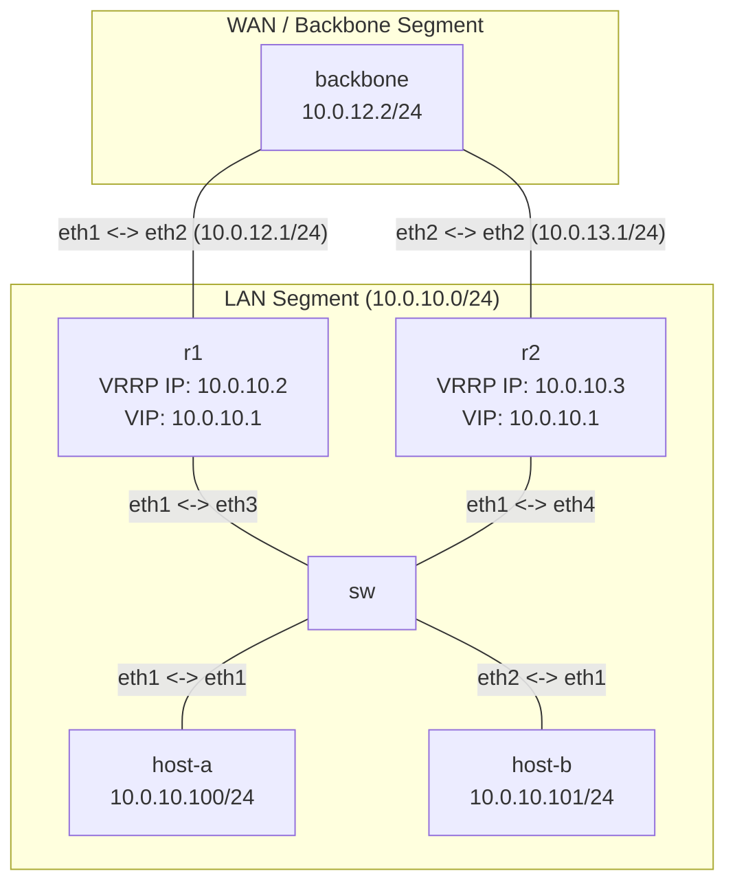

# Bài 26: Troubleshooting Chaos Lab — VRRP

**Arc 5 — Troubleshooting chaos lab**

## Mục tiêu
- Rèn luyện kỹ năng troubleshooting giao thức GateWay Redundancy (VRRP).
- Phân tích và xử lý lỗi split-brain VRRP (trùng lặp Master) và sự mất đồng bộ định tuyến OSPF đi kèm.
- Không có bất kỳ gợi ý nào về lỗi — tự mình tìm kiếm và khắc phục.

## Yêu cầu tiên quyết
Hoàn thành [06-vrrp-ecmp-gateway-ha](../06-vrrp-ecmp-gateway-ha/lab-guide.md) — nắm vững cách cấu hình VRRP và định tuyến tĩnh/động kết hợp với VRRP.

## Tình huống

Hệ thống mạng LAN công ty sử dụng hai router gateway `r1` và `r2` chạy VRRP để dự phòng gateway ảo `10.0.10.1`. Đồng nghiệp báo cáo:

> "Tôi đã cấu hình VRRP trên cả hai router, R1 có priority 200 (đáng lẽ làm Master) và R2 có priority 100 (đáng lẽ làm Backup). Tuy nhiên, hiện tại mạng chập chờn liên tục. Khi tôi kiểm tra log hoặc trạng thái VRRP thì thấy cả R1 và R2 đều tự nhận là Master! Hơn nữa, khi tôi thử tắt R1 đi thì R2 cũng không định tuyến được traffic đi tiếp ra internet."

## Sơ đồ topology


Xem [`topology/chaos-vrrp.clab.yml`](./topology/chaos-vrrp.clab.yml).

## Đề bài / Yêu cầu

1. Deploy topology (`sudo clab deploy -t chaos-vrrp.clab.yml`).
2. Xác nhận lỗi:
   - Kiểm tra trạng thái VRRP trên `r1` và `r2` bằng lệnh `vtysh -c "show ip vrrp"`. Xác nhận cả hai đều hiển thị trạng thái `Master`.
   - Kiểm tra ping từ các host tới `backbone` (`10.0.12.2` hoặc `10.0.13.2`) bị chập chờn.
   - Thử tắt `r1` (`docker exec r1 ip link set eth1 down`), xác nhận các host hoàn toàn mất kết nối ra ngoài dù `r2` vẫn đang chạy.
3. Tìm nguyên nhân gốc. **Không có bất kỳ gợi ý nào.** Một số hướng điều tra:
   - Các thông số cấu hình VRRP trên hai router đã khớp nhau chưa (VRID, IP ảo)?
   - Router backup đã được cấu hình định tuyến động (OSPF) đồng bộ mạng LAN chính xác chưa?
4. Sửa lỗi trực tiếp thông qua `vtysh` trên các router liên quan.
5. Xác nhận sửa lỗi thành công:
   - `r1` là `Master`, `r2` là `Backup`.
   - Ping từ host-a và host-b ra backbone thông hoàn toàn và ổn định.
   - Khi shutdown cổng LAN của `r1`, `r2` lên làm `Master` và định tuyến bình thường không gián đoạn.
6. Ghi lại: quá trình điều tra chi tiết, nguyên nhân lỗi và các lệnh cấu hình đã dùng để sửa.

## Lời giải tham khảo

<details>
<summary>⚠️ Bấm để xem lời giải — chỉ mở sau khi đã tự troubleshoot!</summary>

### Lỗi 1: VRID và VIP trên r2 không khớp với r1 — split-brain
- **Triệu chứng**: cả r1 và r2 đều tự nhận Master.
- **Chẩn đoán**: `show run` trên r2: `vrrp 20 ip 10.0.10.100` — trong khi r1 dùng `vrrp 10 ip 10.0.10.1`. Khác VRID nghĩa là hai router thuộc **hai nhóm VRRP khác nhau**, không nghe thấy advertisement của nhau → mỗi bên tự làm Master nhóm riêng. VIP của r2 còn trùng với IP của host-a (10.0.10.100) — xung đột địa chỉ.
- **Cách sửa** (trên r2 qua vtysh):
  ```
  conf t
  interface eth1
    no vrrp 20
    vrrp 10
    vrrp 10 ip 10.0.10.1
    vrrp 10 priority 100
  ```

### Lỗi 2: OSPF trên r2 khai sai network — mất đường về khi failover
- **Triệu chứng**: tắt r1 thì host mất kết nối ra ngoài dù r2 còn sống.
- **Chẩn đoán**: `show run` trên r2: `network 10.0.20.0/24 area 0` — sai, LAN thật là `10.0.10.0/24`. r2 không quảng bá LAN vào OSPF → backbone không có route trả về LAN qua r2.
- **Cách sửa** (trên r2 qua vtysh):
  ```
  conf t
  router ospf
    no network 10.0.20.0/24 area 0
    network 10.0.10.0/24 area 0
  ```

**Xác nhận cuối:** r1 `Master`, r2 `Backup` (`show ip vrrp`); ping từ host ra backbone ổn định; shutdown cổng LAN r1 → r2 lên Master, ping tiếp tục thông.

</details>

## Thảo luận và hỏi đáp
Bài tập này tự làm và tự xác minh kết quả. Nếu có thắc mắc hoặc cần trao đổi thêm, các bạn hãy đăng bài thảo luận trên group Facebook [Network Thực Chiến](https://www.facebook.com/profile.php?id=61591373979991).
## Bài tiếp theo
→ [27-troubleshooting-chaos-nftables](../27-troubleshooting-chaos-nftables/lab-guide.md): Troubleshooting chaos lab — Firewall & NAT (nftables).
