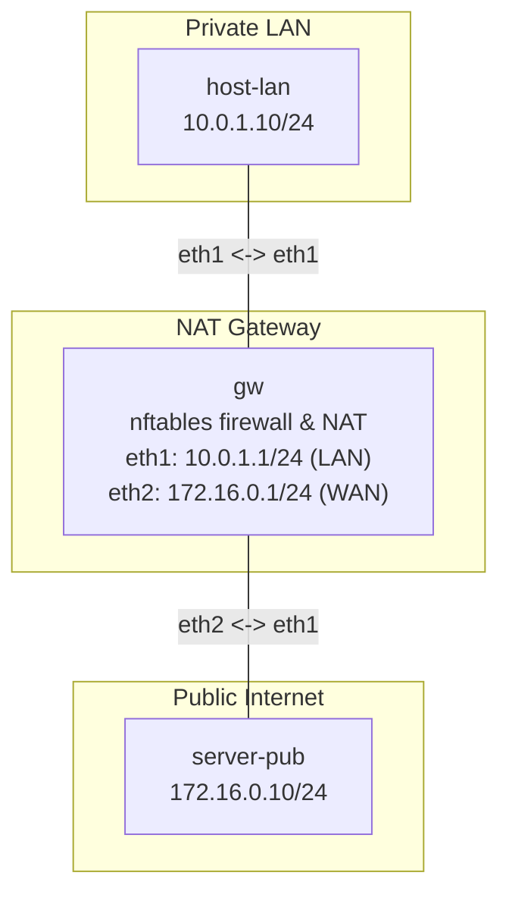

# Bài 27: Troubleshooting Chaos Lab — Firewall & NAT (nftables)

**Arc 5 — Troubleshooting chaos lab**

## Mục tiêu
- Rèn luyện kỹ năng troubleshooting hệ thống Firewall và NAT (Network Address Translation) sử dụng `nftables` trên Linux.
- Hiểu sâu về cơ chế chuyển tiếp gói tin (IP Forwarding), Stateful Firewall (bộ lọc dựa trên trạng thái kết nối), và cơ chế Masquerade IP nguồn.
- Không có bất kỳ gợi ý nào về lỗi — tự mình tìm kiếm và khắc phục.

## Yêu cầu tiên quyết
Hoàn thành [08-nat-masquerade-linux](../08-nat-masquerade-linux/lab-guide.md) và [17-nftables-firewall](../17-nftables-firewall/lab-guide.md) — hiểu rõ về NAT và nftables cơ bản.

## Tình huống

Bạn được giao quản trị một router gateway Linux (`gw`) kết nối mạng LAN nội bộ (Private LAN) ra Internet (mô phỏng bởi máy chủ `server-pub` thuộc Public Internet). Đồng nghiệp báo cáo:

> "Tôi đã cài đặt dịch vụ nftables trên gateway, viết sẵn luật cho phép NAT Masquerade ra ngoài WAN và cấu hình tường lửa chỉ cho phép các kết nối ICMP (ping) và HTTP đi qua. Thế nhưng hiện tại, các máy trạm trong LAN không thể ping được server-pub và cũng không thể truy cập dịch vụ web trên đó. Hãy điều tra và xử lý lỗi gấp!"

## Sơ đồ topology


Xem [`topology/chaos-nftables.clab.yml`](./topology/chaos-nftables.clab.yml).

## Đề bài / Yêu cầu

1. Deploy topology (`sudo clab deploy -t chaos-nftables.clab.yml`).
2. Xác nhận lỗi:
   - Từ `host-lan`, ping tới `server-pub` (`172.16.0.10`) bị thất bại hoàn toàn.
   - Truy cập dịch vụ HTTP (`curl http://172.16.0.10`) từ `host-lan` cũng bị timeout.
3. Tìm nguyên nhân gốc. **Không có bất kỳ gợi ý nào.** Một số hướng đi gợi ý cho bạn:
   - Gateway đã thực sự cho phép chuyển tiếp gói tin (IP forwarding) ở mức kernel chưa?
   - Dùng lệnh `nft list ruleset` trên `gw` để đọc kỹ các luật tường lửa và NAT. 
   - Kiểm tra xem gói tin đi ra WAN có được thay đổi IP nguồn (Masquerade) chính xác trên cổng WAN (`eth2`) chưa, hay lại bị NAT trên cổng khác?
   - Khi gói tin phản hồi từ Server quay lại Gateway, tường lửa có cho phép các kết nối có trạng thái đã thiết lập (`established, related`) đi qua không, hay bị chặn bởi mặc định `policy drop`?
4. Sửa các lỗi tìm được trên `gw` (bao gồm chỉnh sửa kernel parameter và ruleset nftables).
5. Xác nhận sửa lỗi thành công:
   - Từ `host-lan` ping thông tới `server-pub`.
   - Kết nối HTTP thành công (`curl -I http://172.16.0.10` trả về mã HTTP OK).
6. Ghi lại: quá trình chẩn đoán bằng các lệnh (ví dụ `tcpdump`, `nft`), nguyên nhân lỗi và file cấu hình nftables sau khi sửa đổi hoàn chỉnh.

## Lời giải tham khảo

<details>
<summary>⚠️ Bấm để xem lời giải — chỉ mở sau khi đã tự troubleshoot!</summary>

### Lỗi 1: IP forwarding bị tắt ở mức kernel
- **Triệu chứng**: mọi traffic từ LAN qua gateway đều chết, kể cả ping.
- **Chẩn đoán**: `sysctl net.ipv4.ip_forward` trên gw trả về `0`.
- **Cách sửa**:
  ```bash
  docker exec gw sysctl -w net.ipv4.ip_forward=1
  ```
  Sau bước này ping đã thông (rule `ip protocol icmp accept` áp dụng cả 2 chiều), nhưng HTTP vẫn chết.

### Lỗi 2: thiếu rule established/related trong chain forward
- **Triệu chứng**: `curl` vẫn timeout sau khi bật forwarding. `tcpdump` trên gw thấy SYN đi qua, SYN-ACK từ server quay về bị drop.
- **Chẩn đoán**: chain forward `policy drop` chỉ có `icmp accept` và `tcp dport 80 accept` — gói phản hồi (sport 80) không match rule nào.
- **Cách sửa**:
  ```bash
  docker exec gw nft add rule inet filter forward ct state established,related accept
  ```

### Lỗi 3: masquerade nhầm cổng LAN thay vì WAN
- **Triệu chứng**: tuỳ trạng thái 2 lỗi trên mà biểu hiện khác nhau; nhìn thẳng ruleset thấy ngay.
- **Chẩn đoán**: `nft list ruleset` — chain postrouting có `oifname "eth1" masquerade` — eth1 là cổng LAN; NAT nguồn phải áp trên cổng ra WAN (eth2).
- **Cách sửa**:
  ```bash
  docker exec gw nft flush chain ip nat postrouting
  docker exec gw nft add rule ip nat postrouting oifname "eth2" masquerade
  ```

**Xác nhận cuối:**
```bash
docker exec host-lan ping -c 3 172.16.0.10          # thông
docker exec host-lan curl -sI http://172.16.0.10    # HTTP/1.1 200 OK
```

Sửa bền vững: cập nhật cả 3 điểm trong `/etc/nftables/ruleset.nft` rồi `nft -f` lại.

</details>

## Thảo luận và hỏi đáp
Bài tập này tự làm và tự xác minh kết quả. Nếu có thắc mắc hoặc cần trao đổi thêm, các bạn hãy đăng bài thảo luận trên group Facebook [Network Thực Chiến](https://www.facebook.com/profile.php?id=61591373979991).
## Bài tiếp theo
→ [28-ntp-time-sync](../28-ntp-time-sync/lab-guide.md): Đồng bộ thời gian với NTP (chrony).
