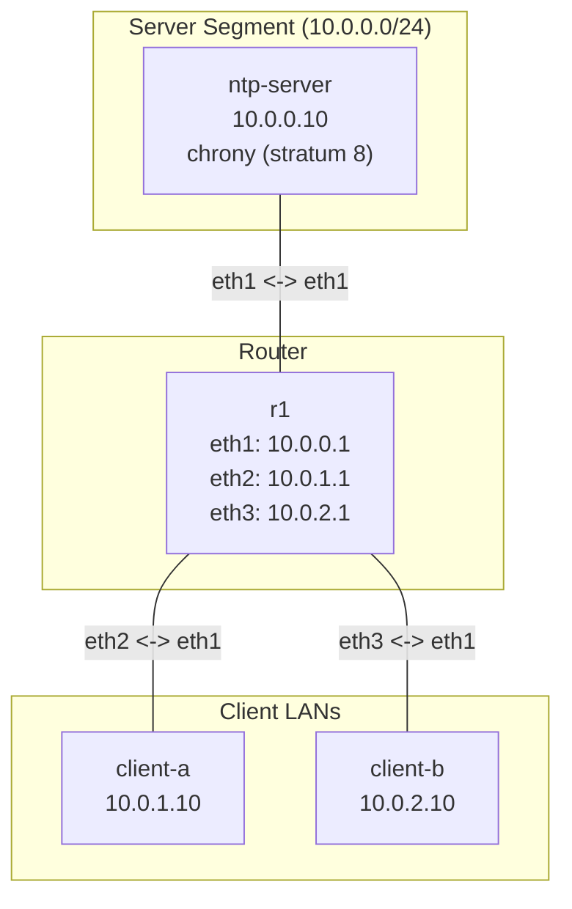

# Bài 28: Đồng Bộ Thời Gian Với NTP (chrony)

**Arc 4 — Security & Observability**

## Mục tiêu
- Hiểu vai trò của đồng bộ thời gian trong vận hành hệ thống: log so khớp được giữa các máy, chứng chỉ TLS, Kerberos, cron job phân tán.
- Cấu hình NTP server nội bộ và NTP client bằng `chrony` — bộ NTP phổ biến nhất trên Linux hiện đại (thay thế ntpd).
- Đọc hiểu output `chronyc sources`, `chronyc tracking` — kỹ năng kiểm tra sức khoẻ time sync khi vận hành.

## Kiến thức nền NTP
- **Stratum**: khoảng cách tới nguồn thời gian gốc. Stratum 0 là đồng hồ nguyên tử/GPS, stratum 1 là server nối trực tiếp nguồn gốc, mỗi tầng client phía sau +1. Server nội bộ standalone thường tự khai `local stratum 8`.
- **chrony mặc định từ chối client**: muốn máy khác truy vấn NTP phải khai `allow <subnet>` — đây là điểm khác biệt lớn so với ntpd và là nguồn lỗi phổ biến khi triển khai.
- **iburst**: gửi liên tiếp 4 gói khi khởi động để rút ngắn thời gian sync đầu tiên từ vài phút xuống vài giây.
- **Ràng buộc trong container**: mọi container chia sẻ kernel clock với host — vì vậy lab chạy `chronyd -x` (không chỉnh đồng hồ thật, chỉ đo offset và duy trì trạng thái sync). Trên máy thật/VM sẽ chạy chronyd bình thường không có `-x`.

## Yêu cầu tiên quyết
Hoàn thành [03-static-route-multi-hop](../03-static-route-multi-hop/lab-guide.md) — hiểu định tuyến tĩnh giữa các subnet.

## Sơ đồ topology


Xem [`topology/ntp-lab.clab.yml`](./topology/ntp-lab.clab.yml).

## Đề bài / Yêu cầu

1. Deploy topology (`sudo clab deploy -t ntp-lab.clab.yml`). Cả 3 node đã cài sẵn `chrony`, IP và route đã cấu hình — nhưng **chưa có config chrony nào**.
2. Hoàn thiện 2 file config (đang có TODO):
   - [`configs/chrony-server.conf`](./configs/chrony-server.conf): khai `local stratum 8` và `allow` cho dải LAN.
   - [`configs/chrony-client.conf`](./configs/chrony-client.conf): khai `server 10.0.0.10 iburst`.
3. Copy config vào từng node và khởi động chrony ở chế độ **không chỉnh clock thật** (`-x`):
   ```bash
   docker cp configs/chrony-server.conf ntp-server:/etc/chrony/chrony.conf
   docker exec ntp-server chronyd -x

   docker cp configs/chrony-client.conf client-a:/etc/chrony/chrony.conf
   docker exec client-a chronyd -x

   docker cp configs/chrony-client.conf client-b:/etc/chrony/chrony.conf
   docker exec client-b chronyd -x
   ```
4. Verify trên client (chờ ~10 giây cho iburst hoàn tất):
   - `docker exec client-a chronyc sources -v` — dòng server phải bắt đầu bằng `^*` (đã chọn làm nguồn sync). `^?` nghĩa là không liên lạc được.
   - `docker exec client-a chronyc tracking` — `Reference ID` phải là `10.0.0.10`, `Stratum` là 9 (server 8 + 1).
5. Verify trên server:
   - `docker exec ntp-server chronyc clients` — phải thấy 2 client `10.0.1.10` và `10.0.2.10` với số packet NTP nhận được.
6. Ghi lại: nội dung 2 file config hoàn chỉnh, output `chronyc sources -v`, `chronyc tracking` trên client và `chronyc clients` trên server.

## Gợi ý
- `chronyc sources -v` in kèm chú giải từng cột — đọc phần chú giải trước.
- Nếu client hiện `^?`: kiểm tra ping tới `10.0.0.10` (loại trừ lỗi mạng trước), sau đó xem lại `allow` trên server — thiếu `allow` là lỗi phổ biến nhất, server nhận request nhưng **im lặng không trả lời**.
- Sửa config xong phải restart daemon: `docker exec <node> pkill chronyd` rồi chạy lại `chronyd -x`.
- **Không dùng `docker restart`** với node containerlab — sẽ mất toàn bộ interface lab.

## Bonus — chuỗi stratum
Cho `client-b` sync từ `client-a` thay vì từ `ntp-server` (sửa `server 10.0.1.10 iburst`). Muốn vậy `client-a` phải kiêm vai server: thêm `allow 10.0.2.0/24` vào config của client-a. Verify `chronyc tracking` trên client-b: `Stratum` bây giờ là 10 — quan sát stratum tăng dần qua từng tầng.

## Lời giải tham khảo

<details>
<summary>⚠️ Bấm để xem lời giải — chỉ mở sau khi đã tự làm!</summary>

**`configs/chrony-server.conf` hoàn chỉnh:**

```
local stratum 8
allow 10.0.0.0/16
driftfile /var/lib/chrony/chrony.drift
```

**`configs/chrony-client.conf` hoàn chỉnh:**

```
server 10.0.0.10 iburst
driftfile /var/lib/chrony/chrony.drift
```

**Giải thích:**
- `local stratum 8`: server không có nguồn Internet nên tự phục vụ thời gian của chính mình ở stratum 8 — không có dòng này server trả lời với stratum 16 (= "chưa sync") và client từ chối dùng.
- `allow 10.0.0.0/16`: mở quyền truy vấn cho toàn bộ 10.0.x.x (bao trùm 10.0.1.0/24 và 10.0.2.0/24). Có thể khai 2 dòng `allow` riêng cho từng subnet — chặt chẽ hơn.
- Output đạt trên client-a:

```
$ chronyc sources -v
MS Name/IP address         Stratum Poll Reach LastRx Last sample
===============================================================================
^* 10.0.0.10                     8   6   377     2    +12us[  +15us] +/- 1ms
```

`^*` = nguồn được chọn; `Reach 377` = 8 lần polling gần nhất đều thành công (số bát phân).

</details>

## Thảo luận và hỏi đáp
Bài tập này tự làm và tự xác minh kết quả. Nếu có thắc mắc hoặc cần trao đổi thêm, các bạn hãy đăng bài thảo luận trên group Facebook [Network Thực Chiến](https://www.facebook.com/profile.php?id=61591373979991).
## Bài tiếp theo
→ 29-troubleshooting-chaos-dhcp (Sắp ra mắt)
