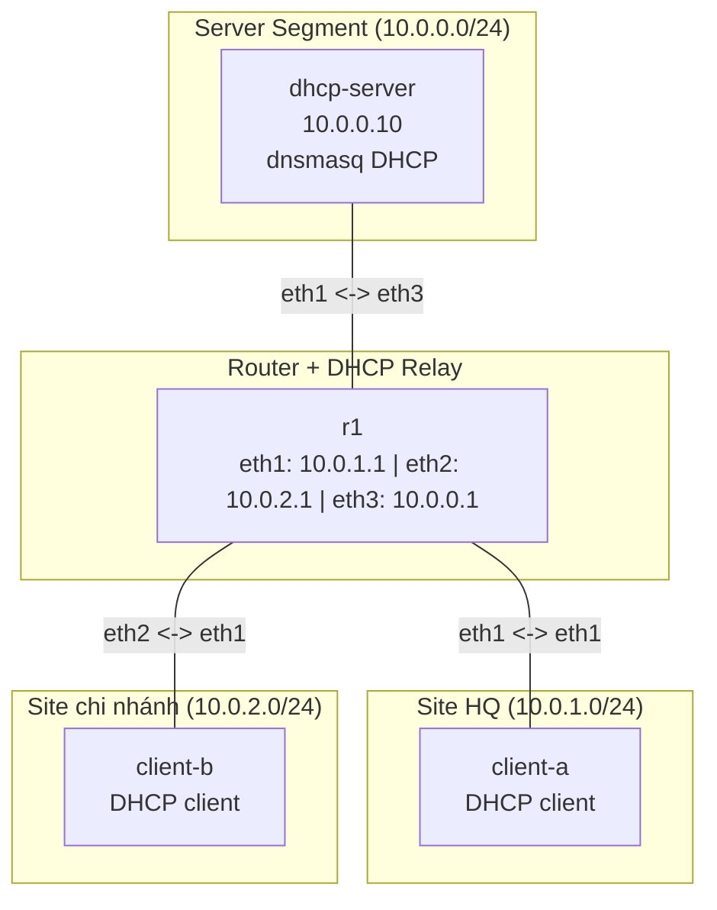

# Bài 29: Troubleshooting Chaos Lab — DHCP Server & Relay

**Arc 5 — Troubleshooting chaos lab**

## Mục tiêu
- Rèn luyện kỹ năng troubleshooting DHCP trong mô hình server tập trung + relay đa site — mô hình phổ biến nhất ở doanh nghiệp.
- Thành thạo đọc log dnsmasq, phân biệt lỗi "không nhận được IP" và lỗi "nhận IP nhưng thiếu/sai option".
- Không có bất kỳ gợi ý nào về lỗi — tự mình tìm kiếm và khắc phục.

## Yêu cầu tiên quyết
Hoàn thành [07-dhcp-server-relay](../07-dhcp-server-relay/lab-guide.md) — nắm vững dnsmasq, dhcp-range, dhcp-option và cơ chế relay.

## Tình huống

Công ty có DHCP server tập trung (`dhcp-server`) đặt ở server segment, cấp IP cho 2 site qua DHCP relay chạy trên router `r1`. Đồng nghiệp báo cáo:

> "Sáng nay cả 2 site cùng kêu. Site chi nhánh: máy mới cắm mạng không xin được IP, chờ mãi timeout. Site HQ lạ hơn: máy vẫn nhận IP bình thường, nhưng không truy cập được server trung tâm — mà ping gateway thì lại... không rõ nữa. Config dnsmasq tôi mới chuẩn hoá lại tuần trước theo template chung, anh xem giúp!"

## Sơ đồ topology


Xem [`topology/chaos-dhcp.clab.yml`](./topology/chaos-dhcp.clab.yml).

## Đề bài / Yêu cầu

1. Deploy topology (`sudo clab deploy -t chaos-dhcp.clab.yml`).
2. Xác nhận lỗi:
   - Trên `client-b`: `docker exec client-b udhcpc -i eth1 -n` — thất bại, không nhận được lease.
   - Trên `client-a`: `docker exec client-a udhcpc -i eth1 -n` — nhận được IP trong dải `10.0.1.100–200`, **nhưng** ping tới server trung tâm `10.0.0.10` thất bại.
3. Tìm nguyên nhân gốc. **Không có bất kỳ gợi ý nào.** Một số hướng điều tra:
   - Log DHCP trên server: `docker exec dhcp-server cat /var/log/dnsmasq.log` — server nói gì khi nhận request qua relay từ từng site?
   - Sau khi client-a có IP: `ip route show` trên client-a — default gateway nhận được là gì, có ai trả lời ARP cho gateway đó không (`arping`/`ip neigh`)?
   - Đối chiếu config `/etc/dnsmasq.conf` trên server với thực tế subnet của từng site.
4. Sửa lỗi trực tiếp trong `/etc/dnsmasq.conf` trên `dhcp-server`, restart dnsmasq (`pkill dnsmasq` rồi `dnsmasq --conf-file=/etc/dnsmasq.conf`). **Không dùng `docker restart`.**
5. Xác nhận sửa lỗi thành công:
   - `client-b` xin lại IP (`udhcpc -i eth1 -n`) — nhận IP trong dải `10.0.2.100–200`.
   - `client-a` xin lại IP — ping thông `10.0.0.10` và ping thông `client-b`.
6. Ghi lại: quá trình điều tra, các dòng log then chốt, nguyên nhân từng lỗi và config sau khi sửa.

## Lời giải tham khảo

<details>
<summary>⚠️ Bấm để xem lời giải — chỉ mở sau khi đã tự troubleshoot!</summary>

### Lỗi 1: dhcp-range site chi nhánh sai dải địa chỉ
- **Triệu chứng**: client-b không bao giờ nhận được lease.
- **Chẩn đoán**: log trên dhcp-server hiện `no address range available for DHCP request via 10.0.2.1` — server nhận được request relay (giaddr `10.0.2.1`) nhưng không có range nào khớp subnet đó.
- **Nguyên nhân gốc**: dòng `dhcp-range=set:branch,10.0.20.100,10.0.20.200,...` khai nhầm `10.0.20.x` thay vì `10.0.2.x` — typo khi "chuẩn hoá template". Dải `10.0.20.0/24` không khớp giaddr `10.0.2.1` nên dnsmasq bỏ qua.
- **Cách sửa**: sửa thành `dhcp-range=set:branch,10.0.2.100,10.0.2.200,255.255.255.0,1h`, restart dnsmasq.

### Lỗi 2: dhcp-option gateway site HQ trỏ IP không tồn tại
- **Triệu chứng**: client-a nhận IP bình thường nhưng mọi kết nối ra ngoài subnet đều chết.
- **Chẩn đoán**: `ip route show` trên client-a hiện `default via 10.0.1.254`; `ip neigh` cho thấy ARP tới `10.0.1.254` ở trạng thái `FAILED` — không thiết bị nào giữ IP này. Gateway thật của subnet là `10.0.1.1` (r1).
- **Nguyên nhân gốc**: dòng `dhcp-option=tag:hq,3,10.0.1.254` khai gateway sai — sót lại từ site cũ dùng `.254` làm gateway.
- **Cách sửa**: sửa thành `dhcp-option=tag:hq,3,10.0.1.1`, restart dnsmasq, client-a renew lease (`udhcpc -i eth1 -n`).

**Lệnh sửa nhanh trong container:**

```bash
docker exec dhcp-server sed -i \
  -e 's/10.0.20.100,10.0.20.200/10.0.2.100,10.0.2.200/' \
  -e 's/tag:hq,3,10.0.1.254/tag:hq,3,10.0.1.1/' /etc/dnsmasq.conf
docker exec dhcp-server pkill dnsmasq
docker exec dhcp-server dnsmasq --conf-file=/etc/dnsmasq.conf
docker exec client-a udhcpc -i eth1 -n
docker exec client-b udhcpc -i eth1 -n
```

</details>

## Thảo luận và hỏi đáp
Bài tập này tự làm và tự xác minh kết quả. Nếu có thắc mắc hoặc cần trao đổi thêm, các bạn hãy đăng bài thảo luận trên group Facebook [Network Thực Chiến](https://www.facebook.com/profile.php?id=61591373979991).
## Bài tiếp theo
→ 30-troubleshooting-chaos-dns (Sắp ra mắt)
