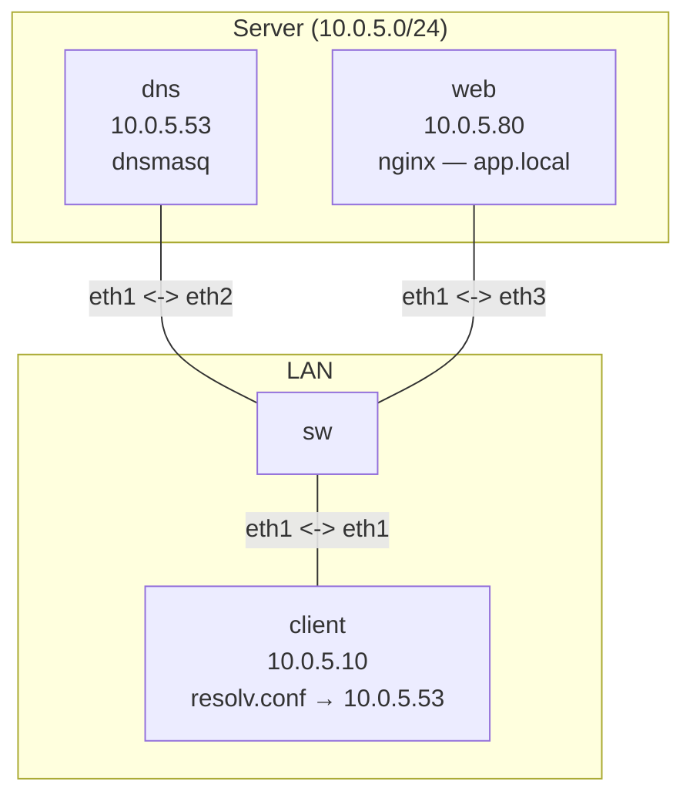

# Bài 30: Troubleshooting Chaos Lab — DNS Nội Bộ (dnsmasq)

**Arc 5 — Troubleshooting chaos lab**

## Mục tiêu
- Rèn luyện kỹ năng troubleshooting DNS — dịch vụ mà khi hỏng, "mọi thứ đều hỏng" trong mắt người dùng.
- Phân biệt 2 lớp lỗi DNS kinh điển: **không trả lời** (service/binding) và **trả lời sai** (record stale) — mỗi lớp có triệu chứng và công cụ chẩn đoán khác nhau.
- Không có bất kỳ gợi ý nào về lỗi — tự mình tìm kiếm và khắc phục.

## Yêu cầu tiên quyết
Hoàn thành [07-dhcp-server-relay](../07-dhcp-server-relay/lab-guide.md) — quen thuộc với dnsmasq và cách đọc config/log của nó.

## Tình huống

LAN nội bộ `10.0.5.0/24` có DNS server (`dns`, chạy dnsmasq) phân giải tên miền nội bộ `app.local` cho ứng dụng web chạy trên máy `web`. Đồng nghiệp báo cáo:

> "Tuần trước team hạ tầng migrate con app sang máy chủ mới và dựng lại luôn DNS server theo config backup. Từ đó user kêu không vào được `app.local`. Tôi kiểm tra thì thấy dnsmasq **đang chạy** trên DNS server, nginx cũng **đang chạy** trên web server, ping IP giữa các máy đều thông. Vậy mà cứ gõ tên miền là chết. Chịu!"

## Sơ đồ topology


Xem [`topology/chaos-dns.clab.yml`](./topology/chaos-dns.clab.yml).

## Đề bài / Yêu cầu

1. Deploy topology (`sudo clab deploy -t chaos-dns.clab.yml`).
2. Xác nhận lỗi:
   - Từ `client`: `docker exec client nslookup app.local` — thất bại (`connection refused` / `no servers could be reached`).
   - Ping bằng IP vẫn thông cả 2 chiều: `docker exec client ping -c 2 10.0.5.53` và `ping -c 2 10.0.5.80` đều OK.
3. Tìm nguyên nhân gốc. **Không có bất kỳ gợi ý nào.** Một số hướng điều tra:
   - dnsmasq đang chạy — nhưng nó đang **lắng nghe ở đâu**? (`ss -ulnp` trên node `dns`)
   - Query từ client có đến được node `dns` không? (`tcpdump -i eth1 port 53` trên `dns`)
   - Khi DNS đã trả lời được: IP nhận về có đúng là máy `web` đang chạy dịch vụ không? Truy cập thử bằng IP đó và bằng IP thật của `web`, so sánh.
4. Sửa lỗi trực tiếp trong `/etc/dnsmasq.conf` trên node `dns`, restart dnsmasq (`pkill dnsmasq` rồi `dnsmasq --conf-file=/etc/dnsmasq.conf`). **Không dùng `docker restart`.**
5. Xác nhận sửa lỗi thành công:
   - `docker exec client nslookup app.local` trả về đúng `10.0.5.80`.
   - `docker exec client curl -sI http://app.local` trả về `HTTP/1.1 200 OK`.
6. Ghi lại: quá trình điều tra từng lớp lỗi, lệnh chẩn đoán, nguyên nhân và config sau khi sửa.

## Lời giải tham khảo

<details>
<summary>⚠️ Bấm để xem lời giải — chỉ mở sau khi đã tự troubleshoot!</summary>

### Lỗi 1: dnsmasq chỉ lắng nghe trên loopback
- **Triệu chứng**: nslookup từ client báo `connection refused` — kernel node dns trả `ICMP port unreachable` vì không có ai nghe trên `10.0.5.53:53`; ping IP vẫn thông.
- **Chẩn đoán**: trên node `dns`, `ss -ulnp | grep 53` cho thấy dnsmasq chỉ bind `127.0.0.1:53` — không có socket trên `10.0.5.53`.
- **Nguyên nhân gốc**: dòng `listen-address=127.0.0.1` (mặc định an toàn của config backup) chưa được sửa khi dựng lại server — dnsmasq chạy nhưng chỉ phục vụ chính nó.
- **Cách sửa**: đổi thành `listen-address=127.0.0.1,10.0.5.53` (hoặc thay bằng `interface=eth1`), restart dnsmasq.

### Lỗi 2: bản ghi app.local trỏ IP máy chủ cũ
- **Triệu chứng**: sau khi sửa lỗi 1, `nslookup app.local` trả lời được nhưng ra `10.0.5.90`; `curl http://app.local` timeout.
- **Chẩn đoán**: `10.0.5.90` không ping được — không tồn tại trên mạng. IP thật của `web` là `10.0.5.80` (curl thẳng IP này ra 200 OK). Đối chiếu config: `address=/app.local/10.0.5.90`.
- **Nguyên nhân gốc**: record stale — migrate app sang máy mới (`10.0.5.80`) nhưng quên cập nhật bản ghi DNS, config backup vẫn giữ IP cũ `10.0.5.90`.
- **Cách sửa**: đổi thành `address=/app.local/10.0.5.80`, restart dnsmasq.

**Lệnh sửa nhanh trong container:**

```bash
docker exec dns sed -i \
  -e 's|listen-address=127.0.0.1|listen-address=127.0.0.1,10.0.5.53|' \
  -e 's|address=/app.local/10.0.5.90|address=/app.local/10.0.5.80|' /etc/dnsmasq.conf
docker exec dns pkill dnsmasq
docker exec dns dnsmasq --conf-file=/etc/dnsmasq.conf
docker exec client nslookup app.local
docker exec client curl -sI http://app.local
```

</details>

## Thảo luận và hỏi đáp
Bài tập này tự làm và tự xác minh kết quả. Nếu có thắc mắc hoặc cần trao đổi thêm, các bạn hãy đăng bài thảo luận trên group Facebook [Network Thực Chiến](https://www.facebook.com/profile.php?id=61591373979991).
## Bài tiếp theo
→ 31-troubleshooting-chaos-ntp (Sắp ra mắt)
