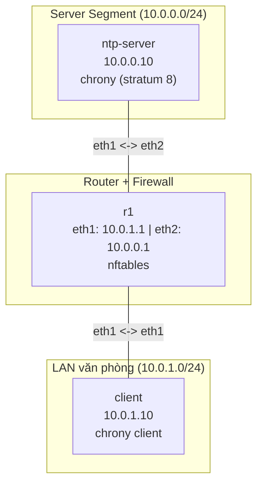

# Bài 31: Troubleshooting Chaos Lab — NTP (chrony)

**Arc 5 — Troubleshooting chaos lab**

## Mục tiêu
- Rèn luyện kỹ năng troubleshooting dịch vụ NTP xuyên qua firewall — bài toán phối hợp giữa lớp mạng và lớp dịch vụ.
- Thành thạo dùng `chronyc sources`, `tcpdump` bám theo gói tin NTP qua từng chặng để khoanh vùng điểm chết.
- Không có bất kỳ gợi ý nào về lỗi — tự mình tìm kiếm và khắc phục.

## Yêu cầu tiên quyết
Hoàn thành [28-ntp-time-sync](../28-ntp-time-sync/lab-guide.md) — nắm vững chrony server/client và [17-nftables-firewall](../17-nftables-firewall/lab-guide.md) — đọc hiểu ruleset nftables.

## Tình huống

Hệ thống giám sát cảnh báo lệch giờ trên các máy ở LAN văn phòng. Kiến trúc: NTP server nội bộ (`ntp-server`) đặt ở server segment, LAN client đi qua router kiêm firewall `r1`. Đồng nghiệp báo cáo:

> "Máy client không chịu sync giờ với NTP server nội bộ, `chronyc sources` toàn dấu `^?`. Tôi đã nhờ team firewall mở port 123 trên router tuần trước rồi, họ confirm đã mở. Còn con NTP server thì tôi dựng theo đúng hướng dẫn, chronyd đang chạy, chẳng có lỗi gì trong log. Ping từ client tới server vẫn thông. Bó tay."

## Sơ đồ topology


Xem [`topology/chaos-ntp.clab.yml`](./topology/chaos-ntp.clab.yml).

## Đề bài / Yêu cầu

1. Deploy topology (`sudo clab deploy -t chaos-ntp.clab.yml`).
2. Xác nhận lỗi:
   - `docker exec client chronyc sources` — nguồn `10.0.0.10` ở trạng thái `^?` (unreachable), cột `Reach` là 0.
   - `docker exec client ping -c 2 10.0.0.10` — vẫn thông (ICMP không bị chặn).
3. Tìm nguyên nhân gốc. **Không có bất kỳ gợi ý nào.** Một số hướng điều tra:
   - NTP dùng giao thức và port gì? Gói tin của client có **đi qua được** `r1` không? Bắt gói 2 chặng để so sánh: `tcpdump -ni eth1 port 123` và `tcpdump -ni eth2 port 123` trên `r1`.
   - Khi gói tin đã tới được server: server **có trả lời không**? (`tcpdump` trên `ntp-server`, đối chiếu request/response)
   - chrony có cơ chế kiểm soát truy cập riêng — xem `chronyc -h 127.0.0.1 accheck <ip>` hoặc đối chiếu config server với bài 28.
4. Sửa các lỗi tìm được (ruleset nftables trên `r1`, config chrony trên `ntp-server`). Restart dịch vụ bằng `pkill` + chạy lại — **không dùng `docker restart`**.
5. Xác nhận sửa lỗi thành công:
   - `docker exec client chronyc sources -v` — nguồn `10.0.0.10` chuyển sang `^*`, `Reach` tăng dần (chờ ~10–30 giây sau khi restart chronyd trên client, hoặc chạy `chronyc burst 4/4` để thúc).
6. Ghi lại: đường đi gói tin qua từng chặng trước/sau khi sửa, nguyên nhân từng lỗi, config và ruleset sau khi sửa.

## Lời giải tham khảo

<details>
<summary>⚠️ Bấm để xem lời giải — chỉ mở sau khi đã tự troubleshoot!</summary>

### Lỗi 1: firewall mở nhầm TCP 123 thay vì UDP 123
- **Triệu chứng**: `tcpdump -ni eth1 udp port 123` trên r1 thấy request NTP từ client đi vào, nhưng `tcpdump -ni eth2 udp port 123` không thấy gói nào đi ra phía server — bị drop tại forward chain.
- **Chẩn đoán**: `nft list ruleset` trên r1: chain forward `policy drop`, rule mở port 123 là `tcp dport 123 accept` — nhưng **NTP chạy trên UDP 123**, không phải TCP. "Team firewall confirm đã mở port 123" — mở đúng số port, sai giao thức.
- **Cách sửa**:
  ```bash
  docker exec r1 sed -i 's/tcp dport 123 accept/udp dport 123 accept/' /etc/nftables/ruleset.nft
  docker exec r1 nft -f /etc/nftables/ruleset.nft
  ```
  (file có sẵn `flush ruleset` nên nạp lại là thay toàn bộ)

### Lỗi 2: chrony server thiếu `allow` — nhận request nhưng im lặng
- **Triệu chứng**: sau khi sửa firewall, `tcpdump -ni eth1 udp port 123` trên `ntp-server` thấy request **đến** nhưng không có gói trả lời **đi**. Client vẫn `^?`.
- **Chẩn đoán**: chrony mặc định **từ chối mọi client NTP** — phải khai `allow`. Config server chỉ có `local stratum 8`, không có dòng `allow` nào. Xác nhận: `docker exec ntp-server chronyc accheck 10.0.1.10` → `Access denied`.
- **Cách sửa**:
  ```bash
  docker exec ntp-server sh -c 'echo "allow 10.0.1.0/24" >> /etc/chrony/chrony.conf'
  docker exec ntp-server pkill chronyd
  docker exec ntp-server chronyd -x
  ```

**Xác nhận cuối:**
```bash
docker exec client pkill chronyd && docker exec client chronyd -x
sleep 10
docker exec client chronyc sources -v   # ^* 10.0.0.10
```

</details>

## Thảo luận và hỏi đáp
Bài tập này tự làm và tự xác minh kết quả. Nếu có thắc mắc hoặc cần trao đổi thêm, các bạn hãy đăng bài thảo luận trên group Facebook [Network Thực Chiến](https://www.facebook.com/profile.php?id=61591373979991).
## Bài tiếp theo
→ 32-troubleshooting-chaos-webserver (Sắp ra mắt)
