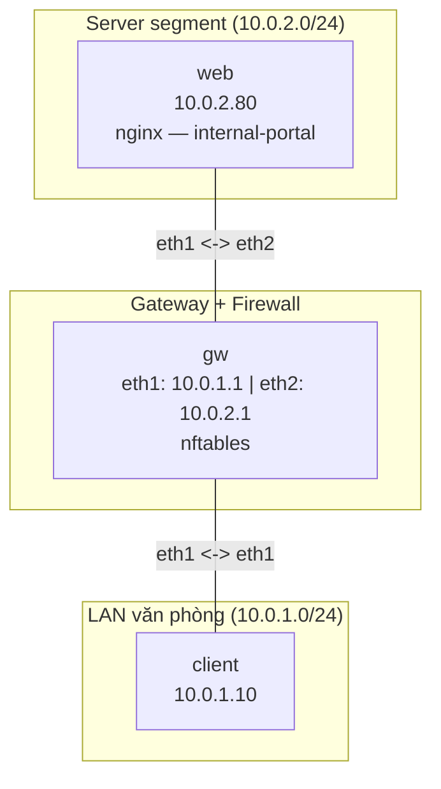

# Bài 32: Troubleshooting Chaos Lab — Truy Cập Webserver

**Arc 5 — Troubleshooting chaos lab**

## Mục tiêu
- Rèn luyện quy trình troubleshooting "user không vào được web" — ticket vận hành phổ biến nhất, đòi hỏi loại trừ tuần tự từng tầng: mạng → firewall → service binding.
- Thành thạo bộ công cụ phân tầng: `ping` (L3), `ss -tlnp` (service đang nghe ở đâu), `tcpdump` (gói tin chết ở chặng nào), `nft list ruleset` (firewall).
- Không có bất kỳ gợi ý nào về lỗi — tự mình tìm kiếm và khắc phục.

## Yêu cầu tiên quyết
Hoàn thành [17-nftables-firewall](../17-nftables-firewall/lab-guide.md) và [04-linux-bridge-vlan](../04-linux-bridge-vlan/lab-guide.md).

## Tình huống

Cổng thông tin nội bộ (`internal-portal`) chạy nginx trên máy `web`, người dùng LAN văn phòng truy cập qua gateway kiêm firewall `gw`. Đồng nghiệp báo cáo:

> "Từ sau đợt deploy tối qua của team app, toàn bộ user không vào được internal-portal nữa. Tôi kiểm tra sơ bộ: ping từ máy user tới IP web server `10.0.2.80` vẫn thông, nginx trên server vẫn đang chạy (`ps` thấy process). Team app thề là 'code không đổi gì liên quan mạng', team firewall thề là 'rule bọn tôi mở từ xưa vẫn nguyên'. Hai bên đổ nhau cả sáng nay, anh phân xử giúp!"

## Sơ đồ topology


Xem [`topology/chaos-webserver.clab.yml`](./topology/chaos-webserver.clab.yml).

## Đề bài / Yêu cầu

1. Deploy topology (`sudo clab deploy -t chaos-webserver.clab.yml`).
2. Xác nhận lỗi:
   - `docker exec client ping -c 2 10.0.2.80` — thông (L3 OK).
   - `docker exec client curl -m 5 http://10.0.2.80` — thất bại.
3. Tìm nguyên nhân gốc. **Không có bất kỳ gợi ý nào.** Quy trình loại trừ gợi mở:
   - Trên `web`: nginx đang **nghe ở địa chỉ nào, port nào**? (`ss -tlnp`) So sánh với nơi client đang gọi tới.
   - Trên `gw`: gói TCP từ client có được forward qua không? (`tcpdump -ni eth1 tcp port 80` và `tcpdump -ni eth2 tcp port 80`, đối chiếu ruleset `nft list ruleset`)
   - Lưu ý: có thể có **nhiều hơn một lỗi** — sửa xong một lỗi phải test lại từ đầu.
4. Sửa các lỗi tìm được (config nginx trên `web` — sửa xong `nginx -s reload`; ruleset nftables trên `gw` — sửa file rồi `nft -f`). **Không dùng `docker restart`.**
5. Xác nhận sửa lỗi thành công:
   - `docker exec client curl -sI http://10.0.2.80` trả về `HTTP/1.1 200 OK`.
   - `docker exec client curl -s http://10.0.2.80` hiển thị nội dung trang portal.
6. Ghi lại: thứ tự loại trừ từng tầng, bằng chứng ở mỗi bước (output ss/tcpdump/nft), nguyên nhân từng lỗi, config sau khi sửa — và kết luận "lỗi của team nào" 😄.

## Lời giải tham khảo

<details>
<summary>⚠️ Bấm để xem lời giải — chỉ mở sau khi đã tự troubleshoot!</summary>

Bài này có **2 lỗi độc lập** ở 2 thiết bị khác nhau — cả team app lẫn team firewall đều... có lỗi.

### Lỗi 1 (team app): nginx bind nhầm 127.0.0.1:8080
- **Triệu chứng**: curl từ client bị RST/timeout dù nginx đang chạy.
- **Chẩn đoán**: trên `web`, `ss -tlnp` cho thấy nginx chỉ nghe `127.0.0.1:8080` — không có socket nào trên `10.0.2.80:80`. Bản `nginx.conf` deploy tối qua mang theo dòng `listen 127.0.0.1:8080;` (config chạy sau reverse proxy ở môi trường khác).
- **Cách sửa**:
  ```bash
  docker exec web sed -i 's/listen 127.0.0.1:8080;/listen 80;/' /etc/nginx/nginx.conf
  docker exec web nginx -s reload
  ```

### Lỗi 2 (team firewall): rule mở nhầm port 8080 thay vì 80
- **Triệu chứng**: sau khi sửa nginx, curl vẫn timeout. `tcpdump -ni eth1 tcp port 80` trên `gw` thấy SYN từ client đi vào, `tcpdump -ni eth2 tcp port 80` không thấy gì đi ra — drop tại forward chain.
- **Chẩn đoán**: `nft list ruleset` trên `gw`: rule là `tcp dport 8080 accept` — "rule mở từ xưa vẫn nguyên" nhưng nó mở cho port 8080 (cổng portal bản cũ), còn portal giờ chạy port 80.
- **Cách sửa**:
  ```bash
  docker exec gw sed -i 's/tcp dport 8080 accept/tcp dport 80 accept/' /etc/nftables/ruleset.nft
  docker exec gw nft -f /etc/nftables/ruleset.nft
  ```

**Xác nhận cuối:**
```bash
docker exec client curl -sI http://10.0.2.80    # HTTP/1.1 200 OK
```

Bài học thực chiến: "service đang chạy" ≠ "service đang nghe đúng chỗ"; và khi 2 team đều "thề không đổi gì" — hãy tin bằng chứng từ `ss`/`tcpdump`, đừng tin lời khai. 😄

</details>

## Thảo luận và hỏi đáp
Bài tập này tự làm và tự xác minh kết quả. Nếu có thắc mắc hoặc cần trao đổi thêm, các bạn hãy đăng bài thảo luận trên group Facebook [Network Thực Chiến](https://www.facebook.com/profile.php?id=61591373979991).
## Bài tiếp theo
→ 33-troubleshooting-chaos-routing-redistribute (Sắp ra mắt)
