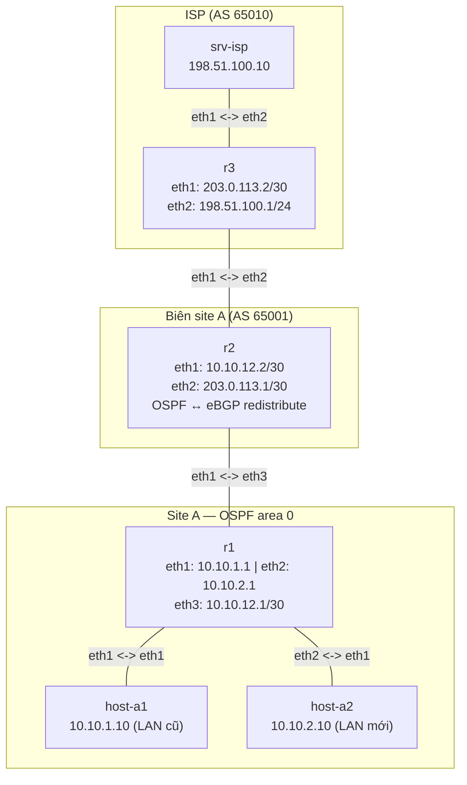

# Bài 33: Troubleshooting Chaos Lab — Routing OSPF ↔ BGP Redistribute

**Arc 5 — Troubleshooting chaos lab**

## Mục tiêu
- Rèn luyện troubleshooting định tuyến đa giao thức: OSPF nội bộ + eBGP ra ISP + redistribute và policy lọc route — mô hình biên doanh nghiệp điển hình, khó hơn bài 18 (OSPF thuần) và 19 (BGP thuần).
- Thành thạo truy vết route theo chuỗi: adjacency OSPF → bảng route → redistribute → policy out → bảng BGP phía nhận.
- Không có bất kỳ gợi ý nào về lỗi — tự mình tìm kiếm và khắc phục.

## Yêu cầu tiên quyết
Hoàn thành [18-troubleshooting-chaos-lab](../18-troubleshooting-chaos-lab/lab-guide.md), [19-troubleshooting-chaos-bgp](../19-troubleshooting-chaos-bgp/lab-guide.md) và [12-bgp-local-pref-prefix-list](../12-bgp-local-pref-prefix-list/lab-guide.md) — nắm vững OSPF, BGP, prefix-list/route-map.

## Tình huống

Site A chạy OSPF nội bộ (`r1` gom 2 LAN, `r2` là router biên chạy eBGP với ISP `r3`, redistribute OSPF vào BGP có lọc bằng prefix-list). Đồng nghiệp báo cáo:

> "Cuối tuần vừa rồi bên tôi làm 2 việc: chuẩn hoá config OSPF theo baseline bảo mật mới (passive-interface mọi cổng trừ uplink), và mở thêm LAN mới `10.10.2.0/24` cho phòng ban mới. Sáng thứ hai thì thảm hoạ: **toàn bộ site mất kết nối ra ngoài**, cả LAN cũ lẫn LAN mới. Tôi nghi ngờ ông thực tập sửa nhầm gì đó trong config nhưng nhìn mãi không ra — anh vào xem giúp, khôi phục LAN cũ trước rồi tính tiếp LAN mới!"

## Sơ đồ topology


Xem [`topology/chaos-routing.clab.yml`](./topology/chaos-routing.clab.yml).

## Đề bài / Yêu cầu

1. Deploy topology (`sudo clab deploy -t chaos-routing.clab.yml`).
2. Xác nhận lỗi (chờ ~30 giây cho giao thức hội tụ):
   - `docker exec host-a1 ping -c 3 198.51.100.10` — thất bại.
   - `docker exec host-a2 ping -c 3 198.51.100.10` — thất bại.
3. Tìm nguyên nhân gốc. **Không có bất kỳ gợi ý nào.** Chuỗi truy vết gợi mở:
   - OSPF adjacency `r1`↔`r2` có hình thành không? (`vtysh -c "show ip ospf neighbor"` trên cả hai)
   - `r2` có học được route các LAN qua OSPF không? (`show ip route ospf`)
   - `r2` có quảng bá các LAN sang ISP không? (`show ip bgp neighbors 203.0.113.2 advertised-routes`)
   - `r3` nhận được những prefix nào? (`show ip bgp` trên r3)
   - Policy out trên `r2` (`show run` — prefix-list, route-map) khớp với danh sách LAN hiện tại chưa?
4. Sửa lỗi qua `vtysh` trên router liên quan (sửa xong nhớ lưu ý: đổi prefix-list/route-map cần `clear ip bgp * soft out` để áp lại). **Không dùng `docker restart`.**
5. Xác nhận sửa lỗi thành công:
   - `host-a1` và `host-a2` đều ping thông `198.51.100.10`.
   - Trên `r3`: `show ip bgp` thấy đủ cả `10.10.1.0/24` và `10.10.2.0/24`.
6. Ghi lại: chuỗi truy vết (adjacency → route table → advertised-routes → BGP table phía ISP), nguyên nhân từng lỗi, config sau khi sửa.

## Lời giải tham khảo

<details>
<summary>⚠️ Bấm để xem lời giải — chỉ mở sau khi đã tự troubleshoot!</summary>

### Lỗi 1: `ip ospf passive` đặt nhầm lên uplink r1→r2 — cả site mất mạng
- **Triệu chứng**: `show ip ospf neighbor` trên cả r1 và r2 đều **trống** — adjacency không hình thành. r2 không học được route LAN nào → BGP không có gì để redistribute → cả site chết.
- **Chẩn đoán**: `show run` trên r1: interface `eth3` (uplink duy nhất tới r2) có `ip ospf passive`. Đợt "chuẩn hoá passive mọi cổng trừ uplink" đã passive nhầm luôn cả uplink — passive interface vẫn được quảng bá subnet nhưng **không gửi/nhận Hello** nên không bao giờ có neighbor.
- **Cách sửa**:
  ```bash
  docker exec r1 vtysh -c "conf t" -c "interface eth3" -c "no ip ospf passive"
  ```
  Sau ~10 giây adjacency lên `Full`, host-a1 (LAN cũ) ping thông ISP — đúng yêu cầu "khôi phục LAN cũ trước".

### Lỗi 2: prefix-list quên thêm LAN mới — chỉ LAN cũ được quảng bá
- **Triệu chứng**: sau khi sửa lỗi 1, host-a1 thông nhưng host-a2 vẫn fail. Trên r2 `show ip route ospf` có đủ cả 2 LAN, nhưng `show ip bgp neighbors 203.0.113.2 advertised-routes` chỉ có `10.10.1.0/24`. Trên r3 `show ip bgp` không có `10.10.2.0/24` → gói ICMP từ host-a2 **đến được** srv-isp nhưng chiều về không có route, chết tại r3.
- **Chẩn đoán**: prefix-list `LAN-OUT` trên r2 chỉ có `seq 5 permit 10.10.1.0/24` — mở LAN mới nhưng quên cập nhật policy biên.
- **Cách sửa**:
  ```bash
  docker exec r2 vtysh \
    -c "conf t" \
    -c "ip prefix-list LAN-OUT seq 10 permit 10.10.2.0/24" \
    -c "exit" \
    -c "clear ip bgp * soft out"
  ```

**Xác nhận cuối:**
```bash
docker exec r3 vtysh -c "show ip bgp"        # đủ 10.10.1.0/24 và 10.10.2.0/24
docker exec host-a1 ping -c 3 198.51.100.10  # OK
docker exec host-a2 ping -c 3 198.51.100.10  # OK
```

Bài học thực chiến: một triệu chứng "mất hết mạng" có thể do 2 lỗi chồng nhau từ 2 thay đổi khác nhau trong cùng một đợt bảo trì — sửa lỗi lớn xong phải test lại toàn bộ để lộ lỗi nhỏ còn nấp phía sau. Và mọi lần **thêm subnet mới** đều phải rà lại policy lọc route ở biên.

</details>

## Thảo luận và hỏi đáp
Bài tập này tự làm và tự xác minh kết quả. Nếu có thắc mắc hoặc cần trao đổi thêm, các bạn hãy đăng bài thảo luận trên group Facebook [Network Thực Chiến](https://www.facebook.com/profile.php?id=61591373979991).
## Bài tiếp theo
→ [41-troubleshooting-chaos-ospf-adjacency](../41-troubleshooting-chaos-ospf-adjacency/lab-guide.md): Troubleshooting chaos lab — OSPF multi-area: adjacency & LSDB (3 lỗi chồng nhau).
