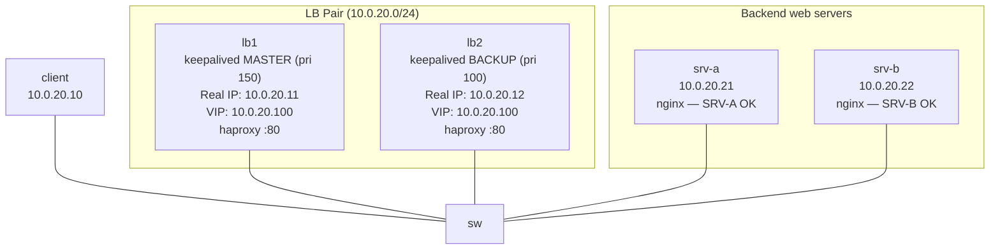

# Bài 34: keepalived + haproxy — VIP HA cho LB Pair

**Arc 1 — Networking nền tảng nâng cao**

## Mục tiêu
- Cấu hình `keepalived` trên 2 node Linux thuần (không phải router FRR) để chia sẻ 1 Virtual IP (VIP) làm địa chỉ load balancer.
- Kết hợp `haproxy` phía sau VIP, cân bằng tải HTTP tới 2 backend web server.
- Thấy rõ điểm khác `vrrpd` (bài 06): `keepalived` dùng `vrrp_script`/`track_script` để theo dõi **sức khỏe tầng ứng dụng** (haproxy còn sống không), không chỉ trạng thái interface — failover ngay cả khi link vẫn up nhưng service chết.

## Yêu cầu tiên quyết
Hoàn thành [06-vrrp-ecmp-gateway-ha](../06-vrrp-ecmp-gateway-ha/lab-guide.md) — đã quen khái niệm VRRP master/backup/priority/preempt qua `vrrpd`. Bài này áp dụng lại khái niệm đó với `keepalived`, xem phần "So sánh vrrpd và keepalived" cuối bài 06 trước khi bắt đầu.

## Sơ đồ topology

- `sw`: Linux bridge nối chung 1 LAN `10.0.20.0/24` — client, lb1, lb2, srv-a, srv-b.
- `lb1`/`lb2`: đã cài sẵn `haproxy` + `keepalived` qua `exec` lúc deploy (xem [`topology/keepalived-lab.clab.yml`](./topology/keepalived-lab.clab.yml)), nhưng `keepalived.conf` mới chỉ có VRRP cơ bản — phần `track_script` để `TODO` tự kiểm chứng ở bước 5.
- `srv-a`/`srv-b`: nginx có sẵn trong image multitool, mỗi node trả về trang riêng để phân biệt backend nào đang phục vụ.

## Đề bài / Yêu cầu

1. Deploy topology (`sudo clab deploy -t keepalived-lab.clab.yml`).
2. **Xác nhận backend sống:**
   - `docker exec client curl -s 10.0.20.21` → `SRV-A OK`.
   - `docker exec client curl -s 10.0.20.22` → `SRV-B OK`.
3. **Xác nhận haproxy trên từng LB (chưa qua VIP):**
   - `docker exec client curl -s 10.0.20.11` và gọi lại vài lần → thấy xen kẽ `SRV-A OK`/`SRV-B OK` (round-robin).
   - Tương tự với `10.0.20.12`.
4. **Xác nhận keepalived bầu Master:**
   - `docker exec lb1 ip addr show eth1` → thấy `10.0.20.100/24` (VIP) trên lb1.
   - `docker exec lb2 ip addr show eth1` → **không** thấy VIP (đang Backup).
   - `docker exec client curl -s 10.0.20.100` → cân bằng tải qua VIP, thấy cả 2 backend.
5. **Test failover kịch bản 1 — mất hẳn kết nối (giống bài 06):**
   ```bash
   docker exec lb1 ip link set eth1 down
   ```
   - Đợi vài giây, `docker exec lb2 ip addr show eth1` → VIP chuyển sang lb2.
   - `docker exec client curl -s 10.0.20.100` → vẫn thông, backend vẫn round-robin bình thường.
   - Khôi phục: `docker exec lb1 ip link set eth1 up` — do preempt mặc định bật, lb1 giành lại Master.
6. **Test failover kịch bản 2 — service chết nhưng link vẫn up (điểm `keepalived` hơn `vrrpd`):**
   ```bash
   docker exec lb1 pkill haproxy
   ```
   - **Không** tắt interface lần này. Theo dõi `docker exec lb1 ip addr show eth1` — VIP có tự rời khỏi lb1 không? Vì sao (đọc lại `vrrp_script`/`track_script` trong `configs/lb1/keepalived.conf`)?
   - Xác nhận VIP đã chuyển hẳn sang lb2: `docker exec lb2 ip addr show eth1`.
   - `docker exec client curl -s 10.0.20.100` → vẫn thông qua haproxy trên lb2.
   - Khôi phục: `docker exec lb1 haproxy -f /etc/haproxy/haproxy.cfg -D` — lb1 tự tăng priority trở lại, giành Master (preempt).
7. Ghi lại: output `ip addr show eth1` trên lb1/lb2 trước–sau mỗi kịch bản failover (5 và 6), kết quả curl qua VIP, và giải thích ngắn gọn vì sao kịch bản 6 xảy ra được với `keepalived` mà `vrrpd` ở bài 06 không tự làm được nếu không có cấu hình tương đương.

## Gợi ý
- `keepalived` mặc định daemonize khi chạy `keepalived -f <conf>` (không cần `-D`), khác `haproxy` cần `-D` để chạy nền.
- Nếu `ip addr show eth1` không thấy VIP ở node nào cả, kiểm tra tiến trình: `docker exec lb1 ps aux | grep keepalived` và log lỗi cú pháp config qua `docker exec lb1 keepalived -f /etc/keepalived/keepalived.conf -n` (chạy foreground để xem lỗi trực tiếp, `Ctrl+C` thoát).
- `vrrp_script` trong `keepalived.conf` chạy `check_haproxy.sh` mỗi 2s (`interval 2`), phải `fall 2` lần liên tiếp mới coi là fail — failover kịch bản 6 không tức thời như kịch bản 5, chờ vài chu kỳ check.
- **KHÔNG dùng `docker restart`** với node containerlab — mất veth, phải destroy + deploy lại.

## Thảo luận và hỏi đáp
Bài tập này tự làm và tự xác minh kết quả. Nếu có thắc mắc hoặc cần trao đổi thêm, các bạn hãy đăng bài thảo luận trên group Facebook [Network Thực Chiến](https://www.facebook.com/profile.php?id=61591373979991).
## Bài tiếp theo
→ (chưa xác định — bài đang soạn)
