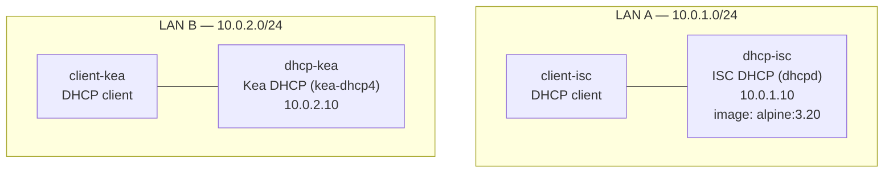

# Bài 35: Triển khai DHCP Server — ISC DHCP (cũ) vs Kea DHCP (mới)

**Arc 1 — Networking nền tảng nâng cao**

## Mục tiêu
- Triển khai DHCP server bằng **ISC DHCP** (`dhcpd`, config `dhcpd.conf`) — daemon kinh điển, vẫn chạy phổ biến trong hạ tầng legacy dù ISC đã ngừng phát triển từ 12/2022.
- Triển khai DHCP server bằng **Kea DHCP** (`kea-dhcp4`, config JSON) — daemon kế nhiệm chính thức, được ISC khuyến nghị migrate sang.
- So sánh trực tiếp: cú pháp cấu hình, định dạng lưu lease, cách reload, khả năng mở rộng (API) giữa 2 daemon.

## Yêu cầu tiên quyết
Hoàn thành [07-dhcp-server-relay](../07-dhcp-server-relay/lab-guide.md) — nắm khái niệm DHCP pool, lease time, gateway/DNS option qua dnsmasq.

## Sơ đồ topology

- `dhcp-isc` dùng image riêng `alpine:3.20`: Alpine 3.22 (image chuẩn các bài khác dùng) đã gỡ gói `dhcp` (ISC DHCP EOL 12/2022 nên bị loại khỏi repo Alpine từ sau 3.20).
- `dhcp-kea` dùng chung image chuẩn `wbitt/network-multitool:3.22.2` — gói `kea` vẫn còn trong Alpine 3.22.
- 2 segment độc lập, không có router: bài này tập trung 100% vào khác biệt cấu hình 2 daemon, phần DHCP relay đã học ở bài 07/29.

Xem [`topology/dhcp-isc-kea.clab.yml`](./topology/dhcp-isc-kea.clab.yml).

## Đề bài / Yêu cầu

1. Hoàn thiện [`configs/dhcpd.conf`](./configs/dhcpd.conf) (ISC DHCP) **trước khi deploy**:
   - Subnet `10.0.1.0/24`, pool `10.0.1.100` – `10.0.1.200`.
   - `option routers` = `10.0.1.1`, `option domain-name-servers` = `8.8.8.8`.
2. Hoàn thiện [`configs/kea-dhcp4.conf`](./configs/kea-dhcp4.conf) (Kea, JSON) **trước khi deploy**:
   - Subnet `10.0.2.0/24`, pool `10.0.2.100` – `10.0.2.200`.
   - Option `routers` = `10.0.2.1`, `domain-name-servers` = `8.8.8.8`.
3. Deploy topology (`sudo clab deploy -t topology/dhcp-isc-kea.clab.yml`). File config đã hoàn thiện sẽ được mount và nạp tự động lúc container khởi động (xem `binds:`/`exec:` trong file topology) — không cần `docker cp` thủ công.
4. Verify phía ISC:
   - `docker exec client-isc udhcpc -i eth1 -n` → nhận IP trong dải `10.0.1.100–200`.
   - `docker exec client-isc ip route show` → default gateway đúng `10.0.1.1`.
   - `docker exec dhcp-isc cat /var/lib/dhcp/dhcpd.leases` → thấy lease vừa cấp.
5. Verify phía Kea:
   - `docker exec client-kea udhcpc -i eth1 -n` → nhận IP trong dải `10.0.2.100–200`.
   - `docker exec client-kea ip route show` → default gateway đúng `10.0.2.1`.
   - `docker exec dhcp-kea cat /var/lib/kea/kea-leases4.csv` → thấy lease vừa cấp (CSV — khác hẳn định dạng text của ISC).
6. Nếu cần sửa config sau khi đã deploy (không muốn destroy lại), áp dụng đúng cách reload của từng daemon — **không dùng `docker restart`** (mất veth của containerlab):
   - ISC không có cơ chế reload qua tín hiệu: `docker exec dhcp-isc pkill dhcpd` rồi chạy lại `docker exec dhcp-isc dhcpd -cf /etc/dhcp/dhcpd.conf -lf /var/lib/dhcp/dhcpd.leases eth1`.
   - Kea: sửa file rồi `docker exec dhcp-kea pkill kea-dhcp4`, chạy lại lệnh trong `exec:` của topology (hoặc dùng Kea Control Agent API — xem Bonus).
7. Viết bảng so sánh 2 daemon: cú pháp config (text block vs JSON) / định dạng lưu lease (text vs CSV) / cách reload / khả năng mở rộng qua API.

## Gợi ý
- ISC: khai interface phục vụ DHCP qua tham số dòng lệnh (`dhcpd ... eth1`, đã có sẵn trong `exec:`) — không cần khai interface trong `dhcpd.conf`.
- Kea: `subnet4` là **mảng**, mỗi subnet **bắt buộc có `"id"`** (số nguyên duy nhất, ví dụ `1`) — thiếu sẽ lỗi `missing parameter 'id'` và server không load được config. `pools` viết dạng chuỗi `"<start-ip> - <end-ip>"` (có khoảng trắng quanh dấu `-`), option khai bằng tên chuỗi (`"routers"`, `"domain-name-servers"`) chứ không phải số hiệu option như ISC/dnsmasq.
- Nếu `kea-dhcp4` không khởi động được (không thấy tiến trình `ps aux | grep kea-dhcp4`), xem log tại `/var/log/kea-dhcp4.log` trong container `dhcp-kea` — lỗi thường gặp nhất là JSON sai cú pháp (thiếu dấu phẩy, thừa dấu phẩy cuối mảng).
- Nếu `dhcpd` không khởi động, chạy tay `dhcpd -cf /etc/dhcp/dhcpd.conf -lf /var/lib/dhcp/dhcpd.leases eth1 -d` (thêm `-d`, foreground) để đọc lỗi cú pháp trực tiếp trên màn hình.

## Bonus — Kea Control Agent (REST API)
ISC DHCP chỉ có `omshell` (giao thức OMAPI cũ, hạn chế). Kea có hẳn REST API qua Control Agent:
1. Trên `dhcp-kea`: `apk add --no-cache kea-ctrl-agent`.
2. Tạo `/etc/kea/kea-ctrl-agent.conf` tối thiểu, lắng nghe `http-host: 127.0.0.1`, `http-port: 8000`.
3. Chạy nền: `nohup kea-ctrl-agent -c /etc/kea/kea-ctrl-agent.conf >/var/log/kea-ctrl-agent.log 2>&1 &`.
4. Query toàn bộ config đang chạy qua API:
   ```bash
   curl -s -X POST -H "Content-Type: application/json" \
     -d '{"command":"config-get","service":["dhcp4"]}' \
     http://127.0.0.1:8000
   ```

## Thảo luận và hỏi đáp
Bài tập này tự làm và tự xác minh kết quả. Nếu có thắc mắc hoặc cần trao đổi thêm, các bạn hãy đăng bài thảo luận trên group Facebook [Network Thực Chiến](https://www.facebook.com/profile.php?id=61591373979991).
## Bài tiếp theo
→ (sắp ra mắt)
