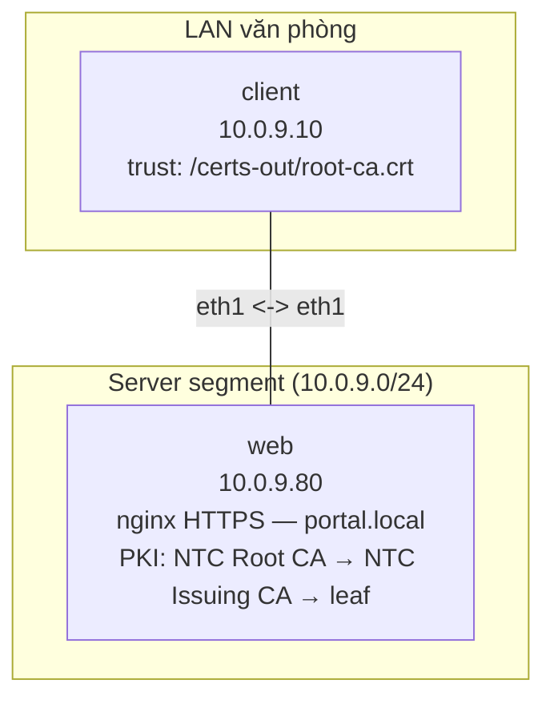

# Bài 36: Troubleshooting Chaos Lab — TLS/HTTPS

**Arc 5 — Troubleshooting chaos lab**

## Mục tiêu
- Rèn luyện quy trình debug TLS/HTTPS — loại sự cố mà thông báo lỗi phía trình duyệt gần như vô dụng, phải dùng công cụ dòng lệnh mới thấy nguyên nhân thật.
- Thành thạo bộ công cụ: `curl -v`, `openssl s_client -connect -servername -showcerts`, `openssl x509 -noout -dates -text`, `openssl verify`.
- Hiểu chuỗi trust PKI nội bộ: root CA → issuing CA (intermediate) → leaf cert, và vì sao server phải serve **fullchain** chứ không chỉ leaf.
- Không có bất kỳ gợi ý nào về lỗi — tự mình tìm kiếm và khắc phục.

## Yêu cầu tiên quyết
Hoàn thành [32-troubleshooting-chaos-webserver](../32-troubleshooting-chaos-webserver/lab-guide.md) (quy trình debug web phân tầng) và biết dùng nginx cơ bản.

## Tình huống

Cổng nội bộ `https://portal.local` của công ty NTC chạy nginx trên máy `web`, cert do PKI nội bộ cấp (mọi máy client đã được phát sẵn root CA `NTC Root CA`). Đồng nghiệp báo cáo:

> "Tuần trước team security 'siết chuẩn TLS' trên portal, rồi đúng đợt này cert tới kỳ gia hạn luôn. Giờ toàn bộ máy nội bộ không vào được https://portal.local nữa — mà hay lắm, mỗi lúc lại thấy báo một kiểu lỗi khác nhau, sửa được cái này lòi cái khác. Team security thề config chuẩn theo best practice, team hạ tầng thề 'quy trình gia hạn cert vẫn như mọi năm'. Anh xem giúp!"

Trên `web` có sẵn script gia hạn cert của team hạ tầng: `/usr/local/bin/renew-cert.sh` (ký leaf cert mới từ issuing CA nội bộ).

## Sơ đồ topology


Xem [`topology/chaos-tls.clab.yml`](./topology/chaos-tls.clab.yml). PKI được script [`configs/gen-certs.sh`](./configs/gen-certs.sh) dựng lúc deploy; root CA phát cho client qua bind mount `/certs-out/root-ca.crt`.

## Đề bài / Yêu cầu

1. Deploy topology (`sudo clab deploy -t chaos-tls.clab.yml`).
2. Xác nhận lỗi:
   - `docker exec client ping -c 2 10.0.9.80` — thông (L3 OK).
   - `docker exec client curl -m 5 --cacert /certs-out/root-ca.crt https://portal.local` — thất bại.
3. Tìm nguyên nhân gốc. **Không có bất kỳ gợi ý nào.** Quy trình loại trừ gợi mở:
   - Handshake có hoàn thành không? Chết ở tầng protocol hay tầng cert? (`curl -v`, `openssl s_client -connect 10.0.9.80:443 -servername portal.local`)
   - Server đang serve **những cert nào**? (`openssl s_client ... -showcerts`) Cert còn hạn không, chain có đủ không? (`openssl x509 -noout -dates -issuer -subject`, `openssl verify -CAfile ...`)
   - Lưu ý: có thể có **nhiều hơn một lỗi** — sửa xong một lỗi phải test lại từ đầu.
4. Sửa các lỗi tìm được ngay trong container (`sed` config, chạy script gia hạn, `nginx -s reload`). **Không dùng `docker restart`.**
5. Xác nhận sửa lỗi thành công:
   - `docker exec client curl -sI --cacert /certs-out/root-ca.crt https://portal.local` trả về `HTTP/1.1 200 OK` (không cần `-k`!).
   - `docker exec client curl -s --cacert /certs-out/root-ca.crt https://portal.local` hiển thị trang portal.
6. Ghi lại: từng lớp lỗi bóc ra theo thứ tự nào, bằng chứng ở mỗi bước (output curl/s_client/x509), nguyên nhân từng lỗi, config + cert sau khi sửa — và kết luận "lỗi của team nào" 😄.

## Lời giải tham khảo

<details>
<summary>⚠️ Bấm để xem lời giải — chỉ mở sau khi đã tự troubleshoot!</summary>

Bài này có **3 lỗi xếp lớp** — sửa xong lỗi này mới lộ lỗi tiếp theo. Cả team security lẫn team hạ tầng đều... có lỗi.

### Lỗi 1 (team security): chỉ cho phép TLSv1/TLSv1.1

- **Triệu chứng**: handshake fail ngay, chưa tới bước kiểm tra cert. `curl -v` báo dạng `error:0A000410:SSL routines::sslv3 alert handshake failure` (hoặc `tlsv1 alert protocol version` tùy client); `openssl s_client` không nhận được cert nào.
- **Chẩn đoán**: `grep ssl_protocols /etc/nginx/nginx.conf` trên `web` → `ssl_protocols TLSv1 TLSv1.1;`. OpenSSL 3.x phía client (và cả phía server) mặc định cấm TLS < 1.2 → hai bên không có protocol chung.
- **Nguyên nhân gốc**: "chuẩn TLS nội bộ" copy từ appliance đời cũ — siết nhầm hướng, giữ lại protocol cổ thay vì protocol hiện đại.
- **Cách sửa**:
  ```bash
  docker exec web sed -i 's/ssl_protocols TLSv1 TLSv1.1;/ssl_protocols TLSv1.2 TLSv1.3;/' /etc/nginx/nginx.conf
  docker exec web nginx -s reload
  ```

### Lỗi 2 (team hạ tầng): cert đã hết hạn

- **Triệu chứng**: sau khi sửa protocol, curl báo `SSL certificate problem: certificate has expired`.
- **Chẩn đoán**: trên `web`: `openssl x509 -in /etc/nginx/certs/server.crt -noout -dates` → `notAfter` nằm trong quá khứ (hết hạn 01/2025). Cert tới kỳ gia hạn nhưng chưa ai chạy quy trình.
- **Cách sửa**: chạy script gia hạn của team hạ tầng rồi reload:
  ```bash
  docker exec web sh /usr/local/bin/renew-cert.sh
  docker exec web nginx -s reload
  ```

### Lỗi 3 (team hạ tầng): server chỉ serve leaf — thiếu intermediate chain

- **Triệu chứng**: cert mới còn hạn hẳn hoi nhưng curl vẫn fail: `unable to get local issuer certificate`.
- **Chẩn đoán**: `openssl s_client -connect 10.0.9.80:443 -servername portal.local -showcerts` → server chỉ gửi **1 cert** (leaf, issuer = `NTC Issuing CA`). Client chỉ trust `NTC Root CA` → không tự nối được leaf → issuing CA → root. Xác nhận: trên `web`, `openssl verify -CAfile /etc/nginx/certs/root-ca.crt /etc/nginx/certs/server.crt` cũng fail, nhưng thêm `-untrusted issuing-ca.crt` thì OK.
- **Nguyên nhân gốc**: `ssl_certificate` trỏ vào leaf đơn lẻ — nginx cần file **fullchain** (leaf + intermediate) để gửi đủ chain cho client.
- **Cách sửa**:
  ```bash
  docker exec web sh -c 'cat /etc/nginx/certs/server.crt /etc/nginx/certs/issuing-ca.crt > /etc/nginx/certs/fullchain.pem'
  docker exec web sed -i 's|ssl_certificate     /etc/nginx/certs/server.crt;|ssl_certificate     /etc/nginx/certs/fullchain.pem;|' /etc/nginx/nginx.conf
  docker exec web nginx -s reload
  ```

Kiểm tra cuối:
```bash
docker exec client curl -sI --cacert /certs-out/root-ca.crt https://portal.local   # HTTP/1.1 200 OK
```

**Bài học**: debug TLS luôn tách 2 tầng — (1) protocol/cipher negotiation, (2) chain of trust + validity. `openssl s_client -showcerts` là bạn thân: nhìn thấy chính xác server gửi gì thay vì đoán qua thông báo lỗi của trình duyệt.
</details>

## Thảo luận và hỏi đáp
Bài tập này tự làm và tự xác minh kết quả. Nếu có thắc mắc hoặc cần trao đổi thêm, các bạn hãy đăng bài thảo luận trên group Facebook [Network Thực Chiến](https://www.facebook.com/profile.php?id=61591373979991).
## Bài tiếp theo
→ 37-troubleshooting-chaos-ldap (Sắp ra mắt)
