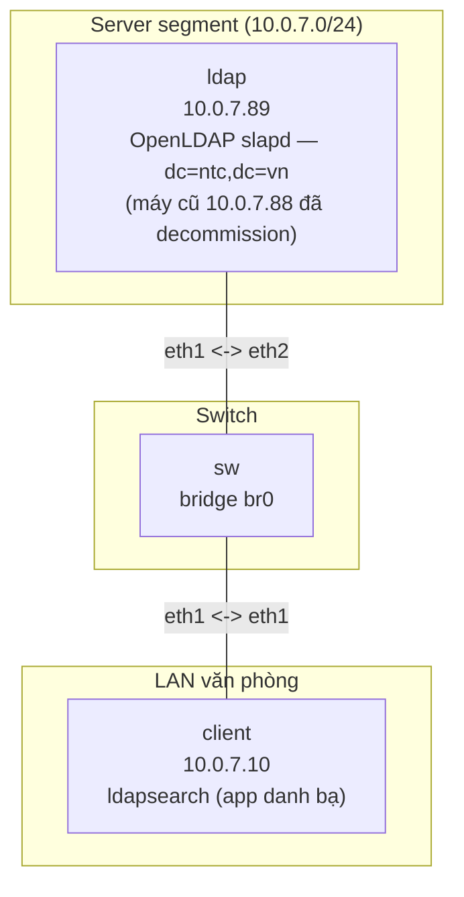

# Bài 37: Troubleshooting Chaos Lab — OpenLDAP

**Arc 5 — Troubleshooting chaos lab**

## Mục tiêu
- Làm quen dịch vụ thư mục LDAP (OpenLDAP/slapd) — xương sống của xác thực tập trung trong doanh nghiệp — qua góc nhìn troubleshooting.
- Thành thạo bộ công cụ: `ldapsearch`, `ldapwhoami`, `ss -tlnp`, đọc `slapd.conf` (listener, suffix, rootdn, ACL).
- Phân biệt 3 tầng lỗi rất hay lẫn nhau ở LDAP: **client config** (URI trỏ đâu) / **listener** (slapd nghe ở đâu) / **ACL** (bind được nhưng không đọc được).
- Không có bất kỳ gợi ý nào về lỗi — tự mình tìm kiếm và khắc phục.

## Yêu cầu tiên quyết
Hoàn thành [32-troubleshooting-chaos-webserver](../32-troubleshooting-chaos-webserver/lab-guide.md) (quy trình loại trừ phân tầng service binding).

## Tình huống

Danh bạ nhân sự nội bộ NTC lưu trong OpenLDAP (`dc=ntc,dc=vn`) trên máy `ldap` (10.0.7.89 — server mới, thay cho máy cũ 10.0.7.88 vừa decommission). Các app nội bộ tra cứu danh bạ bằng **anonymous search**. Đồng nghiệp báo cáo:

> "Sau đợt cuối tuần team hạ tầng migrate LDAP sang server mới + team security 'chuẩn hóa ACL', app danh bạ chết cứng. Tôi ssh vào server thấy process `slapd` vẫn chạy bình thường, data còn nguyên (`slapcat` ra đủ user). Trên máy client thì `ldapsearch` lúc báo không kết nối được, lúc lại kết nối được mà chẳng trả về user nào — loạn hết cả. Hai team đổ lỗi nhau từ sáng, anh phân xử giúp!"

Tài khoản quản trị (chỉ để chẩn đoán): `cn=admin,dc=ntc,dc=vn` / `ntc123`.

## Sơ đồ topology


Xem [`topology/chaos-ldap.clab.yml`](./topology/chaos-ldap.clab.yml).

## Đề bài / Yêu cầu

1. Deploy topology (`sudo clab deploy -t chaos-ldap.clab.yml`).
2. Xác nhận lỗi:
   - `docker exec client ping -c 2 10.0.7.89` — thông (L3 OK).
   - `docker exec client ldapsearch -x -LLL "(uid=*)" cn mail` — thất bại (đây là đúng câu query app danh bạ đang chạy).
3. Tìm nguyên nhân gốc. **Không có bất kỳ gợi ý nào.** Quy trình loại trừ gợi mở:
   - Client đang kết nối tới **đâu**? (`ldapsearch -x -d 1` in ra URI thật; đối chiếu `/etc/openldap/ldap.conf`)
   - Trên `ldap`: slapd đang **nghe ở đâu**? (`ss -tlnp`; so với `ps aux | grep slapd` và `cat /run/openldap/slapd.args`) Socket unix `ldapsearch -H ldapi:///` tại chỗ có chạy không?
   - Khi kết nối được rồi: anonymous bind có thành công không (`ldapwhoami -x`)? Search anonymous và search bằng `-D "cn=admin,dc=ntc,dc=vn" -w ntc123` khác nhau thế nào? → đọc kỹ phần `access to` trong `slapd.conf`.
   - Lưu ý: có **nhiều hơn một lỗi**, nằm ở cả client lẫn server — sửa xong một lỗi phải test lại từ đầu.
4. Sửa các lỗi tìm được ngay trong container. slapd **không có lệnh reload config** — quy trình đúng là: sửa file → `pkill slapd` → chạy lại `sh /etc/openldap/start-slapd.sh` (restart *tiến trình trong container* thì được phép — **không dùng `docker restart`**).
5. Xác nhận sửa lỗi thành công:
   - `docker exec client ldapsearch -x -LLL "(uid=*)" cn mail` trả về đủ **3 user** (an.nguyen, binh.tran, chi.le) — anonymous, không cần `-D/-w`, không cần `-H`.
6. Ghi lại: thứ tự loại trừ client → mạng → listener → ACL, bằng chứng ở mỗi bước, nguyên nhân từng lỗi — và kết luận "lỗi của team nào" 😄.

## Lời giải tham khảo

<details>
<summary>⚠️ Bấm để xem lời giải — chỉ mở sau khi đã tự troubleshoot!</summary>

Bài này có **3 lỗi độc lập** ở 3 tầng khác nhau: client config, listener, ACL — team hạ tầng dính 2, team security dính 1.

### Lỗi 1 (team hạ tầng): client vẫn trỏ server cũ 10.0.7.88

- **Triệu chứng**: `ldapsearch -x` báo `Can't contact LDAP server (-1)`.
- **Chẩn đoán**: `ldapsearch -x -d 1` cho thấy client connect tới `10.0.7.88` — `/etc/openldap/ldap.conf` có `URI ldap://10.0.7.88` (IP máy cũ đã decommission). Thử `-H ldap://10.0.7.89` — vẫn lỗi, nhưng đó là lỗi khác (xem lỗi 2): bằng chứng cần sửa cả 2 đầu.
- **Cách sửa**:
  ```bash
  docker exec client sed -i 's|URI  ldap://10.0.7.88|URI  ldap://10.0.7.89|' /etc/openldap/ldap.conf
  ```

### Lỗi 2 (team hạ tầng): slapd chỉ nghe socket unix `ldapi:///` — không mở TCP 389

- **Triệu chứng**: kết nối tới đúng IP `.89` vẫn `Can't contact LDAP server`. Trên `ldap`: `ss -tlnp` **không có** port 389 nào (khác kiểu bind 127.0.0.1 — ở đây TCP không mở ở đâu cả), nhưng `ps` thấy slapd chạy và `ldapsearch -H ldapi:/// -x -s base -b ""` tại chỗ vẫn trả lời — daemon sống, chỉ là không nghe mạng.
- **Chẩn đoán**: `cat /run/openldap/slapd.args` (hoặc script `/etc/openldap/start-slapd.sh`) → `-h "ldapi:///"`. Biến `SLAPD_SERVICES` bê nguyên từ máy cũ, hồi đó app chạy chung host nên chỉ cần socket local.
- **Cách sửa**:
  ```bash
  docker exec ldap sed -i 's|SLAPD_SERVICES="ldapi:///"|SLAPD_SERVICES="ldap:/// ldapi:///"|' /etc/openldap/start-slapd.sh
  docker exec ldap pkill slapd
  docker exec ldap sh /etc/openldap/start-slapd.sh
  ```

### Lỗi 3 (team security): ACL chặn anonymous read

- **Triệu chứng**: giờ kết nối được, `ldapwhoami -x` trả `anonymous` (bind OK!), nhưng search anonymous trả về rỗng / `No such object (32)`. Search bằng `-D "cn=admin,dc=ntc,dc=vn" -w ntc123` thì ra đủ 3 user → data nguyên vẹn, vấn đề là **quyền đọc**.
- **Chẩn đoán**: `slapd.conf` có ACL tổng `access to * by self write by users read by * none` — `by users read` chỉ cấp cho user **đã authenticated**; anonymous rơi vào `by * none`. Đợt "chuẩn hóa ACL" quên mất app danh bạ dùng anonymous search.
- **Cách sửa**:
  ```bash
  docker exec ldap sed -i 's/    by \* none/    by * read/' /etc/openldap/slapd.conf
  docker exec ldap pkill slapd
  docker exec ldap sh /etc/openldap/start-slapd.sh
  ```

Kiểm tra cuối:
```bash
docker exec client ldapsearch -x -LLL "(uid=*)" cn mail   # đủ 3 user, không cần bind
```

**Bài học**: LDAP lỗi luôn hỏi theo thứ tự — (1) client trỏ đâu, (2) server nghe đâu, (3) bind với danh tính gì, (4) danh tính đó được ACL cho làm gì. `ldapwhoami -x` rẻ mà trả lời ngay câu 3; đừng vội đổ cho network khi thực ra là ACL.
</details>

## Thảo luận và hỏi đáp
Bài tập này tự làm và tự xác minh kết quả. Nếu có thắc mắc hoặc cần trao đổi thêm, các bạn hãy đăng bài thảo luận trên group Facebook [Network Thực Chiến](https://www.facebook.com/profile.php?id=61591373979991).
## Bài tiếp theo
→ 38-troubleshooting-chaos-dns-2 (Sắp ra mắt)
