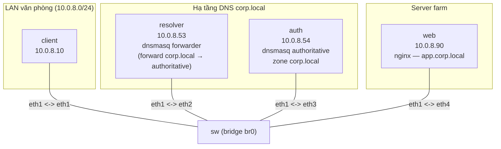

# Bài 38: Troubleshooting Chaos Lab — DNS 2 tầng (forwarder → authoritative)

**Arc 5 — Troubleshooting chaos lab**

## Mục tiêu
- Debug hạ tầng DNS **nhiều tầng** như doanh nghiệp thật: client → resolver văn phòng (forwarder) → DNS authoritative — lỗi có thể nằm ở bất kỳ hop nào, phải "lần theo chain".
- Thành thạo kỹ thuật cô lập từng hop: `dig @<ip cụ thể>` để bỏ qua tầng nghi ngờ, đọc query log dnsmasq, `tcpdump udp port 53` xem query thật sự đi đâu.
- Phân biệt các "mùi" lỗi DNS khác nhau: timeout (không ai trả lời) / SERVFAIL (resolver bó tay) / NXDOMAIN (nguồn tin nói không có tên này).
- Không có bất kỳ gợi ý nào về lỗi — tự mình tìm kiếm và khắc phục.

## Yêu cầu tiên quyết
Hoàn thành [30-troubleshooting-chaos-dns](../30-troubleshooting-chaos-dns/lab-guide.md) — bài này là bản nâng cấp nhiều tầng, lỗi hoàn toàn khác.

## Tình huống

Hệ thống DNS nội bộ NTC gồm 2 tầng: resolver văn phòng `10.0.8.53` (forward zone `corp.local` về server team) và DNS authoritative `10.0.8.54` (giữ records `corp.local`). App chạy trên `web` `10.0.8.90`. Đồng nghiệp báo cáo:

> "Sau đợt bảo trì cuối tuần (server team đổi IP vài máy + release app mới), máy văn phòng không phân giải được tên nội bộ nữa. Mà kỳ lắm: máy tôi thì **mọi tên** đều timeout; anh bên QA thử kiểu khác lại bảo `erp.corp.local` sống mà `app.corp.local` chết. Server team khẳng định 'DNS authoritative vẫn chạy, records vừa cập nhật theo release'. Ba bên ba triệu chứng, anh lần giúp!"

## Sơ đồ topology


Xem [`topology/chaos-dns2.clab.yml`](./topology/chaos-dns2.clab.yml).

## Đề bài / Yêu cầu

1. Deploy topology (`sudo clab deploy -t chaos-dns2.clab.yml`).
2. Xác nhận lỗi:
   - `docker exec client ping -c 2 10.0.8.90` — thông (L3 OK, IP trực tiếp).
   - `docker exec client curl -m 5 http://app.corp.local` — thất bại (không phân giải được).
3. Tìm nguyên nhân gốc. **Không có bất kỳ gợi ý nào.** Quy trình "lần theo chain" gợi mở:
   - Client đang hỏi **DNS nào**? (`cat /etc/resolv.conf`) Hỏi thẳng từng tầng thì sao: `dig @10.0.8.53 app.corp.local` vs `dig @10.0.8.54 app.corp.local`?
   - Trên `resolver`: query có tới không, và resolver forward đi **đâu**? (`cat /var/log/dnsmasq.log`, `tcpdump -ni eth1 udp port 53`)
   - Trên `auth`: record trong config có **đúng như team server nghĩ** không? So sánh status trả về: timeout / SERVFAIL / NXDOMAIN — mỗi loại chỉ về một hop khác nhau.
   - Lưu ý: có **nhiều hơn một lỗi**, rải trên nhiều hop — sửa xong một lỗi phải test lại từ đầu.
4. Sửa các lỗi tìm được ngay trong container. Lưu ý vận hành: dnsmasq **không đọc lại config khi SIGHUP** — quy trình đúng: sửa file → `pkill dnsmasq` → `dnsmasq --conf-file=/etc/dnsmasq.conf` (restart tiến trình trong container thì được phép — **không dùng `docker restart`**).
5. Xác nhận sửa lỗi thành công:
   - `docker exec client dig +short app.corp.local` → `10.0.8.90`.
   - `docker exec client dig +short erp.corp.local` → `10.0.8.90`.
   - `docker exec client curl -s http://app.corp.local` hiển thị trang app.
6. Ghi lại: chain phân giải đầy đủ (client → resolver → auth), lỗi ở hop nào phát hiện bằng bằng chứng gì (resolv.conf / log / tcpdump / dig status), nguyên nhân từng lỗi.

## Lời giải tham khảo

<details>
<summary>⚠️ Bấm để xem lời giải — chỉ mở sau khi đã tự troubleshoot!</summary>

Bài này có **3 lỗi độc lập, mỗi hop một lỗi** — đúng kiểu "sau bảo trì cuối tuần, mỗi team gãy một chỗ".

### Lỗi 1 (hop client): resolv.conf trỏ IP không tồn tại

- **Triệu chứng**: trên client mọi tên đều **timeout** (`dig` báo `;; communications error ... timed out` / `no servers could be reached`).
- **Chẩn đoán**: `cat /etc/resolv.conf` → `nameserver 10.0.8.55` — không máy nào giữ IP này (resolver thật là `.53`). Bằng chứng chốt: `dig @10.0.8.53 erp.corp.local` chạy được ngay.
- **Nguyên nhân gốc**: máy client cấu hình DNS tĩnh bằng tay từ đợt trước, resolver đã chuyển IP.
- **Cách sửa**:
  ```bash
  docker exec client sh -c 'echo "nameserver 10.0.8.53" > /etc/resolv.conf'
  ```

### Lỗi 2 (hop resolver): forward zone về nhầm IP upstream

- **Triệu chứng**: sau lỗi 1, query qua resolver vẫn **timeout/SERVFAIL**, nhưng hỏi thẳng authoritative `dig @10.0.8.54 erp.corp.local` lại ra kết quả → kẹt ở đoạn resolver → auth.
- **Chẩn đoán**: trên `resolver`, `cat /var/log/dnsmasq.log` thấy `forwarded app.corp.local to 10.0.8.64`; `tcpdump -ni eth1 udp port 53` thấy query bắn về `.64` và không có trả lời. Config: `server=/corp.local/10.0.8.64` — gõ nhầm `.64` thay vì `.54`.
- **Cách sửa**:
  ```bash
  docker exec resolver sed -i 's|server=/corp.local/10.0.8.64|server=/corp.local/10.0.8.54|' /etc/dnsmasq.conf
  docker exec resolver pkill dnsmasq
  docker exec resolver dnsmasq --conf-file=/etc/dnsmasq.conf
  ```

### Lỗi 3 (hop authoritative): record gõ thiếu dấu chấm domain

- **Triệu chứng**: giờ `erp.corp.local` phân giải ngon, riêng `app.corp.local` trả **NXDOMAIN** — chính nguồn tin nói "không có tên này". Partial failure = lỗi data, không phải lỗi đường truyền.
- **Chẩn đoán**: trên `auth`, `grep app /etc/dnsmasq.conf` → `address=/app.corplocal/10.0.8.90` — thiếu dấu chấm (`corplocal` thay vì `corp.local`). Record "cập nhật theo release" bị gõ tay sai; vì `local=/corp.local/`, tên không khớp record trả NXDOMAIN thẳng tại authoritative.
- **Cách sửa**:
  ```bash
  docker exec auth sed -i 's|address=/app.corplocal/10.0.8.90|address=/app.corp.local/10.0.8.90|' /etc/dnsmasq.conf
  docker exec auth pkill dnsmasq
  docker exec auth dnsmasq --conf-file=/etc/dnsmasq.conf
  ```

Kiểm tra cuối:
```bash
docker exec client dig +short app.corp.local    # 10.0.8.90
docker exec client curl -s http://app.corp.local # <h1>app.corp.local OK</h1>
```

**Bài học**: DNS nhiều tầng debug bằng cách **hỏi thẳng từng hop bằng `dig @ip`** — mỗi status (timeout / SERVFAIL / NXDOMAIN) chỉ đích danh một đoạn chain. Timeout = không ai nghe ở đó; SERVFAIL = resolver không với được upstream; NXDOMAIN từ authoritative = lỗi record, khỏi nghi network.
</details>

## Thảo luận và hỏi đáp
Bài tập này tự làm và tự xác minh kết quả. Nếu có thắc mắc hoặc cần trao đổi thêm, các bạn hãy đăng bài thảo luận trên group Facebook [Network Thực Chiến](https://www.facebook.com/profile.php?id=61591373979991).
## Bài tiếp theo
→ 39-troubleshooting-chaos-ntp-2 (Sắp ra mắt)
