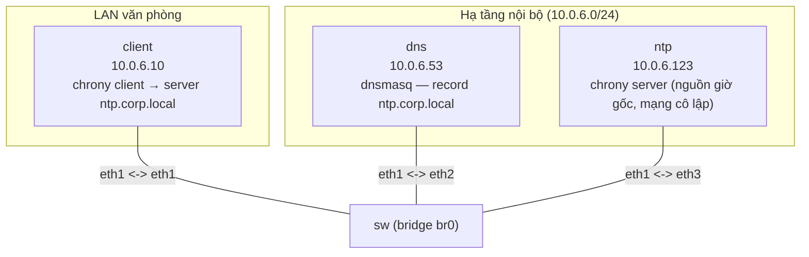

# Bài 39: Troubleshooting Chaos Lab — NTP × DNS (cross-service)

**Arc 5 — Troubleshooting chaos lab**

## Mục tiêu
- Debug sự cố **liên dịch vụ**: NTP server khai báo bằng **hostname** → muốn kết luận được phải chứng minh từng dịch vụ trong chuỗi (DNS rồi mới NTP) vô tội hay có tội, bằng bằng chứng.
- Hiểu sâu cơ chế chọn nguồn của chrony: server "trả lời" khác với server "đáng tin" — stratum 16/unsynchronised bị client từ chối dù gói tin về đầy đủ.
- Thành thạo bộ công cụ: `chronyc sources -v`, `chronyc tracking`, `chronyc ntpdata`, `dig`, `tcpdump udp port 123`.
- Không có bất kỳ gợi ý nào về lỗi — tự mình tìm kiếm và khắc phục.

## Yêu cầu tiên quyết
Hoàn thành [31-troubleshooting-chaos-ntp](../31-troubleshooting-chaos-ntp/lab-guide.md) và [28-ntp-time-sync](../28-ntp-time-sync/lab-guide.md) — bài này lỗi hoàn toàn khác bài 31.

## Tình huống

NTC chuẩn hóa: mọi máy trạm đồng bộ giờ từ `ntp.corp.local` (tên DNS, không hard-code IP — record nằm trên DNS nội bộ `10.0.6.53`, trỏ về NTP server `10.0.6.123`). Mạng server **cô lập, không có upstream internet** — NTP server là nguồn giờ gốc của cả công ty. Đồng nghiệp báo cáo:

> "Từ đợt push config chrony mới xuống máy trạm, không máy nào đồng bộ được giờ nữa — `chronyc tracking` cứ báo 'Not synchronised'. Tôi nghi DNS lắm, vì mình vừa khai NTP bằng hostname thay vì IP — kiểu gì chả do DNS! Team hệ thống thì cãi 'NTP server vẫn chạy, tôi tcpdump thấy nó vẫn trả lời gói NTP mà'. Ai đúng ai sai, anh phân xử bằng bằng chứng giúp!"

## Sơ đồ topology


Xem [`topology/chaos-ntp2.clab.yml`](./topology/chaos-ntp2.clab.yml).

## Đề bài / Yêu cầu

1. Deploy topology (`sudo clab deploy -t chaos-ntp2.clab.yml`). Chờ ~1 phút cho chrony chạy vài chu kỳ poll.
2. Xác nhận lỗi:
   - `docker exec client chronyc tracking` — `Reference ID ... ()`, `Stratum: 0` / `Not synchronised`.
   - `docker exec client chronyc sources` — không có dòng nào bắt đầu bằng `^*` (không nguồn nào được chọn).
3. Tìm nguyên nhân gốc. **Không có bất kỳ gợi ý nào.** Quy trình gợi mở — trả lời lần lượt bằng bằng chứng:
   - Client đang cố nói chuyện với **tên/IP nào**? (`chronyc sources -v` — đọc kỹ từng cột; tên trong config có resolve ra IP không?)
   - DNS có tội không? (`dig ntp.corp.local` từ client — hoạt động hay không?)
   - NTP server có tội không? Nó có trả lời không (`tcpdump -ni eth1 udp port 123` trên `ntp`), và trả lời với **chất lượng nào** (`chronyc ntpdata` trên client sau khi client đã hỏi được; `chronyc tracking` ngay trên `ntp`)?
   - Lưu ý: có **nhiều hơn một lỗi**, và "đồng nghiệp nghi DNS" chưa chắc đúng — sửa xong một lỗi phải test lại từ đầu.
4. Sửa các lỗi tìm được ngay trong container (sửa config → `pkill chronyd` → `chronyd -x`; hoặc dùng lệnh `chronyc` live rồi persist vào config — **không dùng `docker restart`**).
5. Xác nhận sửa lỗi thành công:
   - `docker exec client chronyc sources` có dòng `^*` cho `ntp.corp.local`.
   - `docker exec client chronyc tracking` → `Stratum: 9`, `Leap status: Normal`.
6. Ghi lại: bảng "nghi phạm → bằng chứng → kết luận" cho từng dịch vụ (DNS / NTP server / client config), nguyên nhân từng lỗi — và trả lời câu "ai đúng ai sai" trong tình huống 😄.

## Lời giải tham khảo

<details>
<summary>⚠️ Bấm để xem lời giải — chỉ mở sau khi đã tự troubleshoot!</summary>

Bài này có **2 lỗi** — và DNS (nghi phạm số 1 của đồng nghiệp) hoàn toàn **vô tội**. Cả 2 team đều sai một nửa: config push xuống client có typo, còn NTP server "vẫn trả lời" nhưng trả lời rác.

### Lỗi 1 (client): typo hostname trong config chrony

- **Triệu chứng**: `chronyc sources -v` trên client cho thấy nguồn `ntp.corp.locl` ở trạng thái **unresolved** (không có IP, không poll được).
- **Chẩn đoán**: `grep server /etc/chrony/chrony.conf` → `server ntp.corp.locl iburst` — thiếu chữ `a` (`locl`). Chứng minh DNS vô tội: `dig +short ntp.corp.local` từ client trả `10.0.6.123` ngay — DNS sống, record đúng; tên **trong config** mới sai.
- **Cách sửa**:
  ```bash
  docker exec client sed -i 's/server ntp.corp.locl iburst/server ntp.corp.local iburst/' /etc/chrony/chrony.conf
  docker exec client pkill chronyd
  docker exec client chronyd -x
  ```

### Lỗi 2 (server): thiếu `local stratum` — server trả lời nhưng "không đáng tin"

- **Triệu chứng**: sau lỗi 1, client thấy nguồn, gói tin đi–về bình thường (`tcpdump -ni eth1 udp port 123` trên `ntp` thấy cả request lẫn reply — đúng như team hệ thống nói!), nhưng `chronyc sources` mãi không có `^*`, chỉ `^?`. `chronyc ntpdata` trên client: nguồn báo **Stratum: 16**, Leap status: `Not synchronised`.
- **Chẩn đoán**: `chronyc tracking` ngay trên `ntp` → chính server cũng `Not synchronised`. Mạng cô lập, không có `server`/`pool` upstream nào, và config **thiếu `local stratum`** — chrony không được phép tự nhận là nguồn giờ gốc, nên trả lời với stratum 16 (= vô giá trị). Client làm đúng chuẩn NTP: từ chối nguồn stratum 16. "Server vẫn trả lời" ≠ "server dùng được".
- **Cách sửa** (live + persist):
  ```bash
  docker exec ntp sh -c 'echo "local stratum 8" >> /etc/chrony/chrony.conf'
  docker exec ntp pkill chronyd
  docker exec ntp chronyd -x
  ```
  (Cách live không restart: `docker exec ntp chronyc local stratum 8` — nhưng vẫn phải persist vào config.)

Kiểm tra cuối (chờ vài chu kỳ poll, có thể ép `chronyc burst 4/4` hoặc `chronyc makestep`):
```bash
docker exec client chronyc sources    # ^* ntp.corp.local
docker exec client chronyc tracking   # Stratum: 9, Leap status: Normal
```

**Bài học**: sự cố liên dịch vụ phải xử như vụ án — mỗi nghi phạm một bằng chứng riêng: `dig` minh oan cho DNS; `tcpdump` xác nhận server có trả lời; nhưng chỉ `chronyc ntpdata` mới lộ **chất lượng** câu trả lời (stratum 16). Cảm giác "kiểu gì chả do DNS" không phải bằng chứng.
</details>

## Thảo luận và hỏi đáp
Bài tập này tự làm và tự xác minh kết quả. Nếu có thắc mắc hoặc cần trao đổi thêm, các bạn hãy đăng bài thảo luận trên group Facebook [Network Thực Chiến](https://www.facebook.com/profile.php?id=61591373979991).
## Bài tiếp theo
→ 40-troubleshooting-chaos-nginx-2 (Sắp ra mắt)
