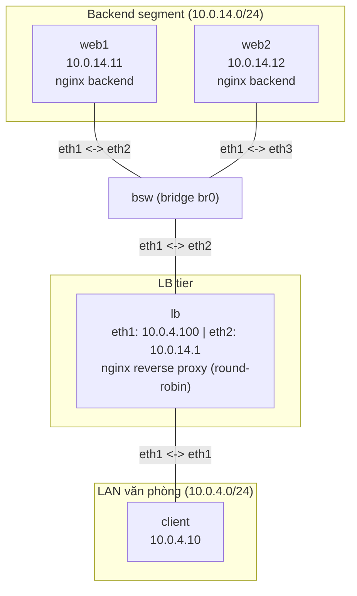

# Bài 40: Troubleshooting Chaos Lab — nginx Reverse Proxy / Load Balancer

**Arc 5 — Troubleshooting chaos lab**

## Mục tiêu
- Debug loại sự cố khó chịu nhất: lỗi **chập chờn** — lúc được lúc không, mỗi lần F5 một kết quả — do load balancer round-robin che giấu việc mỗi backend hỏng một kiểu khác nhau.
- Nắm quy trình debug reverse proxy: tách "lỗi ở proxy" khỏi "lỗi ở backend" bằng cách **curl thẳng từng backend từ chính LB**, đọc `access.log`/`error.log`, dùng `nginx -T` dump config đang chạy.
- Phân biệt mã lỗi HTTP theo tầng: `502 Bad Gateway` (proxy không với được backend) vs `404 Not Found` (backend trả lời nhưng nội dung hỏng).
- Không có bất kỳ gợi ý nào về lỗi — tự mình tìm kiếm và khắc phục.

## Yêu cầu tiên quyết
Hoàn thành [32-troubleshooting-chaos-webserver](../32-troubleshooting-chaos-webserver/lab-guide.md) — bài này là bản nâng cấp kiến trúc reverse proxy, lỗi hoàn toàn khác.

## Tình huống

Portal NTC giờ chạy sau load balancer: `lb` (nginx reverse proxy, `10.0.4.100`) chia tải round-robin xuống 2 backend `web1`/`web2` (`10.0.14.11`/`.12`). Đồng nghiệp báo cáo kèm ticket:

> "Ticket helpdesk ghi 'mạng chập chờn': portal lúc vào được lúc không, F5 vài phát lại được, phát nữa lại lỗi — mà lỗi cũng không giống nhau, lúc thì 'Bad Gateway' lúc thì 'Not Found'. Chuyện xảy ra từ sau khi team release chạy script deploy bản v2 lên 2 backend tối qua. Team mạng đã check: ping, cáp, switch sạch bong — chuyển ticket cho anh đấy. Mạng có thật sự 'chập chờn' không, hay là gì khác?"

## Sơ đồ topology


Xem [`topology/chaos-nginx2.clab.yml`](./topology/chaos-nginx2.clab.yml).

## Đề bài / Yêu cầu

1. Deploy topology (`sudo clab deploy -t chaos-nginx2.clab.yml`).
2. Xác nhận lỗi — vì lỗi chập chờn, phải test **nhiều lần liên tiếp**:
   ```bash
   docker exec client sh -c 'for i in $(seq 1 6); do curl -s -o /dev/null -w "%{http_code}\n" -m 5 http://10.0.4.100; done'
   ```
   Kết quả trộn lẫn `502` và `404` (thứ tự có thể không đều tăm tắp).
3. Tìm nguyên nhân gốc. **Không có bất kỳ gợi ý nào.** Quy trình gợi mở:
   - "Chập chờn" + qua LB round-robin → nghi ngờ: **mỗi backend một bệnh riêng**. Cô lập từng backend: từ `lb`, `curl -s -o /dev/null -w "%{http_code}\n" http://10.0.14.11` và `http://10.0.14.12` — mỗi con trả gì?
   - Trên `lb`: `tail /var/log/nginx/error.log` — 502 sinh ra từ đâu? `nginx -T | grep -A3 upstream` — LB đang được cấu hình trỏ tới đâu, có khớp thực tế backend đang nghe (`ss -tlnp` trên từng backend) không?
   - Trên backend lỗi 404: request **có tới** (`access.log`) mà sao không có nội dung? Config `root` trỏ đi đâu, thư mục đó có tồn tại không?
   - Lưu ý: có **nhiều hơn một lỗi** — sửa xong một lỗi, chạy lại vòng curl 6 lần ở bước 2 để xem "bệnh" còn lại.
4. Sửa các lỗi tìm được ngay trong container (`sed` config + `nginx -s reload`). **Không dùng `docker restart`.**
5. Xác nhận sửa lỗi thành công:
   ```bash
   docker exec client sh -c 'for i in $(seq 1 6); do curl -s -m 5 http://10.0.4.100; done'
   ```
   6/6 request trả `200`, nội dung xen kẽ `backend web1 OK` / `backend web2 OK` (chứng minh LB chia tải thật).
6. Ghi lại: bảng triệu chứng theo mã lỗi (502 → hop nào, 404 → hop nào), bằng chứng log ở mỗi bước, nguyên nhân từng lỗi — và trả lời ticket: mạng có "chập chờn" thật không? 😄

## Lời giải tham khảo

<details>
<summary>⚠️ Bấm để xem lời giải — chỉ mở sau khi đã tự troubleshoot!</summary>

Bài này có **2 lỗi độc lập, mỗi backend "chết" một kiểu** — round-robin trộn 2 bệnh thành một ticket "mạng chập chờn". Mạng hoàn toàn vô tội.

### Lỗi 1 (LB): upstream trỏ nhầm port 8080 trên web1

- **Triệu chứng**: một nửa số request trả `502 Bad Gateway`. Trên `lb`, `error.log`: `connect() failed (111: Connection refused) while connecting to upstream, ... upstream: "http://10.0.14.11:8080/..."`.
- **Chẩn đoán**: `nginx -T` trên `lb` → `upstream portal_backends { server 10.0.14.11:8080; ... }`, trong khi trên `web1` `ss -tlnp` cho thấy nginx nghe port **80**. Đợt deploy v2 đổi port backend về 80 nhưng LB chưa được cập nhật đồng bộ. Lưu ý: nginx có passive health-check (`max_fails`) nên sau vài lần fail có thể tạm loại web1 khỏi vòng quay — vì thế pattern lỗi không đều tăm tắp, càng giống "chập chờn".
- **Cách sửa**:
  ```bash
  docker exec lb sed -i 's/server 10.0.14.11:8080;/server 10.0.14.11:80;/' /etc/nginx/nginx.conf
  docker exec lb nginx -s reload
  ```

### Lỗi 2 (backend web2): `root` trỏ vào thư mục không tồn tại

- **Triệu chứng**: sau lỗi 1, vòng curl còn xen kẽ `200`/`404`. Cô lập: từ `lb`, `curl http://10.0.14.11` → 200, `curl http://10.0.14.12` → **404** — bệnh nằm chắc trên web2, không liên quan LB.
- **Chẩn đoán**: trên `web2`, `access.log` ghi nhận request (tức mạng + listener OK), config có `root /usr/share/nginx/html-v2;` — thư mục `html-v2` **không tồn tại** (`ls /usr/share/nginx/`). Script release v2 đổi `root` trong config cả 2 backend nhưng chỉ tạo thư mục thành công trên web1 (trên web1 config vẫn trỏ `html`).
- **Cách sửa**:
  ```bash
  docker exec web2 sed -i 's|root /usr/share/nginx/html-v2;|root /usr/share/nginx/html;|' /etc/nginx/nginx.conf
  docker exec web2 nginx -s reload
  ```

Kiểm tra cuối:
```bash
docker exec client sh -c 'for i in $(seq 1 6); do curl -s http://10.0.4.100; done'
# 6 dòng 200, xen kẽ: backend web1 OK / backend web2 OK
```

**Bài học**: gặp lỗi "chập chờn" sau load balancer, việc đầu tiên là **tách vòng quay**: curl thẳng từng backend từ chính LB. Mỗi mã lỗi chỉ một tầng: 502 = proxy không nối được backend (nhìn `error.log` của LB); 404 = backend sống nhưng nội dung/`root` hỏng (nhìn `access.log` + config của backend). "Chập chờn" hiếm khi là mạng — thường là nhiều node hỏng không đồng đều.
</details>

## Thảo luận và hỏi đáp
Bài tập này tự làm và tự xác minh kết quả. Nếu có thắc mắc hoặc cần trao đổi thêm, các bạn hãy đăng bài thảo luận trên group Facebook [Network Thực Chiến](https://www.facebook.com/profile.php?id=61591373979991).
## Bài tiếp theo
→ (Sắp ra mắt)
