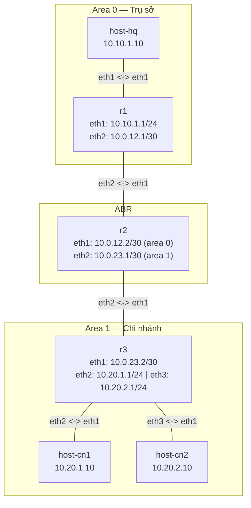

# Bài 41: Troubleshooting Chaos Lab — OSPF multi-area: adjacency & LSDB

**Arc 5 — Troubleshooting chaos lab**

## Mục tiêu
- Troubleshooting OSPF ở mức sâu hơn bài 18: **3 lỗi chồng nhau ở 3 lớp khác nhau** — lớp gói tin (adjacency không lên), lớp tham số vùng (Hello mismatch), lớp LSDB (route bị chặn ở ABR).
- Đọc được **trạng thái neighbor** như một máy trạng thái: `ExStart` khác `Init` khác "không có neighbor nào" — mỗi trạng thái chỉ ra một nhóm nguyên nhân riêng.
- Phân biệt "neighbor `Full` nhưng vẫn thiếu route" — lỗi nằm ở LSDB/summarization chứ không phải adjacency.
- Không có bất kỳ gợi ý nào về vị trí lỗi — tự truy vết.

## Yêu cầu tiên quyết
Hoàn thành [09-ospf-multi-area](../09-ospf-multi-area/lab-guide.md) và [18-troubleshooting-chaos-lab](../18-troubleshooting-chaos-lab/lab-guide.md) — nắm vững area, ABR, LSA type-1/2/3, cơ chế hình thành adjacency (Down → Init → 2-Way → ExStart → Exchange → Full).

## Tình huống

Mạng gồm trụ sở (area 0) và chi nhánh (area 1), `r2` là ABR nối 2 vùng. Đồng nghiệp trực đêm bàn giao ca:

> "Cuối tuần vừa rồi bên tôi làm 3 việc trong cùng một cửa sổ bảo trì: hạ MTU link WAN theo yêu cầu của bên truyền dẫn, áp template chuẩn hoá 'stub area cho mọi chi nhánh' của hãng, và bật summarization gom các LAN chi nhánh cho gọn bảng route. Sáng nay **trụ sở và chi nhánh mất kết nối hoàn toàn với nhau**. Tôi đã kiểm tra cáp, các cổng đều `UP`, ping được IP đầu xa của từng link. Nhìn config thì thấy... vẫn đúng như template hãng đưa. Anh vào xem hộ, tôi bó tay rồi."

## Sơ đồ topology


Toàn bộ mạng chạy OSPF, không có static route, không có redistribute. Xem [`topology/chaos-ospf-adj.clab.yml`](./topology/chaos-ospf-adj.clab.yml).

## Đề bài / Yêu cầu

1. Deploy topology:
   ```bash
   cd topology && sudo clab deploy -t chaos-ospf-adj.clab.yml
   ```
2. Xác nhận lỗi (chờ ~60 giây cho OSPF hội tụ):
   - `docker exec host-hq ping -c 3 10.20.1.10` — thất bại.
   - `docker exec host-cn1 ping -c 3 10.10.1.10` — thất bại.
3. Tìm nguyên nhân gốc. **Không có bất kỳ gợi ý nào về vị trí lỗi.** Chuỗi truy vết gợi mở:
   - `show ip ospf neighbor` trên cả 3 router — neighbor nào **không xuất hiện**, neighbor nào xuất hiện nhưng **kẹt ở trạng thái không phải `Full`**? Hai triệu chứng đó có nguyên nhân hoàn toàn khác nhau.
   - Với neighbor bị kẹt: `show ip ospf interface eth<N>` hai đầu link — so sánh **từng tham số** (MTU, hello/dead interval, area, network type, authentication). Xem thêm log: `docker exec <node> vtysh -c "show log"` hoặc `docker logs <node>`.
   - Với neighbor không xuất hiện: OSPF chỉ nhận Hello khi các cờ vùng khớp nhau — kiểm tra `show ip ospf` (kiểu area: normal/stub/nssa) ở hai đầu.
   - Khi adjacency đã `Full` hết mà route vẫn thiếu: so sánh `show ip ospf database summary` trên `r1` với `show ip route ospf` trên `r2`. Prefix có trong LSDB của ABR nhưng **không sinh ra LSA type-3** sang area 0 thì lỗi nằm ở ABR.
4. Sửa lỗi qua `vtysh` (hoặc lệnh `ip` cho lỗi thuộc lớp interface). **KHÔNG dùng `docker restart`** — mất toàn bộ veth, phải destroy + deploy lại.
5. Xác nhận đã sửa xong:
   - `docker exec r1 vtysh -c "show ip ospf neighbor"` và trên `r2`, `r3`: mọi neighbor đều `Full`.
   - `docker exec r1 vtysh -c "show ip route ospf"` — thấy đường tới các LAN chi nhánh.
   - `docker exec host-hq ping -c 3 10.20.1.10` và `docker exec host-hq ping -c 3 10.20.2.10` — thông.
   - `docker exec host-cn1 ping -c 3 10.10.1.10` — thông.
6. Ghi lại: trạng thái neighbor quan sát được ở từng bước, lệnh dùng để khoanh vùng, nguyên nhân từng lỗi và config sau khi sửa.

## Lời giải tham khảo

<details>
<summary>⚠️ Bấm để xem lời giải — chỉ mở sau khi đã tự troubleshoot!</summary>

### Lỗi 1: MTU mismatch trên link `r1`↔`r2` — adjacency kẹt `ExStart`
- **Triệu chứng**: `show ip ospf neighbor` trên `r1` thấy `2.2.2.2` ở trạng thái `ExStart`, trên `r2` thấy `1.1.1.1` ở `ExStart`/`Exchange` — không bao giờ lên `Full`. Ping IP đầu xa vẫn thông (nên "cáp và cổng đều tốt" là đúng, chỉ là không liên quan).
- **Chẩn đoán**: `show ip ospf interface eth2` trên `r1` cho MTU 1400, trên `r2` (`eth1`) là 1500. OSPF trao đổi MTU trong gói Database Description; router có MTU nhỏ hơn thấy peer khai MTU lớn hơn mình sẽ **loại bỏ gói DD** → không bao giờ qua được `ExStart`. Log: `Packet[DD]: Neighbor ... MTU 1500 is larger than [eth2]'s MTU 1400`. Đợt "hạ MTU theo yêu cầu truyền dẫn" chỉ làm một đầu link.
- **Cách sửa** (lỗi thuộc lớp interface, không phải config FRR):
  ```bash
  docker exec r1 ip link set eth2 mtu 1500
  docker exec r1 vtysh -c "clear ip ospf process"     # ép đàm phán lại ngay, khỏi chờ retransmit
  ```
  Nếu bắt buộc phải giữ MTU lệch (thiết bị truyền dẫn không cho tăng), giải pháp vá tạm là `ip ospf mtu-ignore` **ở cả hai đầu** — nhưng đó là che triệu chứng: gói lớn vẫn sẽ rớt ở data plane.

### Lỗi 2: `area 1` khai `stub` chỉ ở một phía — không có neighbor nào
- **Triệu chứng**: trên `r2` và `r3`, `show ip ospf neighbor` **trống rỗng** ở link `10.0.23.0/30` — khác hẳn lỗi 1 (kẹt trạng thái). Hai đầu vẫn ping được nhau.
- **Chẩn đoán**: `show ip ospf` trên `r2` cho `Area 1 ... (Stub)`, trên `r3` là area thường. Cờ E-bit trong gói Hello khác nhau → Hello bị loại ngay, adjacency không bao giờ bắt đầu. Template "stub area cho mọi chi nhánh" mới áp cho ABR mà chưa áp cho router nội vùng.
- **Cách sửa** — chọn 1 trong 2, miễn **hai đầu giống nhau**:
  ```bash
  # Cách A: trả area 1 về area thường (bỏ template)
  docker exec r2 vtysh -c "conf t" -c "router ospf" -c "no area 1 stub"

  # Cách B: giữ đúng template — khai stub cả ở router nội vùng
  docker exec r3 vtysh -c "conf t" -c "router ospf" -c "area 1 stub"
  ```
  Lời giải này dùng **cách A** cho các bước sau (mạng không có route external nên stub không mang lại lợi ích gì ở đây).

### Lỗi 3: `area 1 range ... not-advertise` trên ABR — `Full` hết nhưng area 0 vẫn không có route
- **Triệu chứng**: sau khi sửa lỗi 1 và 2, mọi neighbor đều `Full`, `r2` có đủ route chi nhánh (`show ip route ospf` thấy `10.20.1.0/24`, `10.20.2.0/24`), nhưng `r1` **không có route nào tới `10.20.x`** → host-hq vẫn ping fail. Chiều ngược lại: `host-cn1` gửi được gói sang trụ sở (r3 có LSA type-3 của `10.10.1.0/24`) nhưng **không có đường về** → vẫn fail.
- **Chẩn đoán**: `show run` trên `r2` có `area 1 range 10.20.0.0/22 not-advertise`. Lệnh summarization được gõ kèm cờ `not-advertise` — thay vì gom 2 LAN thành 1 tuyến, nó **chặn hẳn** không sinh LSA type-3 sang area 0. Kiểm chứng: `show ip ospf database summary` trên `r1` không có prefix `10.20.x` nào.
- **Cách sửa**:
  ```bash
  docker exec r2 vtysh -c "conf t" -c "router ospf" -c "area 1 range 10.20.0.0/22 advertise"
  # hoặc bỏ hẳn summarization, để quảng bá từng /24:
  # docker exec r2 vtysh -c "conf t" -c "router ospf" -c "no area 1 range 10.20.0.0/22"
  ```

**Xác nhận cuối:**
```bash
docker exec r1 vtysh -c "show ip ospf neighbor"   # 2.2.2.2 Full
docker exec r2 vtysh -c "show ip ospf neighbor"   # 1.1.1.1 Full và 3.3.3.3 Full
docker exec r1 vtysh -c "show ip route ospf"      # có 10.20.0.0/22 (hoặc 2 tuyến /24)
docker exec host-hq  ping -c 3 10.20.1.10         # OK
docker exec host-hq  ping -c 3 10.20.2.10         # OK
docker exec host-cn1 ping -c 3 10.10.1.10         # OK
```

Bài học thực chiến: **trạng thái neighbor là bản đồ chỉ đường**. Kẹt `ExStart`/`Exchange` = hai bên nói chuyện được nhưng không thống nhất được database → gần như luôn là MTU. Không thấy neighbor = Hello bị loại → area/kiểu area, hello/dead timer, authentication, subnet mask. `Full` mà vẫn thiếu route = lỗi ở LSDB/policy (summarization, filter), không phải adjacency. Và cờ `not-advertise` là bẫy kinh điển: cùng một lệnh `area range`, thêm một từ là từ "gom tuyến" thành "chặn tuyến". Ping được IP đầu xa **không chứng minh** OSPF sẽ chạy.

</details>

## Thảo luận và hỏi đáp
Bài tập này tự làm và tự xác minh kết quả. Nếu có thắc mắc hoặc cần trao đổi thêm, các bạn hãy đăng bài thảo luận trên group Facebook [Network Thực Chiến](https://www.facebook.com/profile.php?id=61591373979991).

## Bài tiếp theo
→ [42-troubleshooting-chaos-ibgp-nexthop](../42-troubleshooting-chaos-ibgp-nexthop/lab-guide.md): Troubleshooting chaos lab — iBGP dual-homed (next-hop, loopback peering, local-preference).
