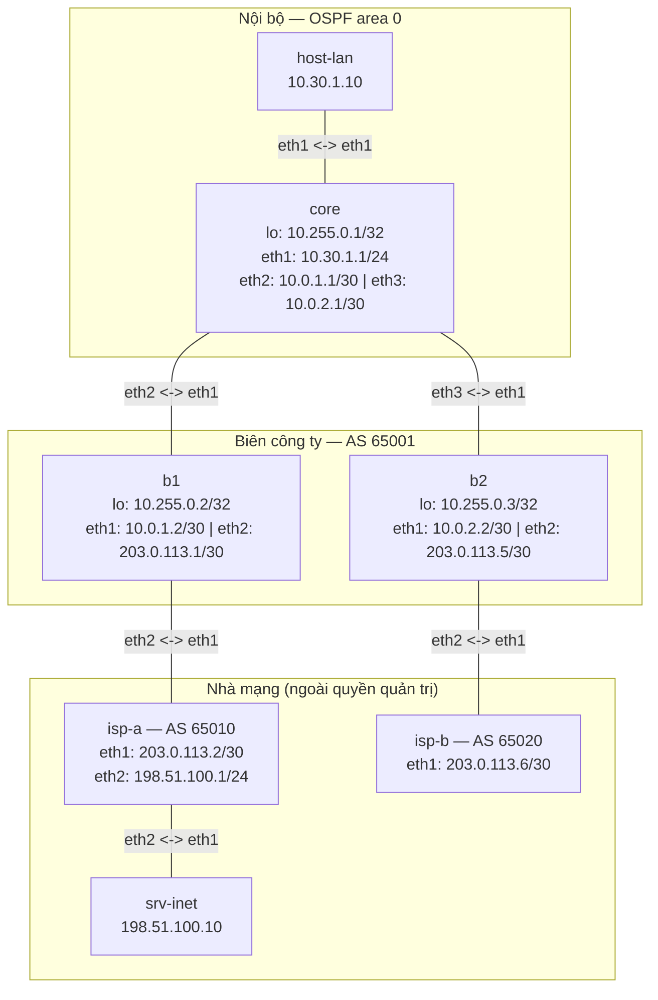

# Bài 42: Troubleshooting Chaos Lab — iBGP dual-homed (next-hop, loopback peering, local-preference)

**Arc 5 — Troubleshooting chaos lab**

## Mục tiêu
- Troubleshooting mạng doanh nghiệp **dual-homed 2 nhà mạng**: OSPF nội bộ + 2 router biên eBGP + iBGP peering qua loopback — khó hơn bài 19 (eBGP 2 AS) và bài 33 (1 điểm thoát).
- Hiểu quan hệ phụ thuộc **BGP ⟶ IGP**: BGP chỉ dùng được route khi next-hop **giải được** trong bảng route; iBGP peering qua loopback chỉ lên khi loopback **có trong IGP**.
- Đọc `show ip bgp` như một quy trình chọn đường: prefix có trong bảng BGP ≠ prefix được cài vào RIB ≠ traffic thực sự đi đúng đường.
- Trải nghiệm tình huống thật: **sửa xong một lỗi thì mạng đứt lại** vì lỗi thứ hai bị che phía sau.
- Không có bất kỳ gợi ý nào về vị trí lỗi.

## Yêu cầu tiên quyết
Hoàn thành [10-bgp-ebgp-co-ban](../10-bgp-ebgp-co-ban/lab-guide.md), [12-bgp-local-pref-prefix-list](../12-bgp-local-pref-prefix-list/lab-guide.md) và [19-troubleshooting-chaos-bgp](../19-troubleshooting-chaos-bgp/lab-guide.md) — nắm eBGP/iBGP, next-hop, local-preference, thứ tự chọn best path.

## Tình huống

Công ty vừa lắp thêm đường ISP-B để dự phòng. Thiết kế: `core` là gateway của LAN và là điểm tập trung iBGP; `b1` peering eBGP với ISP-A (đường chính), `b2` peering eBGP với ISP-B (đường dự phòng, nhà mạng đã prepend AS-path để khách hàng ưu tiên ISP-A). iBGP giữa `core`↔`b1` và `core`↔`b2` chạy qua loopback. Trưởng phòng gọi:

> "Bạn thực tập cuối tuần vừa rồi làm 3 việc: dựng cấu hình cho `b2` bằng cách copy từ `b1` rồi sửa lại IP, thêm đường ISP-B vào hệ thống, và có test kịch bản chuyển hướng lưu lượng sang ISP-B. Từ sáng nay **cả công ty không ra được internet**. Tôi cần: LAN vào internet lại được, **cả 2 phiên iBGP đều `Established`** (không được xoá bớt để cho xong), và lưu lượng phải **đi qua ISP-A** — ISP-B chỉ là dự phòng, băng thông tính tiền theo dung lượng. Router `isp-a`/`isp-b` là của nhà mạng, ta không có quyền sửa."

## Sơ đồ topology


- OSPF area 0 chạy trên `core`, `b1`, `b2` (LAN + 2 link nội bộ + loopback).
- iBGP AS 65001: `core`↔`b1`, `core`↔`b2`, peering bằng địa chỉ loopback `10.255.0.x`.
- eBGP: `b1`↔`isp-a` (AS 65010), `b2`↔`isp-b` (AS 65020). Các subnet `203.0.113.x` **không** được đưa vào OSPF (đúng thực tế: link eBGP không chạy IGP).
- Đích test internet: `198.51.100.10`.

Xem [`topology/chaos-ibgp.clab.yml`](./topology/chaos-ibgp.clab.yml).

## Đề bài / Yêu cầu

1. Deploy topology:
   ```bash
   cd topology && sudo clab deploy -t chaos-ibgp.clab.yml
   ```
2. Xác nhận lỗi (chờ ~60 giây cho OSPF + BGP hội tụ):
   - `docker exec host-lan ping -c 3 198.51.100.10` — thất bại.
   - `docker exec core vtysh -c "show ip route 198.51.100.0/24"` — không có route.
3. Tìm nguyên nhân gốc. **Không có bất kỳ gợi ý nào về vị trí lỗi.** Chuỗi truy vết gợi mở:
   - `show bgp summary` trên `core`, `b1`, `b2`: phiên nào `Established`, phiên nào kẹt `Active`/`Connect`? Phiên kẹt thì kiểm tra **địa chỉ peering có ping được không** và **có trong `show ip route` không** — iBGP qua loopback phụ thuộc hoàn toàn vào IGP.
   - Với phiên đã `Established` mà route vẫn không dùng được: `show ip bgp 198.51.100.0/24` trên `core` — prefix có trong bảng BGP không? Next-hop là địa chỉ nào? Địa chỉ đó `core` có route tới không (`show ip route <next-hop>`)? BGP **không cài** route có next-hop không giải được.
   - Khi mạng đã thông: kiểm tra **traffic đi hướng nào** (`show ip bgp 198.51.100.0/24` xem dấu `>` best path, `traceroute` từ `host-lan`). Nếu best path không phải ISP-A, so sánh các thuộc tính theo đúng thứ tự chọn đường của BGP — thuộc tính nào được so **trước** AS-path?
   - Đối chiếu chéo config `b1` và `b2` (`show run`): hai router cùng vai trò mà khác nhau chỗ nào?
4. Sửa lỗi qua `vtysh`. Lưu ý: đổi route-map/prefix-list xong phải `clear ip bgp * soft in` (hoặc `soft out` tuỳ chiều) để áp lại policy. **KHÔNG dùng `docker restart`.**
5. Xác nhận đã sửa xong — đủ **cả 3** điều kiện:
   - `docker exec core vtysh -c "show bgp summary"` — cả `10.255.0.2` và `10.255.0.3` đều `Established`.
   - `docker exec core vtysh -c "show ip bgp 198.51.100.0/24"` — best path (`>`) đi qua next-hop `10.255.0.2` (b1 / ISP-A).
   - `docker exec host-lan ping -c 3 198.51.100.10` thông, và `docker exec host-lan traceroute -n 198.51.100.10` đi qua `10.0.1.2` (b1) → `203.0.113.2` (isp-a).
6. Ghi lại: mỗi lỗi đã lộ ra ở lệnh nào, vì sao lỗi sau bị lỗi trước che, và config sau khi sửa.

## Lời giải tham khảo

<details>
<summary>⚠️ Bấm để xem lời giải — chỉ mở sau khi đã tự troubleshoot!</summary>

### Lỗi 1: `b1` thiếu `next-hop-self` — `core` có prefix nhưng không cài được route
- **Triệu chứng**: `show bgp summary` trên `core` cho thấy phiên với `10.255.0.2` (b1) đã `Established` và có nhận prefix. Nhưng `show ip route 198.51.100.0/24` trống, `show ip bgp 198.51.100.0/24` hiện đường đi với ghi chú **`(inaccessible)`** và không có dấu `>`.
- **Chẩn đoán**: next-hop của prefix là `203.0.113.2` — địa chỉ của `isp-a` trên link eBGP. Khi `b1` chuyển tiếp prefix eBGP sang iBGP, mặc định **giữ nguyên next-hop gốc**. Subnet `203.0.113.0/30` không được quảng bá vào OSPF nên `core` không có đường tới next-hop đó → BGP coi route là không dùng được. `b2` (copy từ `b1` rồi sửa) lại **có** `next-hop-self`, `b1` thì không — đây là chỗ hai router lệch nhau.
- **Cách sửa**:
  ```bash
  docker exec b1 vtysh \
    -c "conf t" \
    -c "router bgp 65001" \
    -c "address-family ipv4 unicast" \
    -c "neighbor 10.255.0.1 next-hop-self"
  ```
  Sau vài giây `core` cài route qua `10.255.0.2`, LAN ra internet được. **Nhưng chưa xong**: yêu cầu còn 2 điều kiện nữa.

### Lỗi 2: loopback của `b2` không được quảng bá vào OSPF — phiên iBGP thứ hai không bao giờ lên
- **Triệu chứng**: `show bgp summary` trên `core` cho `10.255.0.3` ở trạng thái `Active`/`Connect`, trên `b2` cũng vậy. Cấu hình `neighbor`/`update-source` hai bên nhìn hoàn toàn đúng.
- **Chẩn đoán**: `docker exec core vtysh -c "show ip route 10.255.0.3"` → không có route; `ping 10.255.0.3` từ `core` fail. Xem `show run` trên `b2`: phần `router ospf` chỉ có `network 10.0.2.0/30 area 0`, **thiếu `network 10.255.0.3/32 area 0`**. Bạn thực tập copy config từ `b1` và sửa IP nhưng bỏ sót dòng quảng bá loopback. Hệ quả: `b2` mở phiên với source là loopback không ai biết đường về → gói TCP đi được nhưng chiều về không có route → phiên kẹt mãi.
- **Cách sửa**:
  ```bash
  docker exec b2 vtysh -c "conf t" -c "router ospf" -c "network 10.255.0.3/32 area 0"
  ```
  Kiểm tra: `docker exec core vtysh -c "show ip route 10.255.0.3"` có route qua `10.0.2.2`, sau ~30 giây phiên iBGP lên `Established`.
  → **Và ngay lúc này mạng đứt trở lại** — lỗi 3 vừa được "mở khoá".

### Lỗi 3: route-map `PREF-BACKUP` đặt local-preference 200 cho đường ISP-B — best path chạy vào đường blackhole
- **Triệu chứng**: cả 2 phiên iBGP `Established`, `show ip bgp 198.51.100.0/24` trên `core` có 2 đường nhưng best path (`>`) lại là đường qua `10.255.0.3` (b2/ISP-B). `host-lan` ping fail, `traceroute` chết ngay sau `203.0.113.6` (isp-b).
- **Chẩn đoán**: `show run` trên `core` có `neighbor 10.255.0.3 route-map PREF-BACKUP in` với `set local-preference 200` — di sản của bài test "chuyển hướng lưu lượng sang ISP-B" cuối tuần. **Local-preference được so sánh trước AS-path**, nên dù nhà mạng ISP-B đã prepend AS-path (65020 65020 65020) để tự hạ ưu tiên, policy nội bộ vẫn ép chọn ISP-B. Tệ hơn: `isp-b` quảng bá `198.51.100.0/24` nhưng bên trong lại là route `blackhole` — control plane trông hoàn hảo, data plane nuốt gói. Đó là lý do triệu chứng "BGP nhìn đẹp nhưng không ping được".
- **Cách sửa**:
  ```bash
  docker exec core vtysh \
    -c "conf t" \
    -c "router bgp 65001" \
    -c "address-family ipv4 unicast" \
    -c "no neighbor 10.255.0.3 route-map PREF-BACKUP in" \
    -c "exit" -c "exit" -c "exit" \
    -c "clear ip bgp * soft in"
  ```
  Bỏ policy xong, hai đường về cùng local-preference 100 → BGP so tiếp AS-path: qua ISP-A là `65010` (1 chặng), qua ISP-B là `65020 65020 65020` (3 chặng) → ISP-A thắng, đúng thiết kế. Đường ISP-B vẫn nằm trong bảng BGP làm dự phòng.

**Xác nhận cuối:**
```bash
docker exec core vtysh -c "show bgp summary"                  # 10.255.0.2 và 10.255.0.3 đều Established
docker exec core vtysh -c "show ip bgp 198.51.100.0/24"       # best (>) qua next-hop 10.255.0.2
docker exec core vtysh -c "show ip route 198.51.100.0/24"     # via 10.0.1.2 (b1)
docker exec host-lan ping -c 3 198.51.100.10                  # OK
docker exec host-lan traceroute -n 198.51.100.10              # 10.30.1.1 -> 10.0.1.2 -> 203.0.113.2 -> 198.51.100.10
```

Bài học thực chiến: BGP không tự đi được một mình — **iBGP sống nhờ IGP**. Loopback không có trong IGP thì phiên không lên; next-hop không giải được thì prefix nằm chơi trong bảng BGP chứ không vào RIB (`inaccessible`). Khi so sánh 2 thiết bị cùng vai trò, `show run` cạnh nhau là cách nhanh nhất tìm chỗ lệch. Và nhớ thứ tự chọn đường: **weight → local-preference → AS-path...** — local-preference của bạn luôn thắng prepend của nhà mạng, nên mọi route-map dựng lên để test đều phải gỡ ngay sau khi test xong. Cuối cùng: prefix xuất hiện trong `show ip bgp` **không** đảm bảo đích đến thật sự tới được — hãy luôn kiểm chứng bằng `traceroute`.

</details>

## Thảo luận và hỏi đáp
Bài tập này tự làm và tự xác minh kết quả. Nếu có thắc mắc hoặc cần trao đổi thêm, các bạn hãy đăng bài thảo luận trên group Facebook [Network Thực Chiến](https://www.facebook.com/profile.php?id=61591373979991).

## Bài tiếp theo
→ [43-troubleshooting-chaos-routing-loop](../43-troubleshooting-chaos-routing-loop/lab-guide.md): Troubleshooting chaos lab — routing loop & blackhole (default route, administrative distance).
