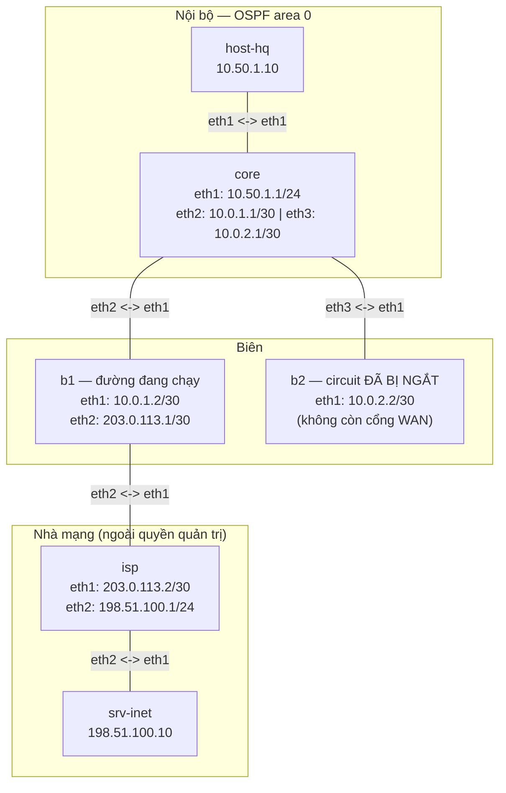

# Bài 43: Troubleshooting Chaos Lab — Routing loop & blackhole (default route, administrative distance)

**Arc 5 — Troubleshooting chaos lab**

## Mục tiêu
- Troubleshooting ở **lớp RIB**: cùng một đích đến có nhiều nguồn route (connected, static, OSPF external), ai thắng và vì sao.
- Nhận diện **routing loop** qua triệu chứng đặc trưng (`Time to live exceeded`, traceroute lặp qua lại 2 hop) và phân biệt với blackhole (im lặng / `Destination Net Unreachable`).
- Hiểu 2 cái bẫy kinh điển: `default-information originate **always**` trên router **không có đường ra thật**, và static route AD 1 âm thầm đè route động.
- Không có bất kỳ gợi ý nào về vị trí lỗi.

## Yêu cầu tiên quyết
Hoàn thành [03-static-route-multi-hop](../03-static-route-multi-hop/lab-guide.md), [09-ospf-multi-area](../09-ospf-multi-area/lab-guide.md) và [18-troubleshooting-chaos-lab](../18-troubleshooting-chaos-lab/lab-guide.md) — nắm bảng route, administrative distance, OSPF external (E2) và cơ chế phát default route.

## Tình huống

Công ty có 2 router biên: `b1` đi nhà mạng (đường đang chạy thật), `b2` từng là đường dự phòng — **circuit của `b2` đã bị nhà mạng ngắt từ tuần trước**, cáp đã rút, chỉ còn link nội bộ về `core`. Trưởng phòng gọi lúc 8 giờ sáng:

> "Từ hôm qua **cả công ty không vào được internet**. Lạ ở chỗ ping ra ngoài không phải là 'không tới đích' mà báo cái gì đó về **TTL**. Tuần trước bọn tôi có 2 việc: chuẩn bị kịch bản chuyển sang đường dự phòng (đã cấu hình sẵn trên `b2` cho khỏi quên), và migrate dải dịch vụ của nhà mạng sang đường mới — hồi đó có thêm mấy dòng route tĩnh trên `core` để đi tắt. Cả hai việc đều 'không ảnh hưởng gì' lúc làm xong. Nhờ anh xử lý, và **dọn luôn mọi cấu hình rác** để đêm nay tôi ngủ yên."

## Sơ đồ topology


- OSPF area 0 chạy trên `core`, `b1`, `b2`. Không có BGP trong bài này.
- Nhà mạng đã có route tĩnh trả về dải LAN `10.50.1.0/24` qua `b1`.
- Đích test internet: `198.51.100.10`.

Xem [`topology/chaos-routing-loop.clab.yml`](./topology/chaos-routing-loop.clab.yml).

## Đề bài / Yêu cầu

1. Deploy topology:
   ```bash
   cd topology && sudo clab deploy -t chaos-routing-loop.clab.yml
   ```
2. Xác nhận lỗi (chờ ~60 giây):
   - `docker exec host-hq ping -c 3 198.51.100.10` — thất bại, để ý **thông báo lỗi cụ thể** trả về là gì.
   - `docker exec host-hq traceroute -n -m 10 198.51.100.10` — quan sát kỹ dãy hop.
3. Tìm nguyên nhân gốc. **Không có bất kỳ gợi ý nào về vị trí lỗi.** Chuỗi truy vết gợi mở:
   - Triệu chứng `Time to live exceeded` + traceroute lặp giữa 2 địa chỉ = gói tin bị đá qua đá lại. Hai router trong vòng lặp đó là ai?
   - Trên từng router trong vòng lặp: đích `198.51.100.10` được **chọn theo entry nào**? Dùng `show ip route 198.51.100.10` (tra theo đích, không phải đọc cả bảng) — chú ý loại route và cặp số `[AD/metric]`.
   - `core` đang có mấy nguồn cấp default route? `show ip route 0.0.0.0/0` và `show ip ospf database external` — router nào phát default, metric bao nhiêu, và router đó **có đường ra internet thật không**?
   - Trên `b2`: nó nhận gói rồi gửi đi đâu? `show ip route 0.0.0.0/0` và `show run` — có gì trỏ ngược lại nội bộ không?
   - Nguyên tắc: static route AD 1 luôn thắng OSPF external AD 110, và **prefix dài hơn luôn thắng default** — kể cả khi entry đó trỏ vào ngõ cụt.
4. Sửa lỗi qua `vtysh`. Yêu cầu của trưởng phòng gồm cả **dọn cấu hình rác**: sau khi sửa, trên `b2` không được còn default route trỏ ngược nội bộ, và `b2` không được phát default vào OSPF khi nó không có đường ra. **KHÔNG dùng `docker restart`.**
5. Xác nhận đã sửa xong:
   - `docker exec core vtysh -c "show ip route 0.0.0.0/0"` — chỉ còn 1 default, học qua OSPF, next-hop `10.0.1.2` (b1).
   - `docker exec core vtysh -c "show ip route 198.51.100.0/24"` — không còn entry static nào cho dải này.
   - `docker exec b2 vtysh -c "show ip route static"` — trống.
   - `docker exec host-hq ping -c 3 198.51.100.10` thông; `docker exec host-hq traceroute -n 198.51.100.10` đi thẳng `10.50.1.1 → 10.0.1.2 → 203.0.113.2 → 198.51.100.10`, không lặp.
6. Ghi lại: vòng lặp gồm những hop nào, mỗi router chọn đường theo entry nào, và vì sao gỡ 1 lỗi chưa đủ để mạng thông.

## Lời giải tham khảo

<details>
<summary>⚠️ Bấm để xem lời giải — chỉ mở sau khi đã tự troubleshoot!</summary>

Ba lỗi cùng nằm ở lớp RIB và **cộng hưởng** với nhau: một lỗi kéo lưu lượng về `b2`, một lỗi biến ngõ cụt thành vòng lặp, một lỗi ghim riêng dải đích test vào `b2` kể cả khi default đã đúng.

### Lỗi 1: `b2` phát default vào OSPF bằng `always` dù không còn đường ra
- **Triệu chứng**: `show ip route 0.0.0.0/0` trên `core` cho default `O E2` next-hop `10.0.2.2` (b2) với metric 5, trong khi default của `b1` (metric 10) bị loại. Toàn bộ lưu lượng internet của công ty được kéo về router đã mất circuit.
- **Chẩn đoán**: `show run` trên `b2` có `default-information originate always metric 5`. Cờ `always` nghĩa là "cứ quảng bá default kể cả bản thân tôi không có default route nào" — cấu hình chuẩn bị sẵn cho kịch bản dự phòng, nhưng để lại sau khi circuit bị ngắt. Metric 5 còn nhỏ hơn metric 10 của `b1` nên nó thắng tuyệt đối. So sánh: `b1` dùng `default-information originate` **không có** `always` — an toàn, vì khi mất static default đi nhà mạng nó sẽ tự ngừng quảng bá.
- **Cách sửa**:
  ```bash
  docker exec b2 vtysh -c "conf t" -c "router ospf" -c "no default-information originate"
  ```

### Lỗi 2: `b2` còn static default trỏ ngược về `core` — ngõ cụt biến thành vòng lặp
- **Triệu chứng**: đây chính là nguồn của `Time to live exceeded`. `traceroute` từ `host-hq` cho dãy lặp `10.50.1.1 → 10.0.2.2 → 10.0.2.1 → 10.0.2.2 → ...` (core ↔ b2) cho tới khi hết TTL.
- **Chẩn đoán**: `show ip route 0.0.0.0/0` trên `b2` cho static `0.0.0.0/0 via 10.0.2.1` — trỏ ngược về chính `core`. Khi `core` đẩy gói sang `b2` (do lỗi 1), `b2` không có đường ra nên áp default này và **đá gói về lại `core`**; `core` lại gửi sang `b2`... Nếu không có dòng này, triệu chứng đã là blackhole/`unreachable` — dễ chẩn đoán hơn nhiều. Đây cũng là lý do mọi router biên **không bao giờ** nên có default route trỏ ngược vào lõi.
- **Cách sửa**:
  ```bash
  docker exec b2 vtysh -c "conf t" -c "no ip route 0.0.0.0/0 10.0.2.1"
  ```
  Sau bước này, lưu lượng internet chung đã đi đúng qua `b1`... nhưng **đích test vẫn chưa thông**.

### Lỗi 3: static route AD 1 trên `core` ghim riêng dải `198.51.100.0/24` vào `b2`
- **Triệu chứng**: đích khác đã đi đúng đường — `docker exec host-hq ping -c 2 203.0.113.2` (IP nhà mạng, chỉ tới được nếu default chạy qua `b1`) thông. Nhưng `ping 198.51.100.10` vẫn fail — giờ là `Destination Net Unreachable` (b2 đã hết default, chỉ còn drop) thay vì lỗi TTL.
- **Chẩn đoán**: `show ip route 198.51.100.10` trên `core` cho `S>* 198.51.100.0/24 [1/0] via 10.0.2.2` — route tĩnh sót lại từ đợt "migrate dải dịch vụ, thêm route đi tắt". Hai lý do nó thắng: **prefix /24 dài hơn default /0** (longest prefix match luôn xét trước), và AD 1 của static nhỏ hơn AD 110 của OSPF external. Bảng route trông vẫn "sạch và hợp lý" — đó là điều làm lỗi này khó thấy.
- **Cách sửa**:
  ```bash
  docker exec core vtysh -c "conf t" -c "no ip route 198.51.100.0/24 10.0.2.2"
  ```

**Xác nhận cuối:**
```bash
docker exec core vtysh -c "show ip route 0.0.0.0/0"          # 1 default duy nhất: O E2 via 10.0.1.2
docker exec core vtysh -c "show ip route 198.51.100.0/24"    # không còn entry static
docker exec b2   vtysh -c "show ip route static"             # trống
docker exec host-hq ping -c 3 198.51.100.10                  # OK
docker exec host-hq traceroute -n 198.51.100.10              # 10.50.1.1 -> 10.0.1.2 -> 203.0.113.2 -> 198.51.100.10
```

Bài học thực chiến: **thông báo lỗi của ping là dữ liệu chẩn đoán**, không phải rác — `TTL exceeded` = loop, `Net Unreachable` = có router chủ động drop, timeout im lặng = gói mất ở đâu đó không ai báo. `default-information originate always` là con dao hai lưỡi: nó hút lưu lượng của cả mạng về một router mà **không hề kiểm chứng** router đó có đường ra hay không — chỉ dùng khi bạn chắc chắn (và nhớ gỡ khi circuit chết). Cuối cùng: mỗi khi migrate xong một dải, hãy rà lại các static route "đi tắt" đã thêm — chúng có AD 1, sống dai hơn mọi giao thức động và không bao giờ tự biến mất khi topology đổi.

</details>

## Thảo luận và hỏi đáp
Bài tập này tự làm và tự xác minh kết quả. Nếu có thắc mắc hoặc cần trao đổi thêm, các bạn hãy đăng bài thảo luận trên group Facebook [Network Thực Chiến](https://www.facebook.com/profile.php?id=61591373979991).

## Bài tiếp theo
→ [44-troubleshooting-chaos-pbr-datapath](../44-troubleshooting-chaos-pbr-datapath/lab-guide.md): Troubleshooting chaos lab — dual-WAN policy routing trên Linux (ip rule, NAT, rp_filter).
