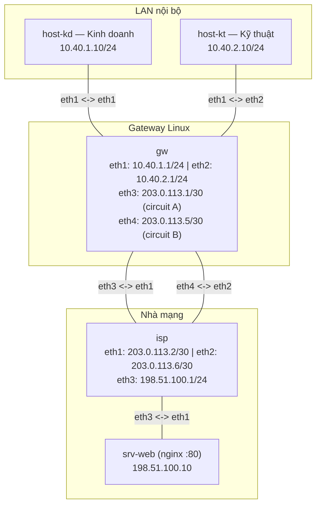

# Bài 44: Troubleshooting Chaos Lab — Dual-WAN policy routing trên Linux (ip rule, bảng route phụ, NAT)

**Arc 5 — Troubleshooting chaos lab**

## Mục tiêu
- Troubleshooting ở **data plane Linux thuần** — không có FRR, không có `vtysh`: lỗi nằm ở `ip rule`, bảng định tuyến phụ và NAT.
- Nắm đúng thứ tự kernel xử lý một gói tin được chuyển tiếp: **rule (RPDB) → bảng route tương ứng → NAT postrouting → cổng ra**. Mỗi lớp hỏng cho một triệu chứng khác nhau.
- Thành thạo bộ công cụ chẩn đoán khác hẳn 3 bài trước: `ip rule show`, `ip route show table <N>`, `ip route get <ip> from <src>`, `nft list ruleset`, `tcpdump`, và đọc **IP nguồn mà server phía xa nhìn thấy**.
- Phân biệt 3 kiểu hỏng dễ nhầm nhau: "bị chặn ngay tại gateway", "đi được nhưng sai đường", "ra đúng đường nhưng không có đường về".
- Không có bất kỳ gợi ý nào về vị trí lỗi.

## Yêu cầu tiên quyết
Hoàn thành [13-pbr-dual-wan](../13-pbr-dual-wan/lab-guide.md), [08-nat-masquerade-linux](../08-nat-masquerade-linux/lab-guide.md) và [27-troubleshooting-chaos-nftables](../27-troubleshooting-chaos-nftables/lab-guide.md) — nắm policy-based routing, bảng route phụ, masquerade/SNAT.

## Tình huống

Công ty thuê 2 circuit của cùng một nhà mạng: **circuit A** (`203.0.113.1`) cho phòng Kinh doanh, **circuit B** (`203.0.113.5`) cho phòng Kỹ thuật — chia tải và tách hoá đơn theo phòng ban. Gateway `gw` là một máy Linux, điều hướng bằng policy routing. Sếp gọi:

> "Phòng Kỹ thuật kêu **không vào được internet** từ sáng, phòng Kinh doanh thì bình thường. Tháng trước máy của phòng Kỹ thuật dính mã độc, anh em có cách ly tạm dải mạng đó — nhưng đã xử lý xong lâu rồi. Cùng đợt đó bọn tôi lắp thêm circuit B và cấu hình chia đường cho hai phòng. Yêu cầu của tôi: **cả hai phòng phải vào được internet**, và **phải đúng đường** — Kinh doanh ra bằng circuit A, Kỹ thuật ra bằng circuit B, vì cuối tháng đối soát cước theo từng circuit. Đừng có gộp hết vào một đường cho nhanh, kế toán sẽ hỏi ngay."

## Sơ đồ topology


Thiết kế mong muốn trên `gw`:

| Nguồn | Bảng route | Cổng ra | IP công cộng server nhìn thấy |
|:---|:---|:---|:---|
| `10.40.1.0/24` (Kinh doanh) | `100` | `eth3` — circuit A | `203.0.113.1` |
| `10.40.2.0/24` (Kỹ thuật) | `200` | `eth4` — circuit B | `203.0.113.5` |
| còn lại (kể cả traffic của chính `gw`) | `main` | `eth3` | `203.0.113.1` |

Xem [`topology/chaos-pbr.clab.yml`](./topology/chaos-pbr.clab.yml) và [`nftables/ruleset.nft`](./nftables/ruleset.nft).

## Đề bài / Yêu cầu

1. Deploy topology:
   ```bash
   cd topology && sudo clab deploy -t chaos-pbr.clab.yml
   ```
2. Xác nhận lỗi:
   - `docker exec host-kd ping -c 3 198.51.100.10` — thông (phòng Kinh doanh bình thường).
   - `docker exec host-kt ping -c 3 198.51.100.10` — thất bại. **Đọc kỹ thông báo lỗi** trả về.
3. Tìm nguyên nhân gốc. **Không có bất kỳ gợi ý nào về vị trí lỗi.** Chuỗi truy vết gợi mở:
   - Kernel duyệt **rule trước bảng route**: `ip rule show` trên `gw` — dải `10.40.2.0/24` khớp rule nào **đầu tiên** (số priority nhỏ hơn được xét trước)? Rule đó dẫn tới bảng route nào, hay tới một hành động khác?
   - Khi rule đã đúng: gói của phòng Kỹ thuật thật sự ra cổng nào? `ip route get 198.51.100.10 from 10.40.2.10 iif eth2` cho biết kernel chọn đường nào; đối chiếu với `ip route show table 200` và `ip route show table all | grep default`.
   - Cách kiểm chứng "đi đúng circuit" **không cần đoán**: `docker exec srv-web tail -n 5 /var/log/nginx/access.log` sau khi `curl` từ host — server ghi lại IP nguồn thật sự sau NAT. Hoặc bắt gói tại nhà mạng: `docker exec isp timeout 10 tcpdump -ni eth2 icmp`.
   - Khi gói đã ra đúng `eth4` mà vẫn không có trả lời: bắt gói ở 2 phía (`tcpdump -ni eth4` trên `gw`, `tcpdump -ni eth2` trên `isp`) và nhìn **địa chỉ nguồn** của gói đi ra — nó là IP công cộng hay IP nội bộ? Rồi soi `nft list ruleset`.
4. Sửa lỗi bằng lệnh `ip`/`nft` trong container (`docker exec gw ...`). Ràng buộc: **không được gỡ policy routing** để dồn cả 2 phòng vào một circuit. **KHÔNG dùng `docker restart`.**
5. Xác nhận đã sửa xong:
   - `docker exec host-kd ping -c 3 198.51.100.10` và `docker exec host-kt ping -c 3 198.51.100.10` — cả hai thông.
   - `docker exec host-kd curl -s -m 5 -o /dev/null -w "%{http_code}\n" http://198.51.100.10` và tương tự với `host-kt` — cả hai trả `200`.
   - `docker exec srv-web tail -n 10 /var/log/nginx/access.log` — request từ Kinh doanh mang IP nguồn `203.0.113.1`, từ Kỹ thuật mang `203.0.113.5`.
   - `docker exec gw ip rule show` — không còn rule chặn dải nào.
6. Ghi lại: mỗi lỗi lộ ra ở lệnh nào, kernel xử lý gói qua các lớp nào, và vì sao 2 lỗi sau chỉ hiện ra **sau khi** sửa lỗi trước.

## Lời giải tham khảo

<details>
<summary>⚠️ Bấm để xem lời giải — chỉ mở sau khi đã tự troubleshoot!</summary>

Ba lỗi nằm ở 3 lớp kernel xử lý gói, xếp chồng đúng theo thứ tự xử lý: **rule → bảng route → NAT**. Sửa lớp trên mới nhìn thấy lỗi lớp dưới.

### Lỗi 1: rule `unreachable` cách ly dải phòng Kỹ thuật vẫn còn nguyên
- **Triệu chứng**: `ping` từ `host-kt` trả về ngay lập tức `Destination Net Unreachable` — không hề timeout. Gói chưa đi đâu cả, chết ngay tại `gw`.
- **Chẩn đoán**: `docker exec gw ip rule show`
  ```
  0:      from all lookup local
  90:     from 10.40.2.0/24 unreachable
  100:    from 10.40.1.0/24 lookup 100
  110:    from 10.40.2.0/24 lookup 200
  32766:  from all lookup main
  ```
  Rule priority **90** được duyệt trước rule 110, và hành động của nó là `unreachable` — kernel trả về lỗi ngay, không tra bảng nào nữa. Đây là biện pháp cách ly khi máy phòng Kỹ thuật dính mã độc tháng trước, xử lý xong nhưng **quên gỡ**. Bài học: rule số nhỏ luôn thắng, và `ip rule` là chỗ gần như không ai nghĩ tới khi debug.
- **Cách sửa**:
  ```bash
  docker exec gw ip rule del from 10.40.2.0/24 unreachable priority 90
  docker exec gw ip rule show
  ```

### Lỗi 2: bảng route của phòng Kỹ thuật bị gõ nhầm số — traffic chạy sang circuit A
- **Triệu chứng**: sau khi gỡ rule chặn, `host-kt` **ping thông**, `curl` ra `200` — nhìn qua tưởng xong. Nhưng log của `srv-web` cho thấy request từ phòng Kỹ thuật vẫn mang IP nguồn `203.0.113.1` (**circuit A**), tức là sai hoá đơn, sai thiết kế.
- **Chẩn đoán**:
  ```bash
  docker exec gw ip route get 198.51.100.10 from 10.40.2.10 iif eth2   # -> dev eth3 (sai)
  docker exec gw ip route show table 200                               # trống!
  docker exec gw ip route show table all | grep default                # default nằm ở table 201
  ```
  Rule 110 trỏ tới `lookup 200` nhưng route lại được cài vào **table 201** — gõ nhầm số bảng lúc dựng circuit B. Tra bảng 200 không có kết quả, kernel **duyệt tiếp** các rule sau và rơi vào `main`, mà `main` có default đi `eth3`. Không lỗi, không cảnh báo, chỉ là... đi nhầm đường. Đây là lý do dual-WAN hay bị "chạy được nên tưởng đúng".
- **Cách sửa**:
  ```bash
  docker exec gw ip route add default via 203.0.113.6 dev eth4 table 200
  docker exec gw ip route del default via 203.0.113.6 dev eth4 table 201
  docker exec gw ip route get 198.51.100.10 from 10.40.2.10 iif eth2   # -> dev eth4
  ```
  → Và ngay lúc này **phòng Kỹ thuật mất mạng trở lại** — lỗi 3 vừa lộ ra.

### Lỗi 3: NAT chỉ có cho circuit A — gói ra circuit B mang IP nội bộ
- **Triệu chứng**: `host-kt` ping không có hồi âm (timeout, không phải `unreachable`). `tcpdump` trên `gw` cho thấy gói **có đi ra** `eth4`, `tcpdump` trên `isp` cho thấy gói **có tới nơi** — nhưng không có gói nào quay về:
  ```bash
  docker exec gw  timeout 10 tcpdump -nni eth4 icmp   # 10.40.2.10 > 198.51.100.10  <-- IP nội bộ!
  docker exec isp timeout 10 tcpdump -nni eth2 icmp
  ```
- **Chẩn đoán**: `docker exec gw nft list ruleset` — chain `postrouting` chỉ có `oifname "eth3" masquerade`. Circuit B lắp sau, cấu hình route thì có mà **quên rule NAT**. Gói ra internet với địa chỉ nguồn `10.40.2.10` (RFC 1918) → nhà mạng không có đường quay về dải nội bộ → mất hút. Cổ điển: "gói đi được nhưng không có đường về".
- **Cách sửa**:
  ```bash
  docker exec gw nft add rule ip nat postrouting oifname "eth4" masquerade
  docker exec gw nft list ruleset
  ```
  Muốn lưu vĩnh viễn thì thêm dòng `oifname "eth4" masquerade` vào `nftables/ruleset.nft` (ngoài thực tế phải sửa file, đừng chỉ gõ lệnh — reboot là mất).

**Xác nhận cuối:**
```bash
docker exec host-kd ping -c 3 198.51.100.10                                        # OK
docker exec host-kt ping -c 3 198.51.100.10                                        # OK
docker exec host-kd curl -s -m 5 -o /dev/null -w "kd=%{http_code}\n" http://198.51.100.10
docker exec host-kt curl -s -m 5 -o /dev/null -w "kt=%{http_code}\n" http://198.51.100.10
docker exec srv-web tail -n 10 /var/log/nginx/access.log   # 203.0.113.1 = Kinh doanh, 203.0.113.5 = Kỹ thuật
docker exec gw ip rule show                                # không còn rule unreachable
```

Bài học thực chiến: trên Linux, gói tin đi qua **nhiều lớp độc lập** và mỗi lớp hỏng theo kiểu riêng — `unreachable` ngay lập tức = chết ở RPDB (`ip rule`); đi được nhưng sai cổng = tra nhầm/rỗng bảng route phụ, kernel âm thầm rơi xuống `main`; đi ra được mà không có hồi âm = NAT hoặc đường về. `ip route get <dst> from <src> iif <iface>` là lệnh đáng giá nhất trong nhóm này: nó **hỏi thẳng kernel** sẽ làm gì với gói đó, thay vì bạn ngồi suy luận từ bảng route. Và với dual-WAN, "ping thông" **không đủ** để nghiệm thu — phải kiểm chứng lưu lượng ra đúng circuit bằng IP nguồn mà phía xa nhìn thấy, vì đi nhầm đường vẫn chạy ngon cho tới ngày kế toán đối soát cước.

</details>

## Thảo luận và hỏi đáp
Bài tập này tự làm và tự xác minh kết quả. Nếu có thắc mắc hoặc cần trao đổi thêm, các bạn hãy đăng bài thảo luận trên group Facebook [Network Thực Chiến](https://www.facebook.com/profile.php?id=61591373979991).

## Bài tiếp theo
→ [45-troubleshooting-chaos-ospf-full-no-ping](../45-troubleshooting-chaos-ospf-full-no-ping/lab-guide.md): Troubleshooting chaos lab — OSPF `Full` hết nhưng không ping được (mức CCNA).
