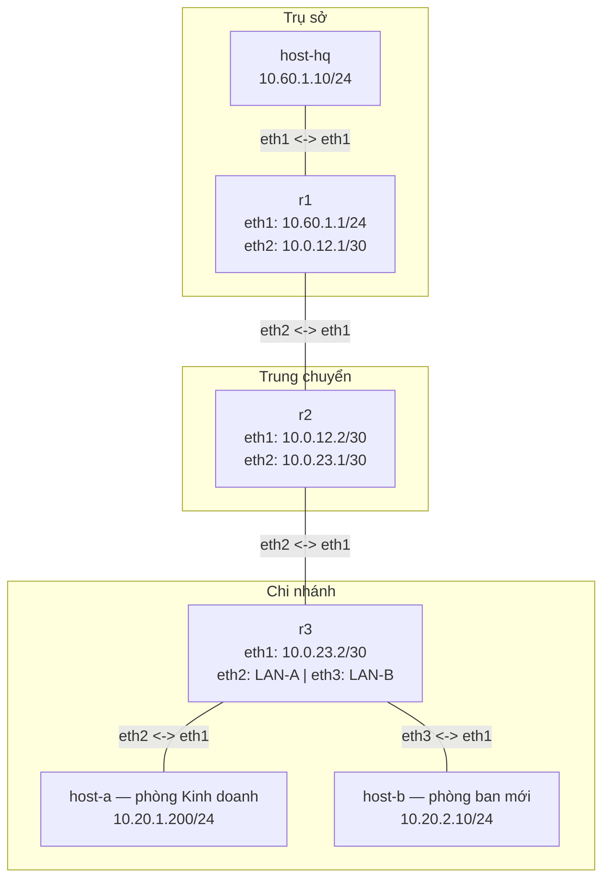

# Bài 45: Troubleshooting Chaos Lab — OSPF `Full` hết nhưng không ping được (mức CCNA)

**Arc 5 — Troubleshooting chaos lab**

## Mục tiêu
- Xử lý tình huống gây bối rối nhất khi mới ra nghề: `show ip ospf neighbor` **`Full` sạch đẹp ở mọi router** mà người dùng vẫn không ping được — chứng minh rằng "OSPF đã lên" **không** đồng nghĩa "mạng đã thông".
- Bài bám **chương trình CCNA 200-301**: OSPFv2 single-area, câu lệnh `network` + wildcard mask, subnetting/subnet mask, default gateway trên máy trạm, và quy trình troubleshooting theo lớp.
- Rèn thang chẩn đoán 3 tầng, hỏi lần lượt từ trên xuống:

  | Tầng | Câu hỏi | Lệnh kiểm chứng (CCNA) |
  |:---|:---|:---|
  | **Quảng bá** | Subnet đã được đưa vào OSPF chưa? | `show ip protocols`, `show ip ospf interface brief`, `show ip route ospf` |
  | **Địa chỉ** | Router và host có thật sự cùng một subnet? | `show ip interface brief`, tính lại dải mạng từ subnet mask |
  | **Máy trạm** | Host có đường về không? | bảng route trên host, so sánh ping **trong LAN** với ping **từ xa** |

- Không có bất kỳ gợi ý nào về vị trí lỗi — tự truy vết.

## Yêu cầu tiên quyết
Hoàn thành [02-ip-subnetting-thuc-chien](../02-ip-subnetting-thuc-chien/lab-guide.md), [09-ospf-multi-area](../09-ospf-multi-area/lab-guide.md) và [18-troubleshooting-chaos-lab](../18-troubleshooting-chaos-lab/lab-guide.md) — nắm subnetting, cách khai `network ... area ...`, và cơ chế hình thành adjacency.

## Tình huống

Toàn mạng chạy OSPF **một vùng duy nhất (area 0)**. Cuối tuần vừa rồi bên IT mở LAN mới cho phòng ban mới và bàn giao máy cho nhân viên phòng Kinh doanh. Sáng thứ hai, bạn nhận ticket:

> "Từ trụ sở không ai truy cập được máy nào ở chi nhánh nữa — cả máy cũ phòng Kinh doanh (`10.20.1.200`) lẫn máy mới của phòng ban mới (`10.20.2.10`). Tôi có kiểm tra rồi: **`show ip ospf neighbor` trên cả 3 router đều `Full` hết**, cáp tốt, cổng `up`, router nào ping router nào cũng được. OSPF rõ ràng không sao cả, chắc lỗi ở đâu đó khác — anh xem giúp chứ tôi hết ý tưởng rồi."

## Sơ đồ topology


**Kế hoạch địa chỉ đã duyệt** (dùng cái này làm chuẩn khi đối chiếu cấu hình thực tế):

| Đoạn mạng | Dải | Gateway |
|:---|:---|:---|
| LAN trụ sở | `10.60.1.0/24` | `10.60.1.1` (r1) |
| Link r1–r2 | `10.0.12.0/30` | — |
| Link r2–r3 | `10.0.23.0/30` | — |
| LAN-A (Kinh doanh) | `10.20.1.0/24` | `10.20.1.1` (r3) |
| LAN-B (phòng ban mới) | `10.20.2.0/24` | `10.20.2.1` (r3) |

Toàn bộ chạy OSPF area 0, không static route, không NAT, không ACL. Xem [`topology/chaos-ospf-fullnoping.clab.yml`](./topology/chaos-ospf-fullnoping.clab.yml).

## Đối chiếu lệnh Cisco IOS ↔ FRR

Lab dùng FRR (Linux) nhưng khái niệm giống hệt CCNA — bảng này để bạn chuyển qua lại giữa phòng thi và lab:

| Việc cần làm | Cisco IOS (chương trình CCNA) | Trong lab (FRR) |
|:---|:---|:---|
| Xem neighbor | `show ip ospf neighbor` | `docker exec r1 vtysh -c "show ip ospf neighbor"` |
| Xem OSPF đang khai network nào | `show ip protocols` | `docker exec r3 vtysh -c "show ip protocols"` |
| Xem cổng nào đang chạy OSPF | `show ip ospf interface brief` | `docker exec r3 vtysh -c "show ip ospf interface brief"` |
| Khai subnet vào OSPF | `network 10.20.2.0 0.0.0.255 area 0` | `network 10.20.2.0/24 area 0` |
| Xem IP/mask các cổng | `show ip interface brief` | `docker exec r3 vtysh -c "show interface brief"` hoặc `docker exec r3 ip -br addr` |
| Đặt IP cho cổng | `ip address 10.20.1.1 255.255.255.0` | `ip address 10.20.1.1/24` |
| Bảng định tuyến | `show ip route` | `docker exec r1 vtysh -c "show ip route"` |
| Vào chế độ cấu hình | `configure terminal` | `docker exec r3 vtysh -c "conf t" -c "..."` |

> Khác biệt cú pháp duy nhất đáng nhớ: IOS khai bằng **wildcard mask** (`0.0.0.255`), FRR khai bằng **prefix length** (`/24`). Wildcard `0.0.0.255` ⟷ `/24`, `0.0.0.127` ⟷ `/25`, `0.0.0.3` ⟷ `/30`.

## Đề bài / Yêu cầu

1. Deploy topology:
   ```bash
   cd topology && sudo clab deploy -t chaos-ospf-fullnoping.clab.yml
   ```
2. Xác nhận lời khai của đồng nghiệp là **đúng** (chờ ~45 giây cho OSPF hội tụ):
   - `docker exec r1 vtysh -c "show ip ospf neighbor"`, tương tự trên `r2`, `r3` — tất cả đều `Full`.
   - `docker exec host-hq ping -c 3 10.20.1.200` — thất bại.
   - `docker exec host-hq ping -c 3 10.20.2.10` — thất bại.
   - Đọc kỹ **thông báo lỗi** của từng lệnh ping: hai đích trả về hai kiểu lỗi khác nhau, đó là manh mối đầu tiên.
3. Tìm nguyên nhân gốc. **Không có bất kỳ gợi ý nào về vị trí lỗi.** Chuỗi truy vết gợi mở:
   - **Tầng quảng bá**: trên `r1`, `show ip route ospf` có những subnet nào của chi nhánh? Subnet nào thiếu hẳn? Trên `r3`, `show ip protocols` liệt kê những network nào, và `show ip ospf interface brief` cho thấy **cổng nào đang chạy OSPF** — có cổng LAN nào vắng mặt không?
   - **Tầng địa chỉ**: so sánh route mà `r1` học được với **kế hoạch địa chỉ đã duyệt** ở trên — prefix length có khớp không? Nếu lệch, tính lại: với mask đó thì dải địa chỉ hợp lệ là từ đâu tới đâu, và IP của máy người dùng có nằm trong dải không?
   - **Tầng máy trạm**: khi router đã có route đầy đủ mà vẫn không ping được, hãy thu hẹp phạm vi — ping từ `r3` (cùng LAN với máy) so với ping từ `host-hq` (từ xa). Nếu gần thì được mà xa thì không, vấn đề là **đường về**: kiểm tra default gateway trên chính máy đó (`docker exec host-b ip route`).
4. Sửa lỗi: lỗi trên router sửa bằng `vtysh`, lỗi trên máy trạm sửa bằng lệnh `ip` trong container. **KHÔNG dùng `docker restart`** (mất veth, phải destroy + deploy lại).
5. Xác nhận đã sửa xong:
   - `docker exec host-hq ping -c 3 10.20.1.200` và `docker exec host-hq ping -c 3 10.20.2.10` — cả hai thông.
   - `docker exec r1 vtysh -c "show ip route ospf"` — có đủ `10.20.1.0/24` **và** `10.20.2.0/24` (đúng prefix length theo kế hoạch).
   - `docker exec r1 vtysh -c "show ip ospf neighbor"` — vẫn `Full` (không được "sửa" bằng cách phá adjacency).
6. Ghi lại: mỗi lỗi phát hiện bằng lệnh nào, thuộc tầng nào trong 3 tầng, và vì sao neighbor `Full` không chứng minh được điều gì về khả năng ping.

## Lời giải tham khảo

<details>
<summary>⚠️ Bấm để xem lời giải — chỉ mở sau khi đã tự troubleshoot!</summary>

Cả 3 lỗi đều **không đụng gì tới adjacency** — đó là lý do OSPF `Full` suốt từ đầu tới cuối. Chúng nằm ở 3 tầng khác nhau bên dưới.

### Lỗi 1: `r3` chưa khai LAN-B vào OSPF — thiếu câu lệnh `network`
- **Triệu chứng**: `docker exec host-hq ping -c 3 10.20.2.10` trả về `Destination Net Unreachable` ngay tại `r1` — vì `r1` không có route nào tới `10.20.2.0/24`.
- **Chẩn đoán**:
  ```bash
  docker exec r1 vtysh -c "show ip route ospf"            # không có 10.20.2.0/24
  docker exec r3 vtysh -c "show ip protocols"             # chỉ khai 10.0.23.0/30 và 10.20.1.0/24
  docker exec r3 vtysh -c "show ip ospf interface brief"  # không có eth3
  ```
  Mở LAN mới xong, người làm đặt IP cho cổng `eth3` nhưng **quên thêm câu lệnh `network` vào tiến trình OSPF**. Cổng có IP, `up`, ping được trong LAN — nhưng OSPF không hề biết nó tồn tại nên không quảng bá đi đâu cả. Trên IOS lỗi này y hệt: thiếu dòng `network 10.20.2.0 0.0.0.255 area 0`.
- **Cách sửa**:
  ```bash
  docker exec r3 vtysh -c "conf t" -c "router ospf" -c "network 10.20.2.0/24 area 0"
  docker exec r3 vtysh -c "show ip ospf interface brief"   # eth3 đã xuất hiện
  docker exec r1 vtysh -c "show ip route ospf"             # đã có 10.20.2.0/24
  ```

### Lỗi 2: `r3` đặt sai subnet mask cho LAN-A (`/25` thay vì `/24`)
- **Triệu chứng**: `docker exec host-hq ping -c 3 10.20.1.200` cũng báo `Destination Net Unreachable` — nhưng lạ ở chỗ `r1` **có** route tới LAN-A. Nhìn kỹ:
  ```bash
  docker exec r1 vtysh -c "show ip route ospf"    # 10.20.1.0/25  <-- không phải /24 như kế hoạch!
  ```
- **Chẩn đoán**: `docker exec r3 vtysh -c "show interface brief"` (hoặc `ip -br addr`) cho `eth2` = `10.20.1.1/25`. Với `/25`, dải mạng chỉ chạy từ `10.20.1.0` tới `10.20.1.127` — **máy `10.20.1.200` nằm ngoài dải đó**. Hệ quả kép:
  - `r1` học prefix `/25` nên gói tới `.200` không khớp route nào → bị chặn ngay tại trụ sở.
  - Kể cả có tới được `r3` thì `r3` cũng không coi `.200` là "trong LAN của mình" nên không biết gửi đi đâu.
  Đây đúng là bài subnetting của CCNA: gõ nhầm `255.255.255.128` thay vì `255.255.255.0`, mọi thứ vẫn `up/up`, OSPF vẫn `Full`, chỉ có nửa số máy trong LAN là mất tích.
- **Cách sửa**:
  ```bash
  docker exec r3 vtysh -c "conf t" -c "interface eth2" -c "no ip address 10.20.1.1/25" -c "ip address 10.20.1.1/24"
  docker exec r3 ip -br addr show eth2                    # 10.20.1.1/24
  docker exec r1 vtysh -c "show ip route ospf"            # 10.20.1.0/24
  docker exec r3 ping -c 2 10.20.1.200                    # r3 ping được máy trong LAN của nó
  ```
  (Trên IOS: `interface g0/1` → `ip address 10.20.1.1 255.255.255.0`.)

### Lỗi 3: `host-b` cấu hình sai default gateway — gói tới được nhưng không có đường về
- **Triệu chứng**: sau khi sửa lỗi 1, `r1` đã có route tới `10.20.2.0/24`, `r3` ping `host-b` bình thường, nhưng `host-hq` ping `10.20.2.10` vẫn timeout (im lặng, không còn `unreachable`).
- **Chẩn đoán**: so sánh 2 phép ping để khoanh vùng
  ```bash
  docker exec r3 ping -c 2 10.20.2.10        # OK  -> máy sống, LAN ổn
  docker exec host-hq ping -c 3 10.20.2.10   # timeout -> chỉ hỏng khi đi từ xa
  docker exec host-b ip route                # default via 10.20.2.254  <-- gateway không tồn tại
  ```
  Gói ICMP từ trụ sở **đến được** `host-b`, `host-b` tạo gói trả lời, nhưng đích `10.60.1.10` không nằm trong LAN nên nó phải nhờ default gateway — mà `.254` không có thật (ARP không ai trả lời). Phiếu bàn giao máy ghi nhầm gateway. Ping trong LAN vẫn OK vì không cần gateway. Đây là lý do phải luôn kiểm tra **cả hai chiều**: đi được không đảm bảo về được.
- **Cách sửa**:
  ```bash
  docker exec host-b ip route replace default via 10.20.2.1 dev eth1
  docker exec host-b ip route
  ```

**Xác nhận cuối:**
```bash
docker exec host-hq ping -c 3 10.20.1.200                  # OK
docker exec host-hq ping -c 3 10.20.2.10                   # OK
docker exec r1 vtysh -c "show ip route ospf"               # có 10.20.1.0/24 và 10.20.2.0/24
docker exec r1 vtysh -c "show ip ospf neighbor"            # vẫn Full
docker exec r3 vtysh -c "show ip ospf interface brief"     # eth1, eth2, eth3 đều có mặt
```

Bài học thực chiến: **`Full` chỉ nói lên rằng hai router đã đồng bộ được cơ sở dữ liệu với nhau — không nói gì về việc mạng của người dùng có được quảng bá, địa chỉ có đúng, hay máy trạm có đường về hay không.** Khi gặp "OSPF ổn mà không ping được", đừng soi mãi vào adjacency; hãy đi xuống theo 3 tầng: (1) subnet **có được khai** vào OSPF không — `show ip protocols` + `show ip ospf interface brief`; (2) prefix học được **có khớp kế hoạch địa chỉ** không — lệch một bit mask là mất nửa LAN; (3) khi router đã đủ route thì **thu hẹp bằng cách ping từ gần rồi từ xa** — gần được, xa không được thì gần như chắc chắn là đường về (default gateway/route ngược). Và luôn nhớ: mọi kết luận phải đối chiếu với **kế hoạch địa chỉ đã duyệt**, chứ không phải với cái đang chạy trên thiết bị.

</details>

## Thảo luận và hỏi đáp
Bài tập này tự làm và tự xác minh kết quả. Nếu có thắc mắc hoặc cần trao đổi thêm, các bạn hãy đăng bài thảo luận trên group Facebook [Network Thực Chiến](https://www.facebook.com/profile.php?id=61591373979991).

## Bài tiếp theo
→ Cập nhật sau (Học tiếp các Arc nâng cao tiếp theo)
