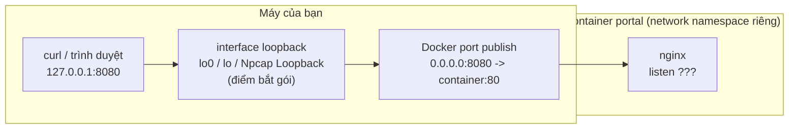

# Bài 46: Ping OK nhưng Web không vào? Dùng Wireshark tìm thủ phạm

**Arc 5 — Troubleshooting chaos lab**

> **Lab chạy ngay trên máy bạn** — chỉ cần Docker + Wireshark. Một container nginx, client chính là máy bạn. Không cần server lab, không cần containerlab, không cần WSL riêng. Dựng lab mất 30 giây.
> Bài song sinh: [47-tcpdump-cli-web-timeout](../47-tcpdump-cli-web-timeout/lab-guide.md) — sự cố cùng họ nhưng trên **server production qua SSH**, không GUI, giải bằng `tcpdump`. Làm bài 46 trước để "nhìn thấy" gói bằng mắt, rồi sang bài 47 tập đọc gói bằng chữ.

## Mục tiêu
- Rèn phản xạ: **`ping` thông không chứng minh gì về dịch vụ TCP**, và nặng hơn — **bắt tay TCP thành công cũng chưa chứng minh ứng dụng còn sống**. Bài này bạn sẽ thấy tận mắt một kết nối `Connected` đàng hoàng rồi chết.
- Đọc được **các chữ ký lỗi trên pcap** và phân biệt: RST ngay sau SYN — SYN lặp im lặng — **bắt tay xong rồi mới đứt**. Mỗi chữ ký chỉ về một nhóm nguyên nhân khác hẳn.
- Hiểu **port publish của Docker (`-p 8080:80`) thật sự làm gì**: nó chỉ đưa gói tới network namespace của container; ứng dụng bên trong bind vào địa chỉ nào lại là chuyện hoàn toàn khác — và đó là nơi sinh ra lỗi này.
- Dùng thành thạo Wireshark trên **loopback**: display filter, Follow TCP Stream, Flow Graph, Expert Information, cột time-delta.
- Kiểm chứng chéo bằng công cụ ngoài pcap: `nginx -T`, `/proc/net/tcp`, `wget` từ bên trong container.

## Yêu cầu tiên quyết
- **Docker** đang chạy: Docker Desktop (Windows/macOS), OrbStack (macOS), hoặc Docker Engine (Linux/WSL2).
- **Wireshark** — trên Windows nhớ cài kèm **Npcap** và tick *Support loopback traffic (Npcap Loopback Adapter)*; trên macOS cài kèm **ChmodBPF** (Wireshark hỏi lúc cài); trên Linux thêm user vào group `wireshark`.
- Kiến thức nền: TCP three-way handshake. Không cần biết trước Docker networking — bài sẽ chỉ ra.

Không cần containerlab. Không cần server lab. Không cần quyền admin ngoài phần cài Wireshark.

## Tình huống

Team app bàn giao cho bạn cổng thông tin nội bộ `internal-portal` đóng gói bằng Docker, kèm một `docker-compose.yml` và file config nginx. Bạn chạy đúng như hướng dẫn, container lên xanh, nhưng mở trình duyệt thì không ra trang. Trong nhóm chat:

> **Team app:** "Container `portal` **Up** rồi mà, `docker ps` thấy `0.0.0.0:8080->80/tcp` đàng hoàng. nginx trong đó chạy ngon, log không có lỗi nào. Máy anh **ping `127.0.0.1` thông** chứ gì? Vậy là mạng OK, chắc trình duyệt anh cache hỏng, xoá cache đi."
>
> **Bạn:** "Xoá rồi. `curl` cũng không được."
>
> **Team app:** "Lạ nhỉ, bên em máy nào cũng chạy 🤷"

Nhiệm vụ: **soi gói, chỉ mặt thủ phạm bằng bằng chứng**, đừng cãi nhau bằng cảm giác.

## Sơ đồ



File của lab: [`docker-compose.yml`](./docker-compose.yml), [`nginx/conf.d/default.conf`](./nginx/conf.d/default.conf), [`nginx/html/index.html`](./nginx/html/index.html).

## Chuẩn bị

```bash
cd bai-tap-ve-nha/46-wireshark-ping-ok-web-fail
docker compose up -d
docker ps --filter name=portal
```

Phải thấy: `portal   Up ...   0.0.0.0:8080->80/tcp`. Dọn dẹp khi xong: `docker compose down`.

## Bắt gói trên loopback

Traffic tới `127.0.0.1:8080` **không đi ra card mạng** — nó chạy trên loopback. Chọn đúng interface:

| Hệ điều hành | Interface trong Wireshark | Ghi chú |
|:---|:---|:---|
| Windows | **Adapter for loopback traffic capture** (Npcap) | Không có mục này = lúc cài Npcap chưa tick loopback → cài lại Npcap |
| macOS | **lo0** | Cần ChmodBPF (Wireshark cài kèm), nếu không thấy interface thì mở lại Wireshark sau khi cài |
| Linux / WSL2 | **lo** | Hoặc `any` |

Display filter dùng suốt bài: `tcp.port==8080`

> ⚠️ **Bẫy IPv6**: `curl http://localhost:8080` phân giải `localhost` ra `::1` **trước** `127.0.0.1`, nên gói của bạn sẽ là IPv6. Muốn gọn, ép IPv4: `curl -4 http://127.0.0.1:8080`. Nếu pcap trống trơn khi bạn chắc chắn đã gõ `curl`, gần như luôn là do lọc nhầm phiên bản IP hoặc chọn nhầm interface.

### Bộ lọc & tính năng Wireshark cần thuộc

| Display filter | Trả lời câu hỏi |
|:---|:---|
| `tcp.port==8080` | toàn bộ hội thoại với portal |
| `tcp.flags.syn==1 && tcp.flags.ack==0` | client có gửi SYN không |
| `tcp.flags.syn==1 && tcp.flags.ack==1` | **có ai bắt tay lại không** — câu hỏi then chốt của bài này |
| `tcp.flags.reset==1` | ai bắn RST, và bắn ở **thời điểm nào** trong phiên |
| `http` | có request/response HTTP nào không |
| `tcp.analysis.retransmission` | client gõ cửa mà không ai mở |

| Thao tác GUI | Dùng để |
|:---|:---|
| **View → Time Display Format → Seconds Since Previous Displayed Packet** | đo khoảng cách giữa các gói |
| **Statistics → Flow Graph** (tick *Limit to display filter*) | nhìn cả phiên dưới dạng sơ đồ mũi tên — bài này nhìn phát ra ngay |
| chuột phải gói → **Follow → TCP Stream** | xem request đã gửi đi và server trả lời gì (nếu có) |
| **Analyze → Expert Information** | Wireshark tự gắn cờ RST / bad TCP |

## Đề bài / Yêu cầu

1. Dựng lab (`docker compose up -d`) và xác nhận container `Up`, có publish `8080->80`.
2. Tái hiện lời khai của team app:
   ```bash
   ping -c 3 127.0.0.1                        # Windows: ping -n 3 127.0.0.1
   curl -4 -v -m 10 http://127.0.0.1:8080
   ```
   **Đọc từng dòng output `-v` của curl**: nó dừng lại ở bước nào? Có dòng `Connected to ...` không? Lỗi cuối cùng là gì? Ghi lại nguyên văn.
3. Bắt gói trên loopback trong lúc chạy `curl`, lọc `tcp.port==8080`. Trả lời bằng bằng chứng:
   - Có `[SYN]` đi ra không?
   - **Có `[SYN, ACK]` trả về không?** (`tcp.flags.syn==1 && tcp.flags.ack==1`)
   - Request HTTP có được gửi đi không? (`http`)
   - Có `[RST]` không, và nó xuất hiện **ở vị trí nào** trong phiên — ngay sau SYN, hay sau khi bạn đã gửi request?
   - Mở **Statistics → Flow Graph** và vẽ lại phiên ra giấy.
4. Đối chiếu bảng **chữ ký lỗi** phía dưới → khoanh nhóm nguyên nhân. Chú ý: kết luận ở bài này **khác** với "không ai nghe port 8080".
5. Từ kết luận đó, đặt câu hỏi tiếp: nếu **có ai đó bắt tay với bạn** nhưng không phải nginx, thì kẻ bắt tay là ai, và nginx đang ở đâu? Kiểm chứng bằng 3 đường độc lập với pcap:
   ```bash
   docker exec portal nginx -T | grep -n listen        # nginx nghĩ nó nghe ở đâu?
   docker exec portal sh -c 'cat /proc/net/tcp'         # kernel trong container đang bind địa chỉ nào? (hex!)
   docker exec portal wget -qO- -T 3 http://127.0.0.1/  # gọi từ BÊN TRONG container
   docker exec portal sh -c 'wget -qO- -T 3 http://$(hostname -i)/'   # gọi vào IP container
   ```
   Hai lệnh `wget` cuối cho kết quả trái ngược nhau — đó chính là câu trả lời.
6. Sửa lỗi trong file config của lab (`nginx/conf.d/default.conf`), rồi áp dụng. **Cẩn thận**: thử `docker exec portal nginx -s reload` trước và **kiểm tra lại `docker logs portal`** — nếu reload không ăn thì đừng đoán, hãy đọc log để biết vì sao, rồi mới chọn cách áp dụng khác.
7. Xác nhận đã sửa:
   - `curl -4 -sI http://127.0.0.1:8080` → `HTTP/1.1 200 OK`.
   - `docker exec portal sh -c 'cat /proc/net/tcp'` → địa chỉ bind đã đổi (so với bước 5).
   - Bắt gói lại → phiên đầy đủ: handshake, `GET /`, `200 OK`, đóng kết nối đẹp. **Follow → TCP Stream** đọc được nội dung trang.
8. Ghi báo cáo: chữ ký pcap quan sát được, nó loại bỏ giả thuyết nào, nguyên nhân gốc, cách sửa, và một câu trả lời cho team app.

### Bảng chữ ký lỗi — khi client "không vào được web"

| Client báo | Chữ ký trên pcap | Thủ phạm nhóm nào |
|:---|:---|:---|
| `Connection refused` — tức thì | `[SYN]` đi ra, `[RST, ACK]` về ngay, **chưa từng có `[SYN, ACK]`** | không có ai nghe ở port đó, hoặc firewall `reject` |
| `Connection timed out` — treo lâu | `[SYN]` lặp lại, delta 1s → 2s → 4s → 8s, không gì trả về | ai đó **DROP im lặng** (firewall), hoặc mất đường về |
| `Empty reply` / `Connection reset by peer` — **sau khi đã kết nối** | Handshake **đủ 3 bước**, request gửi đi, rồi `[RST]` | **có kẻ bắt tay hộ**: proxy / port-forward / load balancer nhận kết nối trước, backend phía sau không sống |

Dòng thứ ba là bài học của bài này: `Connected` trong log curl **không** có nghĩa là bạn đã nói chuyện được với ứng dụng.

## Lời giải tham khảo

<details>
<summary>⚠️ Bấm để xem lời giải — chỉ mở sau khi đã tự troubleshoot!</summary>

*(Toàn bộ output dưới đây lấy từ lần chạy thật: Docker 29.4.3, nginx 1.27.5-alpine.)*

### Bước 1 — `curl -v`: kết nối THÀNH CÔNG rồi mới chết

```
* Host localhost:8080 was resolved.
* IPv6: ::1
* IPv4: 127.0.0.1
*   Trying [::1]:8080...
* Connected to localhost (::1) port 8080          <-- bắt tay TCP xong
> GET / HTTP/1.1
> Host: localhost:8080
> User-Agent: curl/8.7.1
>
* Request completely sent off                     <-- request đã gửi
* Recv failure: Connection reset by peer          <-- rồi bị đạp
curl: (56) Recv failure: Connection reset by peer
```

Đọc kỹ: có `Connected`, có `Request completely sent off`. Nếu không ai nghe port 8080 thì curl đã báo `Connection refused` **trước khi** in dòng `Connected`. Vậy **có ai đó đang nghe ở 8080 và chấp nhận bắt tay** — nhưng kẻ đó không trả lời HTTP.

Còn `ping 127.0.0.1` thì tất nhiên 0% loss — nó chỉ chứng minh stack IP của chính máy bạn còn sống, không liên quan gì tới container.

> Ghi chú theo hệ điều hành: trên **Docker Desktop (macOS/Windows)**, `ping <IP container>` (ví dụ `172.18.0.2`) **không thông**, vì container sống trong một VM Linux và IP đó không được route từ host — 100% packet loss là bình thường, không phải triệu chứng. Trên **Docker Engine chạy thẳng trên Linux** thì ping IP container lại thông. Chi tiết này chính là ví dụ đắt giá cho câu "ping nói rất ít về dịch vụ".

### Bước 2 — pcap trên loopback: handshake đủ, rồi RST

Lọc `tcp.port==8080`, Flow Graph cho ra đúng hình này:

```
127.0.0.1:xxxxx                       127.0.0.1:8080
      |------------- [SYN] ---------------->|
      |<---------- [SYN, ACK] --------------|   <-- CÓ người bắt tay lại
      |------------- [ACK] ---------------->|
      |--- [PSH, ACK] GET / HTTP/1.1 ------>|   <-- request đi được
      |<----------- [RST, ACK] -------------|   <-- rồi bị reset
```

Ba dữ kiện, mỗi cái loại một nhóm nguyên nhân:
- `tcp.flags.syn==1 && tcp.flags.ack==1` → **có gói**. Loại giả thuyết "không ai nghe port 8080" và "firewall chặn im lặng".
- `http` → chỉ có **request**, không có **response**. Loại giả thuyết "nginx trả lỗi 4xx/5xx" (nếu vậy đã có response để đọc).
- `[RST]` xuất hiện **sau** request, không phải ngay sau SYN → kẻ bắt tay đã nhận request rồi mới phát hiện không có ai để chuyển tiếp.

Kết luận: thứ bắt tay với bạn ở `127.0.0.1:8080` **không phải nginx**. Đó là cơ chế port-publish của Docker (`docker-proxy` / cổng chuyển tiếp của Docker Desktop): nó nghe ở phía host, **bắt tay trước**, rồi mới thử nối tới `container:80`. Khi nối không được, nó đạp kết nối của bạn → RST.

### Bước 3 — nginx đang nghe ở đâu?

```bash
$ docker exec portal nginx -T | grep -n listen
138:    listen 127.0.0.1:80;
```

```bash
$ docker exec portal sh -c 'cat /proc/net/tcp'
  sl  local_address rem_address   st ...
   0: 0100007F:0050 00000000:0000 0A ...
```

`/proc/net/tcp` ghi địa chỉ dạng hex little-endian: `0100007F` = `7F.00.00.01` = **127.0.0.1**, `0050` = **port 80**. (Image `nginx:alpine` không có `ss`/`netstat`, đọc thẳng `/proc/net/tcp` là cách chắc ăn nhất — nhớ mẹo này.)

Bằng chứng cuối, đối chứng hai chiều ngay bên trong container:

```bash
$ docker exec portal wget -qO- -T 3 http://127.0.0.1/
<!doctype html>
<meta charset="utf-8">
<title>internal-portal</title>                    <-- gọi vào loopback: CHẠY

$ docker exec portal sh -c 'wget -qO- -T 3 http://$(hostname -i)/'
wget: can't connect to remote host (172.18.0.2): Connection refused   <-- gọi vào IP container: TỪ CHỐI
```

Nguyên nhân gốc: file `nginx/conf.d/default.conf` ghi `listen 127.0.0.1:80;`. nginx **chỉ nghe loopback bên trong network namespace của container** — mà loopback của container là một thế giới riêng, không phải loopback của máy bạn. Docker publish gói tới `172.18.0.2:80`, đúng cái địa chỉ nginx từ chối.

Config kiểu này rất hay gặp thật: nó đúng khi ứng dụng chạy sau một reverse proxy **cùng máy**, và người ta bê nguyên vào container mà quên rằng trong container không còn ai đứng trước nữa.

**`-p 8080:80` không hề bảo đảm ứng dụng nghe ở `0.0.0.0`.** Docker chỉ đưa gói tới cửa nhà container; ứng dụng bên trong bind ở đâu là việc của nó.

### Bước 4 — Sửa: và cái bẫy `nginx -s reload`

Sửa `nginx/conf.d/default.conf`:
```nginx
listen 80;          # thay cho: listen 127.0.0.1:80;
```

Thử reload trước (compose mount cả thư mục nên container thấy file mới ngay):
```bash
$ docker exec portal nginx -T | grep listen
    listen 80;                      # config mới đã vào tới container

$ docker exec portal nginx -s reload
$ curl -4 -sS -m 5 http://127.0.0.1:8080
curl: (56) Recv failure: Connection reset by peer      # ... vẫn hỏng!
```

Đừng đoán — **đọc log**:
```bash
$ docker logs --tail 8 portal
[emerg] 1#1: bind() to 0.0.0.0:80 failed (98: Address in use)
[notice] 1#1: try again to bind() after 500ms
[emerg] 1#1: bind() to 0.0.0.0:80 failed (98: Address in use)
...
```

Rõ ràng: khi reload, master nginx muốn mở socket mới `0.0.0.0:80`, nhưng socket cũ `127.0.0.1:80` **vẫn đang giữ port 80** → `Address in use` → nginx quay về giữ nguyên cấu hình cũ. Kiểm chứng: `/proc/net/tcp` vẫn là `0100007F:0050`.

Vậy phải khởi động lại tiến trình để nhả socket:
```bash
$ docker compose restart portal
$ docker exec portal sh -c 'cat /proc/net/tcp' | sed -n 2p
   0: 00000000:0050 ...        # 00000000 = 0.0.0.0 -> nghe mọi địa chỉ

$ curl -4 -sI http://127.0.0.1:8080
HTTP/1.1 200 OK
Server: nginx/1.27.5
```

Bắt gói lại: handshake → `GET /` → `HTTP/1.1 200 OK` → `[FIN, ACK]` đóng đẹp. **Follow → TCP Stream** đọc được nguyên trang `internal-portal OK`.

Xem access log của nginx còn thêm một chi tiết đáng nhớ:
```bash
$ docker logs --tail 1 portal
192.168.65.1 - - [15/Aug/2026:01:14:28 +0000] "GET / HTTP/1.1" 200 181 "-" "curl/8.7.1"
```
IP nguồn **không phải** `127.0.0.1` mà là `192.168.65.1` — gateway của VM Docker Desktop. Gói của bạn đã bị NAT trên đường vào container. (Trên Docker Engine/Linux bạn sẽ thấy `172.x.0.1`.) Nhớ điều này khi debug bằng access log: IP trong log là IP **sau NAT**, không phải IP thật của client.

### Câu hỏi tự kiểm

1. Nếu bạn tắt hẳn container (`docker compose stop portal`) rồi `curl -4 http://127.0.0.1:8080`, pcap khác thế nào? (Không còn ai nghe 8080 → `[RST]` ngay sau `[SYN]`, không có `[SYN, ACK]`, curl báo `Connection refused` tức thì. Đây chính là dòng 1 của bảng chữ ký — thử để nhìn tận mắt sự khác nhau với dòng 3.)
2. Vì sao lỗi này **không hiện trong `docker logs`** ở trạng thái ban đầu? (nginx không hề biết có ai gọi nó — gói chưa bao giờ tới được nginx. Không request → không log. "Log sạch" không có nghĩa là "không có sự cố".)
3. Nếu ứng dụng nghe `0.0.0.0:80` nhưng bạn publish nhầm `-p 8080:8080` thì pcap trông thế nào? (Giống hệt bài này: bắt tay xong rồi RST — vì Docker vẫn bắt tay hộ ở 8080 phía host, nhưng bên trong container không ai nghe 8080. Cùng chữ ký, khác nguyên nhân → phải kiểm chứng thêm bằng `nginx -T` và `/proc/net/tcp`.)
4. Trên máy thật, còn ai hay "bắt tay hộ" rồi RST như vậy nữa? (Load balancer/reverse proxy khi backend chết, dịch vụ NAT/port-forward của firewall, service mesh sidecar. Chữ ký pcap y hệt — nên khi thấy nó, hãy nghĩ tới "tôi đang nói chuyện với trung gian, không phải với ứng dụng".)

Bài học thực chiến: `ping` thông chỉ chứng minh L3 tới được đích; và như bài này cho thấy, **ngay cả handshake TCP thành công cũng chưa chứng minh ứng dụng còn sống** — chỉ chứng minh có *ai đó* nghe ở port đó. Vị trí của gói `RST` trong phiên là dấu vân tay: RST ngay sau SYN = không ai nghe; RST sau khi bạn gửi request = có trung gian bắt tay hộ, backend chết. Với container, luôn tách bạch hai câu hỏi: *gói có tới được namespace của container không* (`-p` lo việc này) và *ứng dụng trong đó bind vào địa chỉ nào* (`/proc/net/tcp` trả lời). Cuối cùng: khi thao tác sửa "không ăn", đọc log trước khi đoán — `Address in use` nói thẳng cho bạn biết vì sao reload vô nghĩa.

</details>

## Dọn dẹp

```bash
docker compose down
```

## Thảo luận và hỏi đáp
Bài tập này tự làm và tự xác minh kết quả. Nếu có thắc mắc hoặc cần trao đổi thêm, các bạn hãy đăng bài thảo luận trên group Facebook [Network Thực Chiến](https://www.facebook.com/profile.php?id=61591373979991).

## Bài tiếp theo
→ [47-tcpdump-cli-web-timeout](../47-tcpdump-cli-web-timeout/lab-guide.md): cùng họ sự cố nhưng trên server production — **không có GUI**, chỉ SSH và `tcpdump`, không được mang pcap ra khỏi hệ thống.
