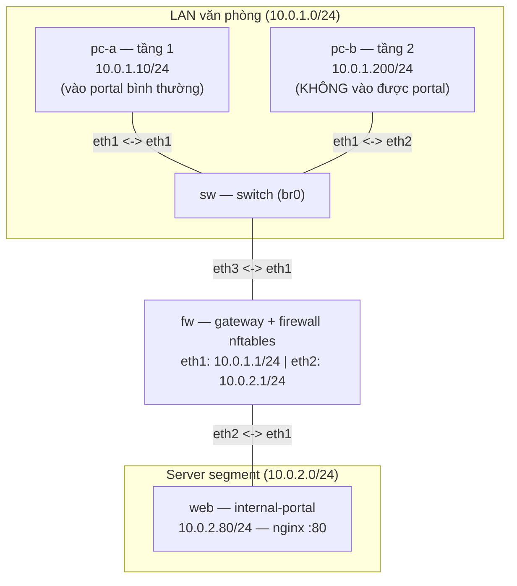

# Bài 46: Ping OK nhưng Web không vào? Dùng Wireshark tìm thủ phạm

**Arc 5 — Troubleshooting chaos lab**

## Mục tiêu
- Rèn phản xạ: **`ping` thông chỉ chứng minh L3 tới được đích** — nó không nói gì về TCP, về port, về firewall. Ticket "ping được mà không vào được web" là ticket bị đổ lỗi lung tung nhất.
- Đọc được **3 chữ ký lỗi trên pcap** và phân biệt chúng: `refused` (có RST) — `timeout im lặng` (DROP) — `unreachable` (ICMP type 3). Mỗi chữ ký chỉ về một nhóm nguyên nhân khác hẳn nhau.
- Thành thạo quy trình **bắt gói nhiều điểm rồi đối chiếu pcap** để khoanh vùng chính xác hop nào nuốt gói — thay vì mở config ra đoán.
- Dùng Wireshark đúng cách: display filter, cột time-delta để nhìn TCP retransmission backoff, Follow TCP Stream, Flow Graph, Expert Information.
- Không có bất kỳ gợi ý nào về vị trí lỗi.

## Yêu cầu tiên quyết
Hoàn thành [17-nftables-firewall](../17-nftables-firewall/lab-guide.md) và [07-dhcp-server-relay](../07-dhcp-server-relay/lab-guide.md) (phần bắt gói với Wireshark — có [video hướng dẫn](https://youtu.be/uJw78eOtZ58)). Máy cá nhân cần cài sẵn **Wireshark**.

## Tình huống

Cổng thông tin nội bộ `internal-portal` (nginx trên máy `web`, `10.0.2.80`) phục vụ LAN văn phòng qua gateway kiêm firewall `fw`. Helpdesk chuyển ticket lên:

> "Mấy anh chị **tầng 2** kêu không vào được portal, cả tuần nay rồi. Tầng 1 thì vẫn dùng bình thường nên bọn em nghĩ không phải lỗi server. Em đã test giúp: từ máy tầng 2 **ping `10.0.2.80` vẫn thông 0% loss**, DNS không liên quan vì mọi người gõ thẳng IP. Team app khẳng định nginx chạy ngon, còn team mạng bảo 'ping thông tức là mạng OK, đi mà hỏi team app'. Hai bên đá qua đá lại cả tuần. Anh soi gói xem thật sự chuyện gì xảy ra với gói tin đi?"

Trong lab: `pc-a` (`10.0.1.10`) là máy tầng 1 — chạy tốt, dùng làm **đối chứng**. `pc-b` (`10.0.1.200`) là máy tầng 2 — máy bị lỗi.

## Sơ đồ topology


Xem [`topology/wireshark-web.clab.yml`](./topology/wireshark-web.clab.yml) và [`nftables/ruleset.nft`](./nftables/ruleset.nft).

## Bắt gói tin — 2 cách

### Cách 1: VS Code Containerlab extension (xem realtime, tiện nhất)
Theo [WINDOWS_STUDENT_GUIDE.md](../../WINDOWS_STUDENT_GUIDE.md):
1. Bấm biểu tượng **Containerlab** ở thanh bên trái IDE → cây lab hiện ra danh sách node và interface.
2. Chuột phải vào **interface** cần soi (ví dụ `pc-b / eth1`) → chọn **Capture Traffic**.
3. Wireshark tự mở, bắt gói realtime. Chạy `curl` ở terminal khác rồi nhìn gói chảy vào.

### Cách 2: pcap + `docker cp` + `scp` (giữ bằng chứng, so nhiều điểm bắt)
```bash
# Trên server lab — bắt nền, chạy curl, dừng bắt
docker exec -d pc-b tcpdump -ni eth1 -w /tmp/pcb.pcap 'host 10.0.2.80'
docker exec pc-b curl -m 30 -sS http://10.0.2.80 ; docker exec pc-b pkill tcpdump
docker cp pc-b:/tmp/pcb.pcap .

# Trên máy cá nhân — kéo file về rồi mở bằng Wireshark
scp ubuntu@<server-lab>:~/pcb.pcap .
```
Đây là cách bắt buộc cho bài này: bạn cần **nhiều file pcap ở nhiều điểm** để đặt cạnh nhau so sánh. Đặt tên file theo điểm bắt (`pcb-eth1.pcap`, `fw-eth1.pcap`, `fw-eth2.pcap`, `web-eth1.pcap`) — lát nữa sẽ hiểu vì sao.

### Bộ lọc Wireshark cần thuộc

| Display filter | Trả lời câu hỏi |
|:---|:---|
| `tcp.flags.syn==1 && tcp.flags.ack==0` | client có gửi SYN không, gửi lại mấy lần |
| `tcp.analysis.retransmission` | client đang gõ cửa mà không ai mở |
| `tcp.flags.reset==1` | có ai bắn RST không → phân biệt DROP với REJECT |
| `icmp` | có ICMP unreachable / frag-needed không |
| `http` | request/response tầng ứng dụng |
| `ip.addr==10.0.2.80` | toàn bộ hội thoại với server |

Mẹo dùng: **View → Time Display Format → Seconds Since Previous Displayed Packet** để nhìn thẳng khoảng cách giữa các lần retransmit. Thêm: **Statistics → Flow Graph** (vẽ sơ đồ mũi tên, đặt cạnh nhau so `pc-a` vs `pc-b` là thấy ngay), **Statistics → Conversations**, **Analyze → Expert Information**, và chuột phải một gói → **Follow → TCP Stream**.

## Đề bài / Yêu cầu

1. Deploy topology:
   ```bash
   cd topology && sudo clab deploy -t wireshark-web.clab.yml
   ```
2. Tái hiện đúng ticket của helpdesk:
   ```bash
   docker exec pc-b ping -c 3 10.0.2.80                                    # thông, 0% loss
   docker exec pc-a curl -m 10 -sI http://10.0.2.80                        # 200 OK
   docker exec pc-b curl -m 10 -sS http://10.0.2.80                        # thất bại
   ```
   **Đọc kỹ thông báo lỗi của `curl` trên `pc-b`** và ghi lại nó — chỉ riêng câu chữ đó đã loại được một nửa số nguyên nhân khả dĩ.
3. Bắt gói tại `pc-b` trong lúc `curl` chạy. Trả lời bằng bằng chứng, không đoán:
   - SYN có **rời khỏi** máy client không?
   - Có gói nào **trả về** không — RST? SYN-ACK? ICMP?
   - Khoảng cách thời gian giữa các lần client gửi lại SYN là bao nhiêu, có quy luật gì?
   - Từ 3 câu trên, đối chiếu bảng "3 chữ ký lỗi" phía dưới → thủ phạm thuộc nhóm nào?
4. Khoanh vùng **hop nào nuốt gói**. Bắt gói song song ở nhiều điểm trong lúc `curl` từ `pc-b`, rồi so các pcap:
   ```bash
   docker exec -d sw  tcpdump -ni br0  -w /tmp/sw.pcap     'tcp port 80'
   docker exec -d fw  tcpdump -ni eth1 -w /tmp/fw-in.pcap  'tcp port 80'
   docker exec -d fw  tcpdump -ni eth2 -w /tmp/fw-out.pcap 'tcp port 80'
   docker exec -d web tcpdump -ni eth1 -w /tmp/web.pcap    'tcp port 80'
   ```
   Điểm cuối cùng còn thấy gói, và điểm đầu tiên không thấy gói nữa — kẹp giữa hai điểm đó chính là thủ phạm.
5. Đối chứng: lặp lại đúng bộ lệnh trên trong lúc `curl` từ **`pc-a`**. So hai bộ pcap. Khác nhau ở chỗ nào, và điều đó nói gì về nguyên nhân?
6. Xác nhận nguyên nhân bằng một đường độc lập với pcap (không dùng pcap để tự chứng minh pcap). Gợi mở: bộ đếm rule và cơ chế trace của nftables.
7. Sửa lỗi. **Sửa file cấu hình rồi nạp lại**, không gõ lệnh tạm (production reboot là mất). **KHÔNG dùng `docker restart`.**
8. Xác nhận đã sửa xong:
   - `docker exec pc-b curl -sI http://10.0.2.80` → `HTTP/1.1 200 OK`.
   - `docker exec pc-a curl -sI http://10.0.2.80` → vẫn `200 OK` (không làm hỏng cái đang chạy).
   - Bắt gói lại tại `pc-b` → thấy đủ handshake 3 bước + `HTTP/1.1 200 OK` trong Follow TCP Stream.
9. Ghi lại báo cáo: từng bước đưa ra giả thuyết gì, pcap nào bác bỏ/xác nhận giả thuyết đó, nguyên nhân gốc, và câu trả lời cho helpdesk (lỗi của team nào 😄).

### 3 chữ ký lỗi trên pcap — bảng tra khi client "không vào được"

| Client báo | Chữ ký trên pcap | Thủ phạm nhóm nào |
|:---|:---|:---|
| `Connection refused` — **tức thì** | SYN đi ra, RST quay về ngay | không có socket nghe ở port đó, **hoặc** firewall `reject with tcp reset` |
| `Connection timed out` — **treo lâu rồi mới báo** | SYN gửi lại nhiều lần, khoảng cách 1s → 2s → 4s → 8s, **không có gì trả về** | ai đó **DROP im lặng** (firewall), hoặc gói đi được mà không có đường về |
| `Network is unreachable` / `No route to host` | ICMP type 3 trả về, hoặc lỗi ngay tại máy client | thiếu route, `ip rule ... unreachable`, sai gateway |

Điểm mấu chốt của bài: DROP **không sinh ra gói nào cả**. Với DROP, "trên pcap không có gì" chính là bằng chứng — không phải là thiếu bằng chứng.

## Lời giải tham khảo

<details>
<summary>⚠️ Bấm để xem lời giải — chỉ mở sau khi đã tự troubleshoot!</summary>

### Bước 1 — Đọc thông báo lỗi: `timeout`, không phải `refused`

```
curl: (28) Connection timed out after 10001 milliseconds
```

`curl` treo đủ 10 giây rồi mới bỏ cuộc. Nếu nginx không nghe port 80, hoặc firewall dùng `reject with tcp reset`, thì client đã nhận RST và báo `Connection refused` **ngay lập tức**. Treo lâu = **không ai trả lời gì hết**. Loại luôn giả thuyết "nginx chết / sai port" mà không cần đụng vào server.

### Bước 2 — pcap tại `pc-b`: SYN đi ra, không gì quay về

Lọc `ip.addr==10.0.2.80`, bật cột time-delta:

```
0.000000  10.0.1.200 → 10.0.2.80  TCP  [SYN] Seq=0 Win=64240 Len=0 MSS=1460
1.020000  10.0.1.200 → 10.0.2.80  TCP  [TCP Retransmission] [SYN] ...
2.050000  10.0.1.200 → 10.0.2.80  TCP  [TCP Retransmission] [SYN] ...
4.100000  10.0.1.200 → 10.0.2.80  TCP  [TCP Retransmission] [SYN] ...
```

Ba dữ kiện, mỗi cái loại một nhóm nguyên nhân:
- SYN **có** rời máy client → không phải lỗi định tuyến/gateway tại client (`tcp.flags.syn==1 && tcp.flags.ack==0` có gói).
- `tcp.flags.reset==1` → **rỗng**. Không ai bắn RST → không phải port đóng, không phải `reject`.
- `icmp` → **rỗng** (trong pcap của phiên `curl`, dù `ping` vẫn chạy được). Không phải thiếu route.

Khoảng cách 1s → 2s → 4s → 8s là **exponential backoff** của TCP khi gửi lại SYN — chữ ký kinh điển của "gói bị nuốt im lặng". Analyze → Expert Information cũng gắn cờ `Retransmission (suspected)`.

Kết luận bước này: có thứ gì đó trên đường đi **DROP** gói. Chưa biết ở đâu — pcap tại client không trả lời được câu đó.

### Bước 3 — Bắt nhiều điểm: kẹp thủ phạm giữa hai pcap

| Điểm bắt | SYN từ `10.0.1.200` | Ý nghĩa |
|:---|:---:|:---|
| `pc-b eth1` | ✅ có | client gửi thật |
| `sw br0` | ✅ có | qua switch LAN OK |
| `fw eth1` (vào) | ✅ có | **tới được firewall** |
| `fw eth2` (ra) | ❌ không | **không đi ra khỏi firewall** |
| `web eth1` | ❌ không | server chưa từng nhìn thấy gói này |

Gói chết **bên trong `fw`**. Server hoàn toàn vô can — và giờ ta có bằng chứng chứ không phải lời khai. Đây là lý do phải bắt cả `eth1` lẫn `eth2` của cùng một thiết bị: chênh lệch giữa hai pcap chỉ ra gói bị bỏ **ở tầng netfilter**, không phải rơi trên dây.

### Bước 4 — Đối chứng với `pc-a`: cùng đường đi, kết quả ngược nhau

Lặp lại y hệt với `pc-a`: pcap tại `fw eth2` **có** SYN từ `10.0.1.10`, `web eth1` thấy SYN, handshake xong, Follow TCP Stream đọc được `HTTP/1.1 200 OK`.

Hai máy **cùng subnet, cùng gateway, cùng đích, cùng port** — một máy qua, một máy bị chặn. Khác biệt duy nhất còn lại là **địa chỉ nguồn**. Đây là manh mối quyết định: thứ nuốt gói phải là thứ biết phân biệt theo source IP.

### Bước 5 — Xác nhận độc lập bằng nftables

```bash
docker exec fw nft list ruleset -a
```
```
table inet filter {
    chain forward {
        type filter hook forward priority 0; policy drop;
        ct state established,related accept
        ip protocol icmp accept
        ip saddr 10.0.1.0/25 tcp dport 80 accept
    }
}
```

Thủ phạm: `10.0.1.0/**25**` — không phải `/24`. Dải `/25` chỉ phủ `10.0.1.0` → `10.0.1.127`:
- `pc-a` = `.10` → khớp rule → `accept`.
- `pc-b` = `.200` → **không khớp** → không rule nào nhận → rơi xuống `policy drop` → gói biến mất, không hồi âm.

Rule này viết từ hồi LAN văn phòng còn là `/25`. Khi công ty thuê thêm tầng 2 và mở rộng lên `/24`, người ta sửa DHCP, sửa địa chỉ gateway — nhưng quên rule firewall. Máy tầng 1 vẫn chạy nên không ai nghi ngờ suốt cả tuần.

Còn vì sao **ping vẫn thông**? Vì `ip protocol icmp accept` là rule riêng, **không hề lọc theo source** — nó cho qua toàn bộ ICMP của cả `/24`. Cái bẫy nằm ở đó: người ta lấy kết quả ping (rule A) để kết luận về HTTP (rule B).

Muốn xem thẳng phán quyết của kernel (tùy chọn, nâng cao):
```bash
docker exec fw nft add rule inet filter forward meta nftrace set 1
docker exec -d fw sh -c 'nft monitor trace > /tmp/trace.log 2>&1'
docker exec pc-b curl -m 5 -sS http://10.0.2.80
docker exec fw sh -c 'pkill -f "nft monitor"; cat /tmp/trace.log'   # thấy verdict drop tại policy
```

### Bước 6 — Sửa: chữa file rồi nạp lại

```bash
docker exec fw sed -i 's#ip saddr 10.0.1.0/25 tcp dport 80 accept#ip saddr 10.0.1.0/24 tcp dport 80 accept#' /etc/nftables/ruleset.nft
docker exec fw nft -f /etc/nftables/ruleset.nft     # file có 'flush ruleset' → nạp lại là sạch, không chồng rule
docker exec fw nft list ruleset
```

**Xác nhận cuối:**
```bash
docker exec pc-b curl -sI http://10.0.2.80    # HTTP/1.1 200 OK
docker exec pc-a curl -sI http://10.0.2.80    # HTTP/1.1 200 OK — không làm hỏng cái đang chạy
```

Bắt gói lại tại `pc-b`: SYN → SYN-ACK → ACK → `GET /` → `HTTP/1.1 200 OK`, không còn dòng `[TCP Retransmission]` nào. Follow TCP Stream đọc được nguyên nội dung trang.

### Câu hỏi tự kiểm

1. Nếu rule là `reject with tcp reset` thay vì `policy drop` thì pcap tại `pc-b` khác thế nào, và `curl` sẽ báo lỗi gì? (Gợi ý: thử `nft insert rule inet filter forward ip saddr 10.0.1.200 tcp dport 80 reject with tcp reset` rồi bắt gói lại — nhớ xoá sau khi thử.)
2. Vì sao `tcpdump` trên `fw eth1` **vẫn thấy** gói dù nftables đã drop nó? (Vì tcpdump/AF_PACKET tap vào gói **trước** khi netfilter xử lý ở chiều vào. Đây là cái bẫy khiến nhiều người kết luận sai "firewall không chặn, tôi thấy gói mà" — thấy ở `eth1` không có nghĩa là gói sống sót. Chính vì vậy bài này bắt cả `eth2`: gói **ra** mới là bằng chứng gói được cho qua.)
3. Nếu bắt gói ở `web eth1` thấy SYN tới nhưng client vẫn timeout, giả thuyết tiếp theo là gì? (Đứt **chiều về** — thiếu route ngược, hoặc firewall thiếu `ct state established,related accept`.)

Bài học thực chiến: `ping` và `curl` đi qua **những rule khác nhau** — dùng kết quả ping để kết luận về dịch vụ TCP là sai lầm phổ biến nhất trong ticket "mạng OK, lỗi tại app". Khi client báo timeout im lặng, đừng đọc config đoán mò: bắt gói **hai đầu của từng thiết bị nghi ngờ**, tìm điểm cuối cùng còn thấy gói — thủ phạm nằm ngay sau đó. Và luôn giữ một **máy đối chứng đang chạy tốt**: khác biệt giữa hai pcap thu hẹp phạm vi nhanh hơn mọi suy luận. Cuối cùng, mọi lỗi kiểu này đều có một biến thể ngoài đời thật: `/25` với `/24`, `10.0.1.0` với `10.0.10.0`, port 80 với 8080 — firewall không bao giờ báo lỗi cho bạn, nó chỉ im lặng.

</details>

## Thảo luận và hỏi đáp
Bài tập này tự làm và tự xác minh kết quả. Nếu có thắc mắc hoặc cần trao đổi thêm, các bạn hãy đăng bài thảo luận trên group Facebook [Network Thực Chiến](https://www.facebook.com/profile.php?id=61591373979991).

## Bài tiếp theo
→ Cập nhật sau (Học tiếp các Arc nâng cao tiếp theo)
