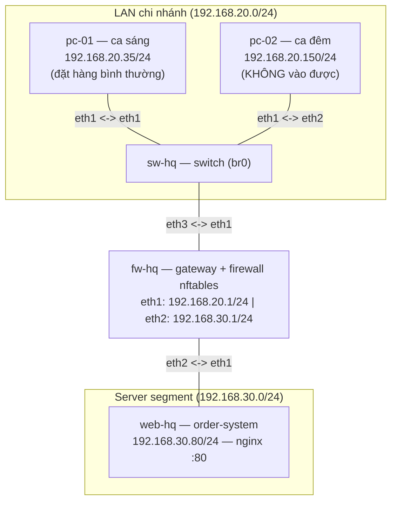

# Bài 47: Không có GUI — troubleshoot "web timeout" bằng tcpdump trên server

**Arc 5 — Troubleshooting chaos lab**

> **Bài này chạy trên server lab qua SSH** — không GUI, không Wireshark, không được mang pcap ra khỏi hệ thống. Toàn bộ kết luận phải rút ra ngay trên terminal.
> Bài song sinh: [46-wireshark-ping-ok-web-fail](../46-wireshark-ping-ok-web-fail/lab-guide.md) — cùng chủ đề "ping thông mà web không vào", nhưng chạy bằng **1 container Docker ngay trên máy bạn** và giải bằng **Wireshark GUI**. Chữ ký lỗi ở đó là *bắt tay xong rồi bị RST*; ở bài này là *SYN im lặng không ai trả lời* — hai đầu đối lập của cùng một bảng tra. Nên làm bài 46 trước để "nhìn thấy" gói, rồi sang bài này tập đọc gói bằng chữ.

## Mục tiêu
- Troubleshoot sự cố mạng khi **chỉ có SSH**: không GUI, không export pcap ra ngoài (chính sách dữ liệu) — tình huống thật ở mọi hệ thống production nghiêm túc.
- Đọc thành thạo output `tcpdump`: cú pháp **TCP flags rút gọn** (`[S]`, `[S.]`, `[.]`, `[P.]`, `[R]`, `[F.]`), sequence/ack, cờ `DF`, TTL.
- Dịch qua lại giữa **display filter của Wireshark** và **BPF capture filter** của tcpdump — hai ngôn ngữ khác nhau, nhầm là bắt trượt.
- Thay từng tính năng GUI bằng tuỳ chọn CLI tương đương: `-ttt` thay cột time-delta, `-A` thay Follow Stream, `-c`/`| wc -l` thay Statistics, `-r` thay File → Open.
- Bổ sung công cụ chỉ có trên host: `ss -tn state syn-sent` (socket đang kẹt), bộ đếm `counter` của nftables.
- Không có bất kỳ gợi ý nào về vị trí lỗi.

## Yêu cầu tiên quyết
Hoàn thành [17-nftables-firewall](../17-nftables-firewall/lab-guide.md). Rất nên làm [46-wireshark-ping-ok-web-fail](../46-wireshark-ping-ok-web-fail/lab-guide.md) trước — bài đó cho bạn hình ảnh trực quan của cùng nhóm triệu chứng, bài này rèn kỹ năng đọc nó bằng chữ.

## Tình huống

2 giờ sáng, bạn trực on-call. Chi nhánh vừa mở **ca đêm**, cấp thêm một loạt máy mới cho nhân viên ca này. Tin nhắn từ trưởng ca:

> "Máy ca đêm không vào được hệ thống đặt hàng `192.168.30.80`, mở trình duyệt quay mãi rồi báo hết giờ. Máy ca sáng thì vẫn vào bình thường — em mượn máy chị Lan (ca sáng) đặt hàng vẫn được. Em **ping `192.168.30.80` từ máy ca đêm thấy thông**, mạng có vấn đề gì đâu? Chắc hệ thống nó chặn tài khoản ca đêm à anh?"

Ràng buộc của bạn đêm nay:
- Chỉ có **SSH vào server lab** — không có màn hình, không cài được Wireshark.
- **Không được copy file pcap ra khỏi hệ thống** (chính sách bảo mật dữ liệu khách hàng). Bắt gói được, nhưng phân tích phải xong tại chỗ.
- `pc-01` (`192.168.20.35`) = máy ca sáng, chạy tốt → dùng làm **đối chứng**. `pc-02` (`192.168.20.150`) = máy ca đêm, bị lỗi.

## Sơ đồ topology


Xem [`topology/tcpdump-web.clab.yml`](./topology/tcpdump-web.clab.yml) và [`nftables/ruleset.nft`](./nftables/ruleset.nft).

## Bộ đồ nghề CLI

### Dịch từ Wireshark sang tcpdump

Hai ngôn ngữ **khác nhau**: Wireshark lọc *sau khi bắt* (display filter), tcpdump lọc *trước khi bắt* (BPF capture filter). Bảng chuyển đổi cho bài này:

| Wireshark (display filter) | tcpdump (BPF capture filter) |
|:---|:---|
| `ip.addr==192.168.30.80` | `host 192.168.30.80` |
| `ip.src==192.168.20.150` | `src 192.168.20.150` |
| `tcp.port==80` | `tcp port 80` |
| `tcp.flags.syn==1 && tcp.flags.ack==0` | `'tcp[tcpflags] & tcp-syn != 0 and tcp[tcpflags] & tcp-ack == 0'` |
| `tcp.flags.reset==1` | `'tcp[tcpflags] & tcp-rst != 0'` |
| `icmp` | `icmp` |
| `ip.src==A && tcp.port==80` | `'src A and tcp port 80'` |

Lưu ý: `tcp.analysis.retransmission` **không có bản BPF** — đó là phân tích do Wireshark suy ra, không phải trường trong gói. Trên CLI bạn tự nhận ra retransmission bằng cách nhìn **cùng một seq lặp lại** và khoảng thời gian giữa chúng.

### Thay từng tính năng GUI

| Wireshark GUI | tcpdump / CLI |
|:---|:---|
| cột *Seconds since previous displayed packet* | `tcpdump -ttt` (delta giữa 2 gói liên tiếp) |
| Follow → TCP Stream | `tcpdump -A` (in payload ASCII) hoặc `-X` (hex + ASCII) |
| File → Open | `tcpdump -r file.pcap` |
| Statistics → Conversations (đếm gói) | `tcpdump -c 20` hoặc `tcpdump ... \| wc -l` |
| cột Source MAC | `tcpdump -e` (in header Ethernet) |
| Expert Information | mắt bạn 🙂 — đọc seq lặp, đọc khoảng thời gian |

Cờ hay dùng: `-nn` (không phân giải DNS lẫn tên port — luôn bật, tránh treo), `-i <iface>`, `-c N` (dừng sau N gói), `-s0` (bắt trọn gói), `-v`, và bọc bằng `timeout 15 tcpdump ...` để tự dừng.

### Đọc TCP flags trong output tcpdump

| Ký hiệu | Nghĩa |
|:---|:---|
| `[S]` | SYN — mở kết nối |
| `[S.]` | SYN+ACK — server chấp nhận (dấu `.` = ACK) |
| `[.]` | ACK trơn |
| `[P.]` | PSH+ACK — có dữ liệu (request/response) |
| `[F.]` | FIN+ACK — đóng đẹp |
| `[R]` / `[R.]` | RST — **từ chối thẳng** |

Nguyên tắc đọc: xem có `[S]` đi ra không, có `[S.]` về không, có `[R]` không. Ba câu đó phân loại được gần hết sự cố "không vào được".

## Đề bài / Yêu cầu

1. Deploy topology trên server lab:
   ```bash
   cd topology && sudo clab deploy -t tcpdump-web.clab.yml
   ```
2. Tái hiện lời khai của trưởng ca:
   ```bash
   docker exec pc-02 ping -c 3 192.168.30.80                     # thông, 0% loss
   docker exec pc-01 curl -m 10 -sI http://192.168.30.80         # 200 OK
   docker exec pc-02 curl -m 10 -sS http://192.168.30.80         # thất bại
   ```
   **Ghi nguyên văn thông báo lỗi của `curl`** — nó đã loại sẵn một nhóm nguyên nhân trước khi bạn bắt gói.
3. Bắt gói tại `pc-02` bằng tcpdump, dùng `-ttt` để đọc khoảng cách thời gian. Chạy 2 terminal (hoặc `-d` + `pkill`):
   ```bash
   # Terminal 1
   docker exec pc-02 timeout 20 tcpdump -nni eth1 -ttt 'host 192.168.30.80'
   # Terminal 2
   docker exec pc-02 curl -m 15 -sS http://192.168.30.80
   ```
   Trả lời bằng bằng chứng: có `[S]` đi ra không? có `[S.]` hay `[R]` về không? có `icmp` không? khoảng cách giữa các lần gửi lại theo quy luật gì?
4. Đối chiếu bảng **3 chữ ký lỗi** phía dưới → khoanh nhóm nguyên nhân.
5. Khoanh vùng **hop nào nuốt gói**: bắt song song ở nhiều điểm rồi so số gói bắt được. Không copy file ra ngoài — đọc thẳng:
   ```bash
   docker exec -d sw-hq  tcpdump -nni br0  -w /tmp/sw.pcap     'tcp port 80'
   docker exec -d fw-hq  tcpdump -nni eth1 -w /tmp/fw-in.pcap  'tcp port 80'
   docker exec -d fw-hq  tcpdump -nni eth2 -w /tmp/fw-out.pcap 'tcp port 80'
   docker exec -d web-hq tcpdump -nni eth1 -w /tmp/web.pcap    'tcp port 80'
   docker exec pc-02 curl -m 15 -sS http://192.168.30.80
   docker exec fw-hq pkill tcpdump ; docker exec sw-hq pkill tcpdump ; docker exec web-hq pkill tcpdump
   docker exec fw-hq  tcpdump -nn -ttt -r /tmp/fw-in.pcap
   docker exec fw-hq  tcpdump -nn -ttt -r /tmp/fw-out.pcap
   docker exec web-hq tcpdump -nn -ttt -r /tmp/web.pcap
   ```
   Điểm cuối cùng còn thấy gói, và điểm đầu tiên không thấy gói nữa — thủ phạm nằm kẹp giữa hai điểm đó.
6. Lặp lại toàn bộ bước 5 với `pc-01` (máy đối chứng). Khác biệt duy nhất giữa hai lượt là gì?
7. Bổ sung 2 góc nhìn mà pcap không cho:
   - Trên client: `docker exec pc-02 ss -tn state syn-sent` trong lúc `curl` đang treo — socket đang ở trạng thái nào?
   - Trên firewall: bộ đếm rule (`nft list ruleset -a`), và nếu muốn xem thẳng phán quyết kernel thì dùng `meta nftrace` + `nft monitor trace`.
8. Sửa lỗi: **sửa file cấu hình rồi nạp lại**, không gõ lệnh tạm. **KHÔNG dùng `docker restart`.**
9. Xác nhận đã sửa:
   - `docker exec pc-02 curl -sI http://192.168.30.80` → `HTTP/1.1 200 OK`.
   - `docker exec pc-01 curl -sI http://192.168.30.80` → vẫn `200 OK`.
   - Bắt lại bằng `tcpdump -A` → đọc được `GET /` và `HTTP/1.1 200 OK` ngay trên terminal.
10. Viết bản bàn giao ca (handover) đúng 10 dòng: triệu chứng, bằng chứng, nguyên nhân gốc, thao tác sửa, việc cần làm tiếp (rule này còn sai ở đâu nữa không?).

### 3 chữ ký lỗi — bảng tra khi client "không vào được"

| Client báo | Chữ ký trên output tcpdump | Thủ phạm nhóm nào |
|:---|:---|:---|
| `Connection refused` — **tức thì** | `[S]` đi ra, `[R.]` về ngay | không có socket nghe ở port đó, **hoặc** firewall `reject with tcp reset` |
| `Connection timed out` — **treo lâu** | `[S]` lặp lại, delta 1s → 2s → 4s → 8s, **không có gì về** | ai đó **DROP im lặng**, hoặc gói đi được mà không có đường về |
| `No route to host` | `icmp unreachable` về, hoặc lỗi ngay tại client | thiếu route, `ip rule ... unreachable`, sai gateway |

DROP **không sinh ra gói nào**. Trên CLI cũng như trên GUI: "không thấy gì" chính là bằng chứng, không phải thiếu bằng chứng.

## Lời giải tham khảo

<details>
<summary>⚠️ Bấm để xem lời giải — chỉ mở sau khi đã tự troubleshoot!</summary>

### Bước 1 — Thông báo lỗi: `timeout`, không phải `refused`

```
curl: (28) Connection timed out after 10001 milliseconds
```

Treo đủ 10 giây rồi mới bỏ cuộc → **không ai trả lời gì hết**. Nếu nginx không nghe port 80, hoặc có thiết bị `reject`, client đã nhận RST và báo `Connection refused` ngay lập tức. Loại luôn giả thuyết "hệ thống chặn tài khoản ca đêm" (nếu bị chặn ở tầng ứng dụng thì phải có kết nối TCP, phải có HTTP 401/403 — đằng này chưa có nổi kết nối).

### Bước 2 — tcpdump tại `pc-02`: `[S]` đi ra, không gì quay về

```
$ docker exec pc-02 timeout 20 tcpdump -nni eth1 -ttt 'host 192.168.30.80'
 00:00:00.000000 IP 192.168.20.150.51234 > 192.168.30.80.80: Flags [S], seq 1043829102, win 64240, options [mss 1460,...], length 0
 00:00:01.020134 IP 192.168.20.150.51234 > 192.168.30.80.80: Flags [S], seq 1043829102, win 64240, options [mss 1460,...], length 0
 00:00:02.048221 IP 192.168.20.150.51234 > 192.168.30.80.80: Flags [S], seq 1043829102, win 64240, options [mss 1460,...], length 0
 00:00:04.096310 IP 192.168.20.150.51234 > 192.168.30.80.80: Flags [S], seq 1043829102, win 64240, options [mss 1460,...], length 0
```

Đọc từng chi tiết:
- Chỉ có **một chiều** — mọi dòng đều là `192.168.20.150 > 192.168.30.80`. Không dòng nào đi ngược lại.
- Toàn `[S]`, không có `[S.]`, không có `[R]`. Kiểm tra riêng cho chắc:
  ```bash
  docker exec pc-02 timeout 15 tcpdump -nni eth1 'tcp[tcpflags] & tcp-rst != 0'   # im lặng hoàn toàn
  docker exec pc-02 timeout 15 tcpdump -nni eth1 icmp                             # cũng im lặng khi curl
  ```
- **`seq` giống hệt nhau** ở cả 4 dòng → cùng một gói SYN được gửi lại, không phải 4 kết nối mới. Đây là cách nhận ra retransmission trên CLI (Wireshark làm hộ việc này bằng nhãn `[TCP Retransmission]`).
- Delta `-ttt`: 1.02s → 2.05s → 4.10s = **exponential backoff** — chữ ký kinh điển của gói bị nuốt im lặng.

Đối chiếu bảng: nhóm **DROP im lặng**. Chưa biết ở đâu.

### Bước 3 — So nhiều điểm bắt: kẹp thủ phạm

Đọc lại từng file ngay trên server bằng `tcpdump -r`:

| Điểm bắt | `[S]` từ `192.168.20.150` | Ý nghĩa |
|:---|:---:|:---|
| `pc-02 eth1` | ✅ có | client gửi thật |
| `sw-hq br0` | ✅ có | qua switch LAN OK |
| `fw-hq eth1` (vào) | ✅ có | **tới được firewall** |
| `fw-hq eth2` (ra) | ❌ trống | **không đi ra khỏi firewall** |
| `web-hq eth1` | ❌ trống | server chưa từng thấy gói này |

Đếm nhanh cho gọn:
```bash
docker exec fw-hq sh -c 'tcpdump -nn -r /tmp/fw-in.pcap  "src 192.168.20.150" 2>/dev/null | wc -l'   # > 0
docker exec fw-hq sh -c 'tcpdump -nn -r /tmp/fw-out.pcap "src 192.168.20.150" 2>/dev/null | wc -l'   # 0
```

Gói chết **bên trong `fw-hq`**. Server vô can — có bằng chứng, không phải lời khai.

### Bước 4 — Đối chứng `pc-01`: cùng đường, khác kết quả

Lặp lại với `pc-01` (`192.168.20.35`): `fw-out.pcap` **có** gói, `web.pcap` có handshake đủ:
```
IP 192.168.20.35.40112 > 192.168.30.80.80: Flags [S], ...
IP 192.168.30.80.80 > 192.168.20.35.40112: Flags [S.], ...
IP 192.168.20.35.40112 > 192.168.30.80.80: Flags [.], ...
IP 192.168.20.35.40112 > 192.168.30.80.80: Flags [P.], length 78: HTTP: GET / HTTP/1.1
IP 192.168.30.80.80 > 192.168.20.35.40112: Flags [P.], length 251: HTTP: HTTP/1.1 200 OK
```

Hai máy cùng subnet, cùng gateway, cùng đích, cùng port — một máy qua, một máy bị chặn. Khác biệt duy nhất còn lại: **địa chỉ nguồn**. Thứ nuốt gói phải biết phân biệt theo source IP.

### Bước 5 — Hai góc nhìn ngoài pcap

```bash
docker exec pc-02 ss -tn state syn-sent
# State  Recv-Q Send-Q   Local Address:Port     Peer Address:Port
# SYN-SENT 0    1      192.168.20.150:51234   192.168.30.80:80
```
Socket kẹt ở `SYN-SENT` — kernel client đang chờ SYN-ACK không bao giờ tới. Khớp 100% với pcap.

```bash
docker exec fw-hq nft list ruleset -a
```
```
table inet filter {
    chain forward {
        type filter hook forward priority 0; policy drop;
        ct state established,related accept
        ip protocol icmp accept
        ip saddr 192.168.20.0/26 tcp dport 80 accept
    }
}
```

Thủ phạm: `192.168.20.0/**26**`. `/26` chỉ phủ `192.168.20.0` → `192.168.20.63`:
- `pc-01` = `.35` → khớp → `accept`.
- `pc-02` = `.150` → **không khớp** → không rule nào nhận → rơi xuống `policy drop` → gói biến mất, không hồi âm.

Rule viết từ hồi chi nhánh chỉ có 1 ca, LAN chia `/26`. Mở ca đêm, cấp thêm máy ở dải `.128+`, sửa DHCP nhưng quên rule firewall. Máy ca sáng vẫn chạy nên không ai nghi ngờ.

Vì sao **ping vẫn thông**? Vì `ip protocol icmp accept` là rule riêng, **không lọc theo source** — cho qua toàn bộ ICMP của cả `/24`. Cái bẫy: lấy kết quả ping (rule A) để kết luận về HTTP (rule B).

Xem thẳng phán quyết kernel (tùy chọn):
```bash
docker exec fw-hq nft add rule inet filter forward meta nftrace set 1
docker exec -d fw-hq sh -c 'nft monitor trace > /tmp/trace.log 2>&1'
docker exec pc-02 curl -m 5 -sS http://192.168.30.80
docker exec fw-hq sh -c 'pkill -f "nft monitor"; cat /tmp/trace.log'
```

### Bước 6 — Sửa và kiểm chứng ngay trên terminal

```bash
docker exec fw-hq sed -i 's#ip saddr 192.168.20.0/26 tcp dport 80 accept#ip saddr 192.168.20.0/24 tcp dport 80 accept#' /etc/nftables/ruleset.nft
docker exec fw-hq nft -f /etc/nftables/ruleset.nft   # file có 'flush ruleset' → nạp lại là sạch
docker exec fw-hq nft list ruleset
```

```bash
docker exec pc-02 curl -sI http://192.168.30.80    # HTTP/1.1 200 OK
docker exec pc-01 curl -sI http://192.168.30.80    # HTTP/1.1 200 OK — không phá cái đang chạy
```

Đọc nội dung HTTP ngay trên CLI (thay Follow TCP Stream):
```bash
docker exec -d pc-02 timeout 15 tcpdump -nni eth1 -A -s0 'tcp port 80'
docker exec pc-02 curl -s http://192.168.30.80 > /dev/null
# → thấy 'GET / HTTP/1.1' và 'HTTP/1.1 200 OK ... order-system OK'
```

### Câu hỏi tự kiểm

1. Nếu rule là `reject with tcp reset` thay vì `policy drop`, output tcpdump khác thế nào? Thử:
   ```bash
   docker exec fw-hq nft insert rule inet filter forward ip saddr 192.168.20.150 tcp dport 80 reject with tcp reset
   docker exec pc-02 curl -m 10 -sS http://192.168.30.80        # 'Connection refused' NGAY
   docker exec fw-hq nft -f /etc/nftables/ruleset.nft            # dọn rule thử nghiệm
   ```
   Trong pcap sẽ có `[R.]` — và TTL của nó khác TTL gói do server thật gửi, vì nó sinh ra ở thiết bị gần hơn. Trên CLI xem TTL bằng `tcpdump -nnv`.
2. Vì sao `tcpdump` trên `fw-hq eth1` **vẫn thấy** gói dù nftables đã drop nó? (Vì tcpdump/AF_PACKET tap vào gói **trước** khi netfilter xử lý ở chiều vào. Thấy ở `eth1` không có nghĩa gói sống sót — vì vậy phải bắt cả `eth2`: gói **ra** mới là bằng chứng gói được cho qua.)
3. Rule sai `/26` này còn ảnh hưởng gì nữa mà chưa ai báo? (Mọi dịch vụ TCP khác của dải `.64`–`.255`, và mọi máy mới cấp trong tương lai. Sửa xong nên rà toàn bộ ruleset tìm các prefix "di tích" khác.)
4. Nếu bắt ở `web-hq eth1` thấy `[S]` tới nhưng client vẫn timeout, giả thuyết tiếp theo là gì? (Đứt **chiều về** — thiếu route ngược, hoặc firewall thiếu `ct state established,related accept`.)

Bài học thực chiến: Wireshark tiện, nhưng phần lớn sự cố thật xảy ra trên máy **không có GUI và không được phép mang dữ liệu ra ngoài** — kỹ năng đọc thẳng output `tcpdump` là thứ phân biệt người vận hành thành thạo với người chỉ biết click. Ba câu hỏi luôn hỏi trước tiên: có `[S]` đi ra không, có `[S.]` về không, có `[R]` không. Sau đó là `-ttt` để đọc backoff và `seq` để nhận ra retransmission. Cuối cùng, quy trình khoanh vùng không đổi dù dùng công cụ nào: **bắt hai đầu của từng thiết bị nghi ngờ, tìm điểm cuối cùng còn thấy gói** — và luôn giữ một máy đối chứng đang chạy tốt để so.

</details>

## Thảo luận và hỏi đáp
Bài tập này tự làm và tự xác minh kết quả. Nếu có thắc mắc hoặc cần trao đổi thêm, các bạn hãy đăng bài thảo luận trên group Facebook [Network Thực Chiến](https://www.facebook.com/profile.php?id=61591373979991).

## Bài tiếp theo
→ Cập nhật sau (Học tiếp các Arc nâng cao tiếp theo)
